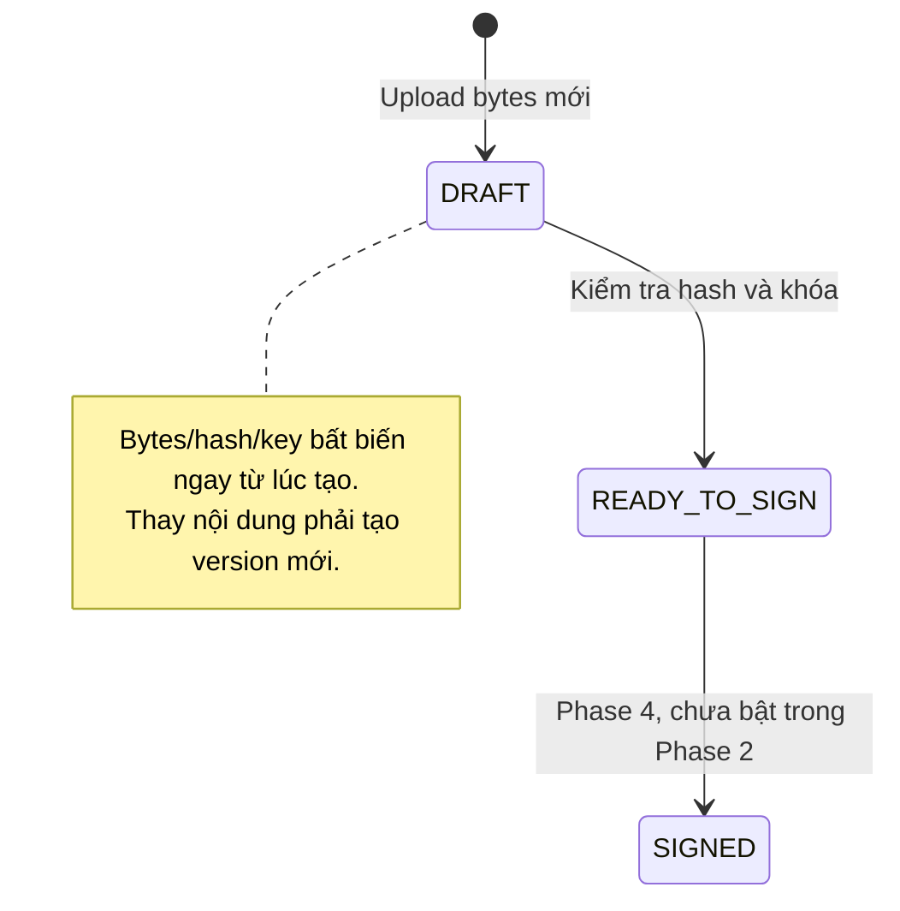

# Phase 2 — Secure PDF Storage, Versioning & SHA-256

Ngày kiểm chứng: 14/11/2026. Phạm vi: native macOS, FastAPI/SQLAlchemy/SQLite, React/TypeScript. Không triển khai chữ ký, khóa client hoặc Blockchain.

## 1. Audit Phase 0 và Phase 1

Đã đọc `plan.md`, `todo.md`, main/config/database, models và migration cũ, auth dependencies/JWT/CSRF/RBAC, routes/API client/AuthContext/frontend layout, `.env.example` và cấu trúc `data/`.

- Phase 0 có venv, SQLite/Alembic, native start script, Vite và storage directory.
- Phase 1 có authentication, refresh/logout/session, Argon2id, CSRF và RBAC; giữ nguyên implementation. 20 test hồi quy Phase 1 đạt. Đây là xác nhận bằng test hiện có, không phải audit độc lập toàn bộ hệ thống auth.
- Phụ thuộc thiếu: pypdf và công cụ RSS; đã bổ sung `pypdf==7.1.0`, `psutil>=7.2,<8`.
- Fixture cũ dùng DB cố định trong `data/db/` và transaction ngoài làm rollback không phản ánh production. Đã thay bằng DB thử nghiệm riêng, commit/rollback thật; không dùng DB/PDF thật cho test.
- `plan.md` cũ còn ghi MinIO và bóc tách nội dung; đã cập nhật riêng Phase 2 thành local storage và từ chối nội dung chủ động.
- Shell môi trường có `DEBUG=release` không hợp lệ với bool. Lệnh vận hành dùng `DEBUG=false`; không thay đổi cấu hình macOS hay secret.

## 2. Database và migration

Revision `063d00eeffb0 → a2d000000002`, chỉ thêm hai bảng và trigger; không tạo lại bảng users/sessions. Migration dùng định nghĩa cố định, độc lập với ORM tương lai. Downgrade cố ý từ chối thao tác xóa tài liệu khi chưa có retention/backup được duyệt.

| Bảng | Các cột |
|---|---|
| documents | id UUID PK, owner_id FK users.id + index, title varchar(255), visibility PRIVATE/SHARED, created_at UTC, updated_at UTC |
| document_versions | id UUID PK, document_id FK + index, version_no integer, original_filename varchar(255), file_sha256 varchar(64), storage_key varchar(200), file_size_bytes bigint, state DRAFT/READY_TO_SIGN/SIGNED, created_at UTC, locked_at nullable UTC |

Document 1—N DocumentVersion. Unique `(document_id, version_no)` và `storage_key`; CHECK cho số phiên bản/kích thước dương, độ dài hash, enum và trạng thái khóa. SQLite FK được bật trên connection. SQLite lưu timestamp không có offset; mọi timestamp được tạo theo UTC, frontend bổ sung UTC khi đọc chuỗi không có offset.

Trigger `version_immutable` chặn thay đổi id/document/number/content hash/key/size/filename/created_at và transition trái phép, kể cả bulk/raw SQL UPDATE. Không có API xóa vĩnh viễn hoặc thay bytes.

Đã backup DB trước migration tại `data/db/backups/pre-phase2-20261114T131344Z.db` (bị gitignore). Sau migration: **23 users, 40 auth_sessions**, giữ nguyên số lượng; hai bảng mới rỗng. Test migration riêng còn kiểm chứng giữ nguyên user và session mẫu. `alembic check`: không có schema drift.

## 3. API và authorization

Tất cả endpoint dùng `get_current_user` của Phase 1; thao tác ghi dùng `verify_csrf`. Chỉ owner được truy cập, kể cả tài liệu SHARED và tài khoản ADMIN; chia sẻ thực tế dành cho giai đoạn sau. Tài liệu không tồn tại/không thuộc owner/version không thuộc document cùng trả **404**. UUID sai trả 422.

| Method | Path dưới `/api/v1/documents` | Response chính |
|---|---|---|
| POST | rỗng | 201, metadata phiên bản đầu tiên; multipart `file`, `title` tùy chọn |
| GET | rỗng | `{items,total,limit,offset}`, chỉ tài liệu của user; limit 1–100, mặc định 20 |
| GET | `/limits` | `{max_upload_bytes}` để UI đọc cấu hình upload |
| GET | `/{id}` | id, title, visibility, created_at, updated_at |
| GET | `/{id}/versions` | mảng phiên bản giảm dần; limit tối đa 100, offset; UI tải thêm |
| POST | `/{id}/versions` | 201, tạo phiên bản mới từ multipart `file` |
| GET | `/{id}/versions/{vid}` | metadata phiên bản |
| POST | `/{id}/versions/{vid}/ready` | DRAFT → READY_TO_SIGN, xác minh hash rồi khóa; lặp lại trả 409 |
| GET | `/{id}/versions/{vid}/download` | stream PDF, attachment filename do server tạo, nosniff, private/no-store |

Ví dụ response upload (các UUID minh họa):

```json
{
  "id": "ef55df22-55b3-48e1-9728-047ca237134d",
  "version_id": "ef55df22-55b3-48e1-9728-047ca237134d",
  "document_id": "6b18225b-e86b-438d-ab3f-c47e7aeb5fa9",
  "version_no": 1,
  "original_filename": "tai-lieu.pdf",
  "file_sha256": "<64 lowercase hexadecimal characters>",
  "file_size_bytes": 102400,
  "state": "DRAFT",
  "created_at": "2026-11-14T13:00:00",
  "locked_at": null
}
```

Không trả storage_key hoặc physical path. Lỗi: 400 PDF không hợp lệ/nội dung chủ động/budget; 401 chưa đăng nhập; 403 CSRF; 404 ownership; 409 integrity/missing file/transition; 413 quá dung lượng; 415 sai extension/magic; 503 parser đang bận/lỗi DB hoặc storage; 507 hết dung lượng/quota. Không trả exception trace cho client.

## 4. Vòng đời và concurrency



Phase 2 không có API ký hoặc transition sang SIGNED. Trigger hiện chỉ cho DRAFT → READY_TO_SIGN; Phase 4 phải có migration/gate riêng sau khi xác minh chữ ký. Không sinh chữ ký giả.

Với SQLite, UPDATE document lấy writer lock trước khi đọc MAX(version_no), sau đó lưu phiên bản trong cùng transaction; unique constraint là lớp bảo vệ bổ sung. Test hai session/luồng độc lập đồng thời tạo phiên bản cho kết quả v2/v3, giữ nguyên v1. Busy timeout 5 giây; lỗi bận có thể trả 503 để client thử lại.

## 5. Bảo toàn bytes và local storage

`IStorageService` là Protocol dùng BinaryIO: save/get/exists/delete (rollback). Service nghiệp vụ không ghép physical path; fake in-memory adapter được kiểm thử.

Đường dẫn: `data/storage/documents/{document_uuid}/v{number}_{version_uuid}.pdf`. Chỉ server sinh UUID/key. Filename gốc chỉ là metadata hiển thị, cắt chiều dài, bỏ control/path components và ký tự HTML nguy hiểm; React render text, không dùng innerHTML.

Local adapter duyệt directory bằng file descriptor và O_NOFOLLOW từ repository root; từ chối root ngoài repository, traversal, symlink directory/file và object không phải regular file. File mới 0600, directory mới 0700. Ghi binary theo chunk 64KB vào file tạm cùng directory, flush + fsync, atomic hard-link không ghi đè đích, fsync directory, bỏ file tạm. Không mount static storage.

PDF được kiểm tra nhưng không viết lại. Hash streaming của input được đối chiếu hash **đọc lại từ file đã lưu**, size cũng phải trùng; hash cuối lưu DB là hash của bytes trên disk. Download và ready luôn hash lại; download stream từ chính descriptor đã kiểm tra để tránh mở lại pathname. Bất biến được thực thi ở storage/service/DB, không chỉ UI.

Multipart spool của backend và temp worker đều ở `data/tmp/`, nằm trong repository, không commit.

## 6. Rollback và phục hồi sau crash

Nếu lưu file thất bại, adapter bỏ đúng file tạm/publication của thao tác hiện tại. Nếu metadata/commit thất bại, service rollback DB và chỉ xóa key vừa tạo thành công; không xóa key bị collision. Cleanup thất bại được log critical bằng key thao tác, không log JWT/secret.

Filesystem và SQLite không có transaction chung. Process/OS crash giữa publish và commit có thể để lại orphan hoặc temp; không tuyên bố atomic cross-resource tuyệt đối. Có cơ chế reconciliation chỉ đọc:

```bash
# Dừng upload để không nhầm thao tác đang chạy là orphan.
DEBUG=false venv/bin/python scripts/reconcile_storage.py
```

Báo cáo orphan_keys, missing_keys, temporary_files, unsafe_symlinks; không tự xóa/attach file. Bỏ qua `.gitkeep`. Sau kiểm chứng repository hiện tại, bốn danh sách đều rỗng. Vận hành viên cần điều tra từng key và backup trước khi xử lý; không có tính năng tự dọn toàn bộ data/. Nếu file bị mất, phục hồi từ backup theo đúng key và kiểm tra SHA-256 trước khi đưa lại vào phục vụ.

## 7. PDF validation và giới hạn

Các lớp: giới hạn thực tế file và toàn multipart request (cả không Content-Length), extension, MIME tham khảo, magic, EOF, strict structure parsing. Cho phép MIME sai nếu bytes/parse hợp lệ; MIME không là bằng chứng an toàn. Chính sách strict có thể từ chối một số PDF reader khác có khả năng tự sửa.

Parser `pypdf` chạy trong subprocess, không chạy unbounded trong event loop/request thread. Duyệt dictionaries/arrays/name objects, giải indirect references, xử lý vòng lặp và duyệt các object trong xref/object streams kể cả không nối với catalog. Cấm JavaScript/JS/Launch/OpenAction/AA/SubmitForm/EmbeddedFiles/EmbeddedFile/EF và các cấu trúc bổ sung như XFA/RichMedia/GoToR/GoToE/ImportData. Không regex-only, không sửa hoặc làm sạch file gốc.

Mặc định: wall 5s, CPU 3s (RLIMIT_CPU), RSS 256MB do parent kiểm tra 10ms, 50.000 lượt duyệt, độ sâu 64, tối đa 2 parser/process. Parent kill + wait khi timeout/RSS; worker còn có alarm và giới hạn file tạm 128MiB. Trên Linux thêm RLIMIT_AS; trên macOS không giả định RLIMIT_AS là RSS hard cap. Cấu hình ở `.env.example`.

RSS polling có thể overshoot ngắn trước khi kill, không phải hạn mức bộ nhớ cứng tuyệt đối. Giới hạn hai parser là trên từng process; vận hành MacBook 8GB nên chạy một worker. Không đọc/giải nén toàn bộ page content để tìm arbitrary executable payload; đây không phải antivirus, PDF conformance verifier hoàn chỉnh hoặc OS security sandbox. Subprocess vẫn chạy với quyền của backend, nên không bảo vệ tuyệt đối khỏi lỗ hổng thực thi mã trong parser. File encrypted bị từ chối; chưa có bộ corpus fuzz lớn, compressed-object-stream fixture chuyên biệt hoặc PDF parser exploit test. Nên cập nhật parser định kỳ và không tuyên bố chặn mọi mã độc.

Tham khảo API parser: [pypdf PdfReader](https://pypdf.readthedocs.io/en/stable/modules/PdfReader.html).

## 8. Frontend

Routes `/` và `/documents` là danh sách, `/documents/:id` là chi tiết, đều bọc ProtectedRoute/AuthContext hiện có. Dùng Axios client hiện có để giữ cookie, CSRF và refresh. Có upload/drop/progress, loading/empty/success/error/retry, phân trang, lịch sử, tải thêm phiên bản cũ, download, SHA-256/copy, trạng thái và khóa chuẩn bị ký. Upload progress 100% đổi sang thông báo đang kiểm tra/lưu, không báo thành công sớm.

Thiết kế kế thừa layout DocSign, dùng bảng tài liệu yên tĩnh và phần hash làm điểm nhấn. Palette: nền #f8fafc, giấy #ffffff, chữ #173344, phụ #526976, teal #247b88, lỗi #9d263d. Typography hệ thống hiện có; tiêu đề 32px/26px mobile, nội dung 14–16px, hash monospace. Layout canh trái, danh sách và lịch sử không tràn ở màn hình nhỏ; có keyboard focus và tên nút accessible. Phase 1 chưa có dark mode, không bổ sung hệ theme mới.

Đã kiểm thử React DOM với jsdom; chưa chạy browser E2E, kiểm thử trực quan bằng screenshot hoặc kiểm thử điện thoại thật. Tiến độ tải dựa trên Axios; backend quyết định giới hạn cuối cùng và UI đọc cấu hình qua `/limits`.

## 9. Kết quả kiểm thử

| Nhóm | Kết quả | Bằng chứng |
|---|---|---|
| Phase 1 hồi quy auth/RBAC | 20/20 đạt | tests/security/test_phase1_security.py |
| API/integration/security Phase 2 | 15/15 đạt | tests/phase2/test_api.py |
| Database, concurrency, adapter giả | 3/3 đạt | tests/phase2/test_database.py |
| PDF validation/security/budgets | 32/32 đạt | tests/phase2/test_pdf.py |
| Storage/hash/recovery | 18/18 đạt | tests/phase2/test_storage.py |
| React DOM | 13/13 đạt | frontend/src/pages/Documents/Documents.test.tsx |
| Production TypeScript/Vite build | Đạt | npm run build --prefix frontend |
| Additive migration + schema check | Đạt | alembic upgrade head / alembic check |

Tổng backend **88 passed**, gồm **68 Phase 2**; 1 cảnh báo deprecation TestClient/httpx từ thư viện. Security tests gồm IDOR, cross-document ID, UUID, unauthenticated, CSRF, checksum mismatch, file missing, disk full, DB rollback, DB immutability và uniqueness, traversal/symlink, parser timeout/RSS/object/depth/slots, JavaScript/Launch/SubmitForm/embedded/encrypted PDFs. Fake disk/permission/DB failures được inject có kiểm soát. Kiểm thử storage restart tạo adapter mới đọc cùng file; chưa mô phỏng power-loss/OS reboot.

Tất cả PDF được tạo bằng pypdf từ trang trắng và dữ liệu đệm tổng hợp. Test DB/storage riêng, không dùng PDF hoặc DB thật của người dùng.

Frontend tests gồm list/empty, upload/progress/success, drag-drop, extension/size/backend error/network error, history/hash, XSS-safe title/filename, download API, copy, ready và protected route. Đây là component/integration tests mock API; backend được kiểm chứng riêng, chưa phải browser-to-server E2E.

## 10. Benchmark thực tế

Dữ liệu chi tiết: [`phase2-benchmark.json`](phase2-benchmark.json). Script tái lập: `venv/bin/python scripts/benchmark_phase2.py` từ repository root. Phép đo tuần tự nhẹ, mỗi stage/size một mẫu, synthetic PDF đúng 1/5/10/20MiB, không stress test. Không dùng kết quả này làm percentile/SLA.

Máy đo: `macOS-14.5-arm64-arm-64bit-Mach-O`, `arm64`, Python 3.13.9, RAM vật lý 8192 MiB. Các số đo là trên máy thực tế này; không suy diễn thành chứng nhận hiệu năng trên cấu hình khác.

| MiB | SHA-256 ms | Storage write ms | Read + hash ms | PDF validation ms | API upload ms | API download ms |
|---|---|---|---|---|---|---|
| 1 | 0.6 | 1.419 | 0.586 | 110.883 | 115.116 | 8.131 |
| 5 | 2.503 | 2.589 | 2.374 | 85.619 | 110.956 | 19.378 |
| 10 | 4.677 | 8.008 | 4.793 | 89.765 | 155.028 | 34.984 |
| 20 | 13.761 | 14.517 | 9.442 | 106.16 | 187.798 | 65.803 |

| Upload MiB | Parent peak RSS MiB | Parent delta MiB | Child peak RSS MiB | Combined peak RSS MiB | CPU parent + child s | Throughput MiB/s |
|---|---|---|---|---|---|---|
| 1 | 156.75 | 4.2 | 34.14 | 187.92 | 0.1019 | 8.69 |
| 5 | 148.58 | 16.52 | 37.69 | 186.25 | 0.09456 | 45.06 |
| 10 | 168.81 | 31.19 | 42.73 | 203.11 | 0.11191 | 64.5 |
| 20 | 257.28 | 74.58 | 51.95 | 263.75 | 0.13587 | 106.5 |

Logical disk cuối phép đo: 58,785,792 bytes; allocated file blocks: 58,785,792 bytes, gồm PDF fixture cuối, bốn file lưu và DB. Thư mục benchmark riêng được cleanup khi kết thúc.

RSS lấy mẫu 2ms, chỉ theo dõi PID worker được tạo bởi pipeline; CPU dùng resource rusage parent + waited children. Fixture generation không tính vào latency nhưng allocator có thể giữ RAM từ fixture. API dùng in-process TestClient có buffer HTTP body; download backend có stream nhưng test client có buffer, vì vậy peak RSS/throughput API không đại diện cho HTTP transport thực. OS cache nóng, không coi throughput này là tốc độ SSD bền vững. Không cam kết parser RAM 10MB hay storage RAM 0MB.

## 11. Rủi ro còn lại và readiness Phase 3

- PDF scanning là lớp kiểm soát cấu trúc/chính sách, không đảm bảo file vô hại tuyệt đối; chưa có antivirus, fuzz corpus lớn hoặc OS sandbox.
- RSS kill có độ trễ polling; giới hạn parser là theo process. Parser nhiều worker hoặc nhiều request upload đồng thời cần capacity/rate-limit policy bổ sung trước khi mở dịch vụ rộng hơn.
- Không có transaction chung DB/filesystem; abrupt crash cần reconciliation chỉ đọc và xử lý từng key được review. Chưa kiểm thử mất điện thật hoặc fsync durability trên mọi filesystem.
- Chủ máy/backend OS account vẫn có thể sửa file/DB. Hash trước download phát hiện sửa trước khi kiểm tra; không bảo vệ tuyệt đối khỏi ghi đồng thời trên cùng inode từ process ngoài ứng dụng sau khi đã hash. Không mount storage cho process khác ghi.
- Chính sách strict/EOF và encrypted rejection có thể từ chối một số PDF hợp lệ theo reader khác. Một vài cấu trúc rủi ro bị chặn bảo thủ, kể cả dùng lành tính.
- `npm install` cuối báo **2 cảnh báo moderate**, thuộc react-router/react-router-dom kế thừa Phase 1; chưa nâng major router trong phạm vi này. Các advisory liên quan redirect từ URL đầu vào và SSR hydration cần được xử lý trước triển khai rộng. App hiện không dùng SSR, link tài liệu dùng UUID server. Vite/Vitest được cập nhật bản vá; không chạy audit fix --force.
- React DOM tests chưa thay cho browser E2E/visual/responsive QA thực tế. SQLite concurrency được kiểm thử với hai writer, chưa stress nhiều worker.
- MinIO **DEFERRED**. Retention, sharing, audit log bền vững, quotas, background cleanup và backup policy đầy đủ nằm ngoài Phase 2.

**Sẵn sàng về interface/dữ liệu để bắt đầu Phase 3:** có document/version UUID, SHA-256 cố định, ownership APIs, binary storage abstraction và gate READY_TO_SIGN. Chưa triển khai Phase 3/4. Khi Phase 4 bắt đầu, phải thiết kế signature verification/transaction rồi mới mở transition SIGNED bằng migration mới; không bypass trigger hiện tại.

## 12. Trạng thái TASK-P2

| Task | Trạng thái | Kiểm chứng |
|---|---|---|
| P2-01 Models/migration | [x] | Migration preserve user/session, schema check, unique/FK/relationship |
| P2-02 Storage interface | [x] | Memory adapter qua business service |
| P2-03 Local storage | [x] | Round-trip, no overwrite, atomic failure, traversal/symlink/permissions/missing |
| P2-04 MinIO | [ ] DEFERRED | Native không phụ thuộc MinIO, chưa có adapter |
| P2-05 SHA-256 | [x] | Reference 0/1 byte/1/5/10MiB; benchmark đến 20MiB |
| P2-06 PDF validation | [x] | Valid/magic/extension/structure/truncated/oversize |
| P2-07 Active content | [x] | Action/indirect/orphan/embedded/encrypted, CPU/wall/RSS/object/depth budgets; giới hạn ở mục 7 |
| P2-08 Filename/UUID | [x] | Traversal/Unicode/HTML/control/duplicate names; safe React text |
| P2-09 Upload API | [x] | Auth, hashing, DB rollback, disk full, request byte cap |
| P2-10 Download/IDOR | [x] | Owner, cross-user/cross-doc, integrity/missing, stream headers |
| P2-11 Immutability | [x] | DB trigger, state conflict, v1/v2, concurrent v2/v3 |
| P2-12 Frontend | [x] | 13 DOM tests + production build; browser E2E chưa chạy |

`todo.md` đánh dấu 11/12; không đánh dấu MinIO là hoàn thành. Các checkbox mô tả phạm vi Phase 2 đã kiểm thử, không phải chứng nhận production security.

## 13. Danh sách file tạo mới

- `backend/alembic/versions/a2d000000002_documents.py`
- `backend/app/api/v1/documents.py`
- `backend/app/core/upload_limit.py`
- `backend/app/crypto/hasher.py`
- `backend/app/models/document.py`
- `backend/app/schemas/document.py`
- `backend/app/services/document_service.py`
- `backend/app/services/pdf_validator.py`
- `backend/app/services/pdf_worker.py`
- `backend/app/storage/base.py`
- `backend/app/storage/local.py`
- `docs/phase2-benchmark.json`
- `docs/phase2-report.md`
- `frontend/src/api/documents.ts`
- `frontend/src/pages/Documents/Documents.test.tsx`
- `frontend/src/pages/Documents/documents.css`
- `frontend/src/pages/Documents/index.tsx`
- `frontend/src/test-setup.ts`
- `frontend/vitest.config.ts`
- `scripts/benchmark_phase2.py`
- `scripts/reconcile_storage.py`
- `tests/__init__.py`
- `tests/phase2/__init__.py`
- `tests/phase2/conftest.py`
- `tests/phase2/test_api.py`
- `tests/phase2/test_database.py`
- `tests/phase2/test_pdf.py`
- `tests/phase2/test_storage.py`

## 14. Danh sách file chỉnh sửa

- `.env.example`
- `.gitignore`
- `README.md`
- `backend/app/core/config.py`
- `backend/app/core/database.py`
- `backend/app/main.py`
- `backend/app/models/__init__.py`
- `backend/requirements.txt`
- `frontend/package-lock.json`
- `frontend/package.json`
- `frontend/src/App.tsx`
- `plan.md`
- `requirements.txt`
- `tests/conftest.py`
- `todo.md`
