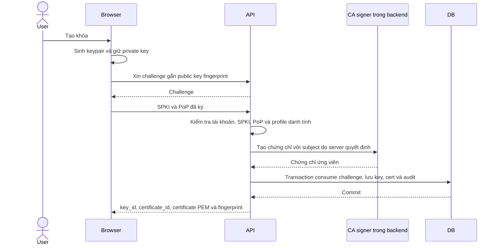

# Kế hoạch triển khai chứng chỉ số và CA riêng cho DocSign

Ngày lập 16/11/2026. PKI-01 đến PKI-17 đã triển khai. PKI-18 đã có kiểm thử tự động và tài liệu; lượt Chrome E2E đầy đủ/320px còn chờ do chủ máy dừng Computer Use bằng Escape. Chủ CA là chủ hệ thống. Hướng dẫn vận hành tại [private-ca-setup.md](private-ca-setup.md), kịch bản demo tại [private-ca-demo.md](private-ca-demo.md).

## 1. Mục tiêu và hiện trạng

Yêu cầu được triển khai thành bốn kết quả có thể nghiệm thu.

1. Người dùng tạo khóa trên trình duyệt, đăng ký public key với PoP và nhận chứng chỉ X.509 do CA riêng ký trong cùng luồng.
2. Kết quả xác minh tài liệu có chứng thực yêu cầu PDF, manifest, chữ ký, public key, chứng chỉ, chủ thể và CA cùng khớp, kèm kiểm tra thời hạn và thu hồi.
3. Có trang riêng kiểm tra chứng chỉ, trang riêng kiểm tra chữ ký và thông tin danh tính được CA chứng thực.
4. ADMIN vận hành CA, duyệt danh tính, quản lý cấp/gia hạn/thu hồi, tra cứu lịch sử qua audit.

Các điểm đã xác nhận trong source hiện tại được liệt kê dưới đây.

| Thành phần | Hiện trạng | Điểm cần thay đổi |
| --- | --- | --- |
| `frontend/src/crypto/keygen.ts` | WebCrypto RSA-PSS 3072-bit sinh khóa tại client | Sau đăng ký khóa, nhận và lưu tham chiếu chứng chỉ |
| `backend/app/services/key_service.py` | Đăng ký SPKI, xác thực PoP, consume challenge và lưu key nguyên tử | Cấp chứng chỉ trong transaction đăng ký |
| `backend/app/schemas/signature.py` | `SignedManifest` v1 strict, JCS, fingerprint SPKI | Bổ sung schema manifest v2 có ràng buộc chứng chỉ và người ký |
| `backend/app/models/signature.py` | Chữ ký được giữ bằng trigger chống UPDATE/DELETE | Migration bổ sung evidence v2, bảo toàn evidence v1 |
| `backend/app/services/verification_service.py` | `certificate_trust` được gán `SELF_REGISTERED` khi đọc được key | Thêm validator X.509, trust policy và kết quả chứng chỉ |
| `backend/app/schemas/verify.py` | Có enum `TRUSTED_CA`, package v1 chứa SPKI | Định nghĩa trust CA nội bộ rõ ràng, package v2 có chứng chỉ |
| Phase 7 | Audit chain, ADMIN Dashboard và cảnh báo đã có | Thêm sự kiện PKI và số liệu chứng chỉ |

Kế hoạch này là một phần mở rộng riêng để thực hiện trước khi chốt ma trận kiểm thử Phase 8 và demo Phase 10. Backlog gốc tiếp tục được theo dõi tại `todo.md`.

## 2. Kiến trúc và các quyết định mặc định

Các giá trị dưới đây là lựa chọn đề xuất để bắt đầu triển khai và có thể cấu hình.

| Hạng mục | Lựa chọn |
| --- | --- |
| Mô hình ban đầu | Một private Root CA ký trực tiếp chứng chỉ người dùng |
| Tên CA | `DocSign Private CA` |
| Khóa CA | RSA 4096-bit, public exponent 65537 |
| Chữ ký chứng chỉ | RSA PKCS#1 v1.5 với SHA-256, tách cấu hình khỏi RSA-PSS ký tài liệu |
| Khóa người dùng | RSA-PSS 3072-bit/SHA-256 hiện có |
| Thời hạn Root CA | 5 năm |
| Thời hạn chứng chỉ user | 365 ngày, giới hạn trong thời hạn issuer |
| Trust anchor | Danh sách fingerprint SHA-256 DER của Root CA do người vận hành cấu hình |
| Thu hồi MVP | Registry server làm nguồn kiểm tra trực tuyến có thẩm quyền |
| Định dạng | Chứng chỉ X.509 v3, PEM để trao đổi, DER để fingerprint |
| Thời gian | UTC, kiểm tra tại thời điểm verify, không backdate theo input client |

Luồng tổng thể được thể hiện dưới đây.



CA riêng cung cấp miền tin cậy do chủ hệ thống vận hành. Việc người xác minh tin CA được quyết định bởi trust store đã cấu hình. Kiểm tra đường dẫn chứng chỉ lấy trust anchor làm đầu vào tin cậy. [RFC 5280](https://www.rfc-editor.org/rfc/rfc5280.html)

## 3. Quản lý private key của CA

### Cấu hình đề xuất

```dotenv
PKI_ENABLED=true
CA_PRIVATE_KEY_PATH=/absolute/private/path/docsign-ca-key.pem
CA_PRIVATE_KEY_PASSWORD_FILE=/absolute/private/path/docsign-ca-passphrase
CA_CERTIFICATE_PATH=/absolute/private/path/docsign-ca-cert.pem
CA_TRUSTED_ROOT_SHA256=<fingerprint-of-approved-root-DER>
CA_USER_CERT_VALIDITY_DAYS=365
```

- Private key CA lưu dạng PKCS#8 PEM có mã hóa. Runtime đọc secret mở khóa từ file có quyền truy cập riêng cho tài khoản chạy backend. Có thể bổ sung secret manager khi triển khai thật.
- `.env` chứa đường dẫn và cấu hình. Với bản local nhỏ, hỗ trợ thêm `CA_PRIVATE_KEY_PASSWORD` dưới dạng `SecretStr` nếu người vận hành chọn nạp secret qua môi trường. Chốt một nguồn password trong mỗi cấu hình, báo lỗi khi cấu hình mâu thuẫn.
- Linux/WSL kiểm tra quyền file bằng filesystem Linux. Windows dùng ACL thích hợp. Hướng dẫn vận hành ghi rõ khác biệt của ổ Windows mount vào WSL.
- CLI `scripts/init_ca.py` tạo mới CA vào đường dẫn người vận hành chỉ định và xuất fingerprint public. Có kiểm tra tránh ghi đè CA hiện có. Startup nạp CA đã có và kiểm tra key/cert khớp, fingerprint pin, hiệu lực và quyền ký.
- Lỗi password, key/cert mismatch hoặc CA hết hạn làm readiness PKI báo lỗi rõ ràng. Luồng đang yêu cầu cấp chứng chỉ trả lỗi có cấu trúc và rollback đầy đủ.
- Giới hạn quyền đọc file, backup mã hóa, quản lý password riêng và loại secret khỏi source, ảnh chụp, exception, API response và audit. `.gitignore` chỉ là một lớp quản lý source.
- CA signer có interface nhỏ `issue_certificate`/`sign_crl` để có thể chuyển sang signer service hoặc HSM trong tương lai. Bản đầu dùng process backend để phù hợp kiến trúc native hiện tại.

Biến môi trường cũng có thể xuất hiện trong môi trường tiến trình và công cụ vận hành. Thiết kế bảo vệ gồm quyền truy cập, cách nạp secret, lưu trữ và luân chuyển. [OWASP Secrets Management](https://cheatsheetseries.owasp.org/cheatsheets/Secrets_Management_Cheat_Sheet.html)

### Rotation và sự cố CA

- Lưu nhiều CA theo lịch sử, một issuer được chọn để cấp mới. Root được tin cho xác minh và issuer được phép cấp mới là hai trạng thái quản lý riêng.
- Rotation tạo CA mới và cập nhật trust store qua cấu hình được người vận hành kiểm tra fingerprint. Chứng chỉ cũ tiếp tục tham chiếu đúng CA đã cấp.
- Khi CA bị lộ, đánh dấu `COMPROMISED`, ngừng cấp, vô hiệu hóa trust cho xác minh hiện tại theo chính sách, tạo CA mới và cấp lại chứng chỉ. Audit ghi mốc sự cố và phạm vi ảnh hưởng.
- Backup thử phục hồi trên môi trường riêng. Người có quyền đọc bộ key CA đã mở khóa hoặc kiểm soát signer có thể giả mạo chứng chỉ trong miền CA đó.

## 4. Chủ thể chứng chỉ và xác minh danh tính

Luồng đăng ký hiện tại nhận email và họ tên do người dùng nhập. Vì vậy phải phân biệt các mức bảo đảm trong UI và API.

| Mức | Điều kiện | Cách hiển thị |
| --- | --- | --- |
| `ACCOUNT_BOUND` | Tài khoản đăng nhập hợp lệ và PoP hợp lệ | CA chứng thực public key gắn với tài khoản DocSign |
| `ADMIN_REVIEWED` | ADMIN đối chiếu thông tin theo quy trình của chủ hệ thống | Danh tính đã được ADMIN xét duyệt, kèm thời điểm và người duyệt |
| `UNKNOWN` | Thiếu nguồn hoặc bằng chứng kiểm tra phù hợp | Mức xác minh danh tính chưa xác định |

- Chứng chỉ tự cấp ban đầu dùng UUID tài khoản làm định danh ổn định, với SAN URI `urn:uuid:<user_id>`. Subject ban đầu thể hiện tài khoản. Thông tin tự khai được hiển thị với nhãn nguồn rõ ràng.
- ADMIN có trang yêu cầu xác minh danh tính, xem thông tin cần thiết và duyệt hoặc từ chối kèm lý do. Quy trình thu thập bằng chứng được chủ CA quy định, ưu tiên dữ liệu tối thiểu và quyền truy cập giới hạn.
- Khi được duyệt, server lưu identity review và có thể cấp chứng chỉ mới chứa tên được duyệt. Subject của chứng chỉ đã cấp là snapshot, thay đổi profile tài khoản áp dụng cho lần cấp sau.
- Mức xét duyệt được lưu gắn với fingerprint chứng chỉ trong registry. Trình xác minh trực tuyến có thể đối chiếu chính xác review này. Chế độ offline hiển thị claims đã ký trong chứng chỉ và trạng thái review là `UNKNOWN` khi thiếu nguồn xác nhận.
- Nâng cấp assurance portable có thể dùng extension/policy X.509 đã đặc tả với OID của tổ chức. Đầu việc này cần đặc tả riêng trước khi phát hành profile mới.
- Kết quả kiểm tra ghi rõ người cấp, chủ thể, nguồn danh tính và mức xét duyệt. Phạm vi bảo đảm danh tính do quy trình CA đã thực hiện quyết định.

Mặc định chứng chỉ được cấp ngay ở mức `ACCOUNT_BOUND`; luồng ADMIN xét duyệt cung cấp mức bảo đảm bổ sung mà vẫn đáp ứng yêu cầu tự cấp cùng khóa.

## 5. Profile X.509 và validator

Profile triển khai cần được chốt bằng test vector.

- Root CA có BasicConstraints critical với `CA=true`, `path_length=0`, quyền `keyCertSign` và `cRLSign`, cùng SKI/AKI thích hợp.
- Leaf có `CA=false`, KeyUsage critical với `digitalSignature=true`, serial ngẫu nhiên dương theo giới hạn X.509, SKI/AKI và SPKI chính xác của user. EKU để trống trong profile ban đầu, mục đích ký tài liệu được validator ứng dụng kiểm tra.
- Validator kiểm tra issuer/path, chữ ký CA, thời hạn, BasicConstraints, KeyUsage, extension critical, thuật toán, kích thước khóa và trust anchor pin. Issuer DN hoặc tên CA chỉ là metadata hỗ trợ.

Các thành phần profile và kiểm tra chứng chỉ được đối chiếu theo chuẩn PKIX. [RFC 5280](https://www.rfc-editor.org/rfc/rfc5280.html)

Dùng thư viện X.509 và trình kiểm tra đường dẫn có chính sách phù hợp mục đích ký tài liệu. Spike đầu tiên xác nhận phiên bản `cryptography` đang cài, khả năng cấu hình policy, cách kiểm tra Root→leaf và khả năng liên thông OpenSSL; khóa phiên bản đã được kiểm chứng trong cả hai requirements. Các API xác minh có chính sách riêng cho từng mục đích sử dụng. [Cryptography X.509 verification](https://cryptography.io/en/stable/x509/verification/)

Tái sử dụng PoP hiện có để chứng minh quyền sở hữu SPKI khi cấp chứng chỉ. CSR chuẩn được bổ sung khi có nhu cầu nhập yêu cầu từ công cụ ngoài; subject và extensions cấp thực tế vẫn do server xây từ profile đã cho phép. Thư viện hỗ trợ tạo CSR, dựng chứng chỉ và lưu private key với mã hóa. [Cryptography X.509 tutorial](https://cryptography.io/en/stable/x509/tutorial/)

## 6. Mô hình dữ liệu và migration

| Bảng/thành phần | Nội dung chính |
| --- | --- |
| `certificate_authorities` | ID, cert PEM/DER fingerprint, subject, validity, issuer status, trust status, thời điểm rotation/compromise |
| `certificates` | ID, key_id, user_id, ca_id, issuer+serial unique, DER fingerprint unique, certificate PEM, subject snapshot, validity, revoked_at/reason, issued_at, identity_review_id nullable |
| `public_keys` | Thêm current_certificate_id nullable trong giai đoạn migration |
| `identity_reviews` | User, claims snapshot, trạng thái review, reviewer, reviewed_at, lý do và tham chiếu bằng chứng có quyền truy cập |
| `signature_certificate_bindings` | signature_id unique, certificate_id, exact DER fingerprint; dữ liệu được giữ bất biến |
| Verification/report DTO | Thêm kết quả cert, nguồn trust/revocation, identity binding và mức xét duyệt |

- Gia hạn cùng key tạo certificate mới với serial và fingerprint mới. Lịch sử hỗ trợ nhiều chứng chỉ của một key; pointer chọn cert mặc định cho lần ký mới.
- Chứng chỉ và bằng chứng đã dùng để ký được giữ lại bằng FK/retention guards. Thu hồi được lưu qua metadata trạng thái có quy tắc chuyển trạng thái.
- Tạo migration additive từ Alembic head thực tế lúc bắt đầu triển khai, dự kiến sau `a8f000000008`. Kiểm tra head mới nhất trước khi chọn revision ID.
- Kiểm tra constraint `Signature.signature_format = DETACHED_JCS_V1` và trigger hiện có khi mở rộng v2. Viết migration giữ nguyên bytes các manifest/chữ ký cũ và khôi phục guards đầy đủ sau thao tác batch SQLite.
- Trước upgrade DB thật, backup SQLite online, chụp row counts/checksum evidence và kiểm tra FK/integrity. Chạy thử upgrade với dữ liệu Phase 1–7 có sẵn.

## 7. Đăng ký khóa và tự cấp chứng chỉ nguyên tử

1. Client sinh keypair như hiện tại, lấy SPKI fingerprint và xin challenge.
2. Server xác minh session, account status, algorithm, PoP và identity profile. Server quyết định subject, validity và extensions.
3. Sinh key_id/certificate_id/serial và ký certificate ứng viên trước khi giữ writer lock dài. Chứng chỉ chỉ được trả cho client sau commit.
4. Transaction writer thực hiện conditional consume challenge, recheck user/key ownership, CA còn được phép cấp, issuer validity và identity profile version. Lưu key, cert, pointer và audit cùng transaction.
5. Lỗi cấp/lưu/commit rollback toàn bộ nghiệp vụ. Serial đã sinh có thể bỏ qua. Response không chứa candidate certificate của transaction thất bại.
6. Request có idempotency key gắn user, SPKI fingerprint và request digest. Retry đúng request sau lost response trả bản ghi đã commit. Request khác dùng lại idempotency key bị 409; replay challenge khác tiếp tục bị chặn.
7. Frontend có trạng thái sinh khóa/đang cấp/hoàn thành/lỗi có thể retry. Sau thành công hiển thị certificate serial, fingerprint, issuer, thời hạn, assurance và nút tải PEM.

Khóa cũ có thể xin chứng chỉ qua luồng riêng với PoP mới và policy đang hoạt động. Việc cấp thêm certificate được ghi nhận theo thời điểm thực tế.

## 8. Ràng buộc PDF, chữ ký và chứng chỉ bằng manifest v2

Tạo schema riêng `SignedManifestV2` và dispatcher theo `manifest_version`. Các bytes đã ký bằng v1 được giữ nguyên.

Các trường v2 giữ lại binding hiện có và bổ sung `signer_user_id`, `certificate_sha256` tính trên DER. `manifest_version=2`, `signing_context=DOCSIGN_DOCUMENT_SIGNATURE_V2` và `signature_format=DETACHED_JCS_V2`.

Package v2 chứa manifest, signature, leaf certificate và chain public. Chứng chỉ leaf chính xác được xác định bởi DER hash đã được ký. Khi package giữ thêm SPKI để tương thích, validator kiểm tra SPKI đó trùng SPKI trong chứng chỉ.

Trong prepare-sign, client và server đều kiểm tra certificate fingerprint, SPKI fingerprint, certificate subject user ID và key đang chọn. Client ký đúng canonical JCS v2. Submit recheck expiry, revocation của key/cert/CA, ownership và binding tại writer transaction cuối cùng, tương tự nonce final gate hiện có. Chứng chỉ hết hiệu lực giữa prepare và submit làm giao dịch thất bại có thể giải thích.

Gia hạn hoặc đổi tên tạo cert mới cho chữ ký sau. Mỗi chữ ký cũ tiếp tục trỏ chính xác certificate đã được bind khi ký.

## 9. Quy tắc xác minh thống nhất

Các chế độ internal, independent package, QR share và report dùng một policy xác minh chung.

| Chiều kiểm tra | Điều kiện cho kết quả tài liệu đã được chứng thực đầy đủ |
| --- | --- |
| PDF | SHA-256 của bytes thực tế bằng hash trong manifest |
| Manifest | Schema/version/context được hỗ trợ, canonical bytes chính xác |
| Chữ ký | RSA-PSS hợp lệ với public key từ leaf certificate |
| Certificate binding | SHA-256 DER bằng `certificate_sha256` đã ký |
| Key binding | SPKI fingerprint bằng manifest, key registry và key đã chọn ở chế độ có registry |
| Identity binding | UUID trong subject SAN khớp `signer_user_id`, và owner/signer registry ở chế độ nội bộ |
| CA trust | Chuỗi và profile hợp lệ tới Root CA nằm trong trust store cấu hình |
| Thời gian | Leaf và issuer hợp lệ tại thời điểm kiểm tra |
| Thu hồi | Key, certificate và CA đủ điều kiện theo nguồn trạng thái có thẩm quyền và policy hiện hành |
| Assurance | Hiển thị nguồn/mức danh tính được xác nhận, tách khỏi kết quả binding |

- Trust root gửi kèm package là dữ liệu đầu vào cần đối chiếu với pin đã cấu hình. Trình xác minh tự chọn trust anchor từ trust store của mình.
- Công bố các dimension độc lập, ví dụ `document_integrity`, `cryptographic_validity`, `certificate_binding`, `certificate_chain`, `certificate_validity`, `certificate_revocation`, `identity_binding`, `identity_assurance` và `trust_scope=DOCSIGN_PRIVATE_CA`.
- Kết quả xanh của luồng v2 yêu cầu tất cả điều kiện bắt buộc đã được xác nhận. Lỗi hoặc nguồn thu hồi không có trả `UNKNOWN`/`UNVERIFIABLE` theo chiều tương ứng.
- Mức `ACCOUNT_BOUND` cho biết danh tính tài khoản đã khớp. Giao diện hiển thị `ADMIN_REVIEWED` khi nguồn review trực tuyến đã được xác minh cho đúng certificate.
- Certificate hợp lệ nhưng sai key, sai user, sai issuer pin, sai DER binding hoặc sai PDF đều làm xác minh đầy đủ thất bại.
- Thời điểm ký trong manifest là thời điểm khai báo/server ghi nhận. Policy MVP đánh giá validity tại hiện tại. Xác minh lịch sử dựa trên TSA và dữ liệu thu hồi lịch sử là phần mở rộng riêng.
- Share issuance và public verify áp dụng cùng policy, bao gồm race revoke/expiry. Public QR trả DTO tối thiểu về issuer, trạng thái và mức danh tính được chủ tài liệu đồng ý công khai.
- Report receipt lưu snapshot policy version và các dimension PKI, tiếp tục xuất từ dữ liệu server đã tính.

### Online và offline

Online dùng registry nội bộ cho trạng thái thu hồi và identity review. Offline xác minh được hash, chữ ký, certificate chain, binding và validity khi đã có trust anchor độc lập. Nguồn trạng thái thu hồi vắng mặt được báo `UNKNOWN`, làm trạng thái xác minh đầy đủ chưa đạt.

Giai đoạn kế tiếp có thể xuất CRL có chữ ký CA, `thisUpdate/nextUpdate`, CRL number và giới hạn độ cũ theo policy. Tài liệu đi kèm nêu thời điểm nguồn trạng thái phản ánh thực tế. OCSP có thể được bổ sung khi có nhu cầu vận hành dịch vụ riêng.

## 10. API và giao diện đề xuất

| API | Quyền và mục đích |
| --- | --- |
| `POST /api/v1/keys` | User đăng ký khóa và nhận cert tự cấp, trả key/cert cùng trạng thái |
| `GET /api/v1/certificates/me` | User xem lịch sử cert của mình, phân trang |
| `GET /api/v1/certificates/{id}` | Owner/ADMIN xem cert và thông tin quản trị phù hợp |
| `GET /api/v1/certificates/{id}/download` | Owner/ADMIN tải cert PEM |
| `POST /api/v1/certificates/{id}/renew` | Owner, PoP mới, CSRF và rate limit |
| `POST /api/v1/certificates/{id}/revoke` | Owner/ADMIN, có lý do và idempotency |
| `POST /api/v1/certificates/issue-for-key` | Owner xin cert cho key cũ, PoP mới |
| `POST /api/v1/verify/certificate` | Public upload PEM/DER để kiểm tra cert, kết quả tối thiểu |
| `POST /api/v1/verify/signature` | Public gửi manifest, detached signature và cert, PDF tùy chế độ |
| `GET /api/v1/pki/ca-certificates` | Public lấy chứng chỉ CA, fingerprint và hướng dẫn trust |
| `POST /api/v1/identity-reviews` | User gửi yêu cầu xét duyệt danh tính |
| `GET/PATCH /api/v1/admin/identity-reviews/...` | ADMIN xét duyệt, từ chối và tra cứu |
| `GET /api/v1/admin/pki/status` | ADMIN xem readiness CA, hạn, số cert, trạng thái issuer |

Route verify-certificate trả subject/issuer, serial, cert/SPKI fingerprint, validity, chain status, revocation source/time và assurance. Public lookup theo ID/serial chỉ được mở sau khi chốt DTO tránh lộ hồ sơ cá nhân.

Các trang cần có được xác định như sau.

- `/certificates` quản lý chứng chỉ cá nhân, gia hạn/thu hồi/tải và xin duyệt danh tính.
- `/verify/certificate` tải chứng chỉ lên, xem CA nào cấp, chủ thể được chứng thực và kết quả kiểm tra từng chiều.
- `/verify/signature` kiểm tra detached signature + manifest + cert. Khi có PDF, kiểm tra cả document hash. Khi thiếu PDF, UI ghi rõ phần toán học/binding đã kiểm tra và tình trạng document hash chưa xác định.
- `/admin/pki` quản trị CA public metadata, chứng chỉ và yêu cầu xác minh danh tính.
- KeyManagement, SignModal, PublicShare, IndependentVerify, Dashboard và report được cập nhật dùng kết quả PKI cùng nhãn trust thống nhất.

Chữ ký cũ cho biết key đã ký một thông điệp cụ thể. Khi cần chứng minh người đang thao tác hiện sở hữu khóa, bổ sung challenge ngẫu nhiên dùng một lần, TTL 5 phút, purpose `VERIFY_POSSESSION`, ràng buộc cert fingerprint và phiên yêu cầu. Kết quả hiển thị thời điểm chứng minh sở hữu cùng subject của certificate.

## 11. Vòng đời, quyền truy cập và chống lạm dụng

- Thu hồi key đồng thời thu hồi các cert liên quan trong transaction và ghi audit. Thu hồi một cert chặn cert đó, key còn khả năng sử dụng theo các cert khác còn hiệu lực và policy.
- Cert renewal tạo bản ghi mới. Cert cũ được giữ đến expiry/revocation thực tế để xác minh chữ ký đã bind trước đó.
- Account bị disabled chặn cấp, gia hạn và ký mới. Hành vi xác minh chữ ký đã tồn tại dựa trên trạng thái key/cert/CA và policy, được đặc tả bằng test.
- Identity review có version snapshot. Claims thay đổi trong lúc cấp phải được recheck tại commit để tránh cấp cert theo dữ liệu đã hết hiệu lực.
- Endpoint quản trị dùng RBAC ADMIN và CSRF cho mutation. Owner check áp dụng cho cert, renewal, download và identity evidence.
- Giới hạn PEM/DER, độ sâu chain, số cert kèm theo, kích thước manifest/signature và concurrency trước parser/crypto. Schema giới hạn trường và thuật toán được chấp nhận.
- Trust store và registry quyết định issuer/status. AIA/CRL URLs trong file upload được hiển thị như dữ liệu; network retrieval cần một cơ chế allowlist/deadline riêng khi triển khai.
- Audit bổ sung `CERTIFICATE_ISSUE`, `CERTIFICATE_RENEW`, `CERTIFICATE_REVOKE`, `CA_ROTATE`, `CA_COMPROMISED`, `IDENTITY_REVIEW` và `CERTIFICATE_VERIFY`. Mở rộng allowlist typed metadata của Phase 7, ghi ID/fingerprint/status và hạn chế dữ liệu cá nhân.

## 12. Tương thích dữ liệu cũ

- Cơ chế đọc v1 tiếp tục kiểm tra đúng chữ ký toán học, hash và evidence cũ. UI thể hiện trạng thái chứng chỉ của v1 là `LEGACY_NO_CERTIFICATE_BINDING`.
- Cấp certificate mới cho một public key cũ chỉ có hiệu lực từ lần cấp đó. Chứng thực tài liệu bằng cert yêu cầu chữ ký mới trên manifest v2 đã bind cert.
- Chữ ký v1 giữ nguyên bytes, timestamps, hash và khóa. Nâng tài liệu cũ sang luồng v2 tạo phiên bản PDF hoặc bản ký mới theo chính sách single-signature/version của project.
- API versioned dispatcher và response fields mới phải cập nhật đồng thời validators TypeScript, WebCrypto bridge, package import/export, reports, QR mapping và test fixtures.
- Bật PKI cho các lần ký mới sau khi CA đã khởi tạo và gate v2 đạt. Thiết lập compatibility mode cho việc đọc dữ liệu lịch sử, có nhãn rõ ràng trong kết quả.

## 13. Backlog thực hiện theo thứ tự

| ID | Công việc | Điều kiện nghiệm thu |
| --- | --- | --- |
| PKI-01 | [x] Chốt profile X.509, trust policy, TTL và spike thư viện | Fixture Root/leaf và kiểm tra liên thông OpenSSL đạt |
| PKI-02 | [x] CLI init/load CA, encrypted PEM, config/readiness | Key/cert/pin mismatch và password sai được xử lý an toàn |
| PKI-03 | [x] Migration CA, certificates, reviews và bindings | Upgrade dữ liệu cũ, FK, integrity và checksum đạt |
| PKI-04 | [x] Service cấp cert với subject từ server | Đúng SPKI, user ID, issuer, validity và serial |
| PKI-05 | [x] Tích hợp đăng ký key + cert + audit nguyên tử | Key và cert cùng commit, rollback sạch, retry có kết quả ổn định |
| PKI-06 | [x] API owner/admin quản lý cert và cert cho key cũ | RBAC/IDOR/PoP/CSRF, renew/revoke idempotent đạt |
| PKI-07 | [x] Quy trình ADMIN xét duyệt danh tính | Claims/reviewer/time có snapshot, cấp cert mới theo claims đã duyệt |
| PKI-08 | [x] Manifest/package v2 và retention migration | DER cert hash và signer user ID nằm trong bytes đã ký |
| PKI-09 | [x] Client chọn cert và ký JCS v2 | Preview PDF, key và cert cùng binding, chặn stale flow |
| PKI-10 | [x] Gate submit với cert/key/CA và writer transaction | Concurrent revoke/expiry/rotation được xử lý đúng |
| PKI-11 | [x] Validator tài liệu hợp nhất internal/independent | Mọi dimension và điều kiện tổng thể đúng policy |
| PKI-12 | [x] Tích hợp share/QR/report/receipt | Public DTO tối thiểu, report server snapshot, race tests đạt |
| PKI-13 | [x] API/trang verify certificate | Từng chiều chain, expiry, revocation và identity có kết quả đúng |
| PKI-14 | [x] API/trang verify signature và possession challenge | Kiểm tra detached signature, PDF qua package và chống replay challenge |
| PKI-15 | [x] UI quản lý cert và ADMIN PKI | Owner/admin flows, lỗi/retry, hết hạn/thu hồi và tải PEM hoạt động |
| PKI-16 | [x] Audit, Dashboard, cảnh báo PKI | Đúng allowlist, thống kê và nhãn trust mới |
| PKI-17 | [x] Compatibility v1 và key cũ | Evidence cũ giữ nguyên, kết quả lịch sử hiển thị đúng phạm vi |
| PKI-18 | [~] Regression, test bảo mật PKI, tài liệu vận hành/demo | Tự động và tài liệu đã triển khai; còn Chrome E2E đầy đủ/320px sau khi chủ máy dừng bằng Escape |

Nhánh mở rộng sau MVP gồm CRL/offline revocation, OCSP, intermediate CA với offline root, HSM/secret manager chuyên dụng và TSA/PAdES.

## 14. Ma trận kiểm thử bắt buộc

1. Đăng ký key mới nhận đúng một cert có SPKI, UUID và issuer đúng, audit chain nguyên vẹn.
2. Sửa một byte PDF, sửa manifest, sửa signature, đổi key hoặc tráo certificate đều bị phát hiện.
3. Tráo cert khác cùng key sau renewal vẫn bị phát hiện bởi DER fingerprint binding của manifest.
4. Tự tạo CA cùng tên, gửi Root mới trong package hoặc giả issuer DN đều thất bại với trust store đã pin.
5. Leaf có CA=true, quyền ký sai, issuer profile sai, critical extension lạ, cert chưa hiệu lực/hết hạn bị từ chối theo dimension.
6. Thu hồi key/cert/CA, issuer hết hạn và CA compromise cho kết quả đúng trong internal, upload verify, QR và report.
7. Revoke/expiry/rotation xảy ra giữa prepare và submit hoặc giữa verification và share issuance được recheck tại final transaction.
8. Cấp cert lỗi, DB lỗi, timeout hoặc response bị mất có rollback/reconcile đúng, tránh orphan và cấp trùng.
9. Hai request cấp/gia hạn đồng thời giữ invariant owner, nonce, serial và current certificate pointer.
10. User B thử tải/thu hồi/gia hạn cert hoặc đọc review của user A bị chặn; ADMIN mutation kiểm tra CSRF.
11. Claims từ request bị giả, tự nhận ADMIN_REVIEWED hoặc đổi UUID đều bị bỏ qua/từ chối; server dùng snapshot có thẩm quyền.
12. Offline có trust anchor hợp lệ nhưng thiếu revocation evidence hiển thị UNKNOWN, full verification chưa đạt; cert verification API không có DB vẫn kiểm tra được các dimension độc lập.
13. V1 sau migration giữ nguyên bytes và kết quả crypto cũ, được gắn nhãn legacy; cert mới của key cũ không tự bổ sung binding vào chữ ký cũ.
14. Backdate signing_timestamp không làm vượt qua expiry/revocation hiện tại; thời gian client chỉnh sai không điều khiển thời điểm verify của server.
15. Kiểm tra mật khẩu/key CA sai, secret file permissions, nội dung log/exception/report và bundle frontend để phát hiện secret exposure.
16. PoP và possession challenge phân biệt purpose, TTL, certificate fingerprint và trạng thái consume một lần.
17. PEM/DER lỗi, chain quá dài, input quá lớn, URL AIA do client chọn và request dồn dập bị xử lý trong resource budgets.
18. Browser Chrome thực tế và responsive 320px kiểm tra tạo key+cert, ký v2, verify ba file, verify certificate riêng và verify signature riêng.

## 15. Điều kiện chốt tính năng

- Chủ hệ thống khởi tạo và nạp được CA đã bảo vệ, đọc được fingerprint và thử phục hồi backup.
- Tạo key trên browser nhận cert và xem được certificate subject đúng tài khoản.
- Ký v2 rồi kiểm tra PDF + chữ ký + cert cho kết quả đầy đủ đúng, các trường hợp thay thế từng thành phần thất bại có lý do cụ thể.
- Hai trang kiểm tra chứng chỉ/chữ ký có kết quả dễ hiểu về toán học, binding, CA trust, thu hồi và danh tính.
- Có demo ACCOUNT_BOUND, ADMIN_REVIEWED trực tuyến, expired, revoked, CA lạ, legacy và thiếu nguồn trạng thái offline.
- Mọi thao tác giữ đầy đủ audit, retention, quyền riêng tư và dữ liệu đã có; các test Phase 1–7 được chạy lại cùng test PKI.

## 16. Điểm cần chủ CA chốt trước khi phát hành

- Tên pháp nhân/cá nhân hiển thị ở issuer và phạm vi người dùng được cấp.
- Nơi lưu key CA, cách nạp password, nơi giữ backup và người có quyền vận hành.
- Thông tin nào ADMIN sẽ đối chiếu để duyệt danh tính, thời gian giữ bằng chứng và thông tin được đưa lên certificate/public QR.
- Thời hạn cert, chính sách gia hạn/thu hồi và hành vi xác minh sau khi CA rotation/compromise.

Trong lúc triển khai có thể dùng tên CA, UUID và dữ liệu QA cùng các mặc định đã ghi ở mục 2. Thông tin danh tính công khai và trust anchor phát hành phải được chủ CA xác nhận theo cấu hình thực tế.

## 17. Kết quả triển khai PKI-01 đến PKI-06

Mốc nghiệm thu sáu task đầu ngày 16/11/2026. Tại mốc này, PKI-07 đến PKI-18 chưa thực hiện và certificate tự cấp có assurance `ACCOUNT_BOUND`. Kết quả mở rộng sau đó được ghi riêng tại mục 18.

- Profile cố định Root ký trực tiếp leaf đã được kiểm chứng với cryptography 50.0.2 và OpenSSL 3.5.5. Đây là validator cho profile riêng của DocSign; hỗ trợ intermediate CA thuộc phạm vi mở rộng.
- Backend tự cấp certificate cùng transaction đăng ký key/audit, hỗ trợ retry có idempotency, cấp certificate cho key cũ bằng PoP mới, gia hạn, thu hồi và API owner/ADMIN.
- Migration `a9f000000009` đã áp dụng trên database cục bộ sau backup `data/db/backups/docsign_pre_pki_20261116_095803.db`. Đối chiếu dữ liệu lịch sử của 12 bảng cũ, kiểm tra FK và integrity đều đạt. `alembic check` không phát hiện thay đổi schema còn thiếu.
- CA cục bộ đã khởi tạo với encrypted PKCS#8, file secret mode 0600 và thư mục mode 0700 trên filesystem Linux của WSL. `.env` bật PKI và tham chiếu đường dẫn cùng public fingerprint; không chứa private key hoặc password dạng thô. Backend cần khởi động lại để nạp cấu hình.
- `current_certificate_id` dùng ownership trigger SQLite để tránh vòng FK; certificate evidence và binding có retention guards.
- Kiểm thử PKI riêng: **32 passed**. Hồi quy toàn bộ backend trên bản sao source được đối chiếu SHA-256 trong filesystem Linux: **402 passed, 4 warnings**, 310,96 giây. Các warning là deprecation của Starlette/httpx và HTTP 422.
- Các gate đã chạy gồm OpenSSL interoperability, CA pin/password/key mismatch, secret permissions, rollback, mất response/retry, cấp/gia hạn đồng thời, recheck thu hồi/expiry/account/issuer tại transaction, quota, key cũ sai profile, RBAC/IDOR/CSRF và migration upgrade/downgrade. Frontend chưa thay đổi trong sáu task này.

## 18. Kết quả mở rộng PKI-07 đến PKI-18

Ngày cập nhật 16/11/2026. Đã triển khai PKI-07 đến PKI-17: workflow identity review với snapshot bất biến, certificate có mức ADMIN_REVIEWED sau khi cấp lại, manifest/package v2, lựa chọn certificate và kiểm tra binding phía browser, final gate trong writer transaction, policy xác minh thống nhất, share/report, kiểm tra certificate/chữ ký/possession riêng, UI owner/ADMIN và thống kê/cảnh báo/audit PKI.

Các gate tự động và vận hành đã hoàn tất:

| Gate | Kết quả |
| --- | --- |
| Backend toàn bộ Phase 1–7 và PKI | **423 passed**, 4 deprecation warnings, 356,93 giây; source được đối chiếu SHA-256 trước khi chạy trên filesystem Linux |
| PKI trong tổng backend | 32 test cấp/lifecycle ban đầu và 21 case v2/identity/verify/security/interop |
| Frontend | **132 passed**, 15 test files; gồm stale response, thay PEM, retry sau reload và revoked UI |
| TypeScript + production build | `npm run build` đạt; X.509 parser được tách chunk tải khi ký |
| WebCrypto ↔ Python | Dùng signer/certificate binding TypeScript thật: sinh key, PoP, xác thực certificate, ký v2, lưu và verify đạt |
| Migration database thật | Head `b0f000000010`; backup `data/db/backups/docsign_pre_pki_v2_20261116_195529.db`; 18 bảng cũ giữ nguyên count và SHA-256; FK/integrity đạt |
| Alembic | `alembic check` không có upgrade operation còn thiếu |
| Audit dữ liệu thật sau migration | Chuỗi hợp lệ, 1 entry được giữ nguyên |
| CA recovery | Bản sao encrypted key/certificate nạp lại được bằng password source hiện có, khớp Root fingerprint |

Các case PKI kiểm tra tráo certificate sau renewal, sai SPKI/user/fingerprint, root ngoài trust store, offline revocation UNKNOWN, replay possession, quyền owner/ADMIN/CSRF, CA compromise không đảo ngược, các race thu hồi certificate/CA/account/expiry/pin trước final write và race thu hồi trước phát hành share. Không đưa private key vào bundle/response/audit; hồ sơ review giữ riêng tư.

Đã kiểm tra Chrome thật với database/CA QA riêng: đăng nhập, sinh khóa non-extractable, tự cấp certificate, trang quản lý hiển thị đúng binding và possession thành công. Chủ máy dừng Computer Use bằng Escape trước khi hoàn tất browser E2E ký/verify PDF và viewport 320px. Vì vậy PKI-18 giữ trạng thái một phần: còn gate demo thủ công này; không coi nó đã đạt. Backend QA và Vite đã dừng, không mở lại điều khiển Chrome sau Escape. Kịch bản tiếp tục ở [private-ca-demo.md](private-ca-demo.md).

Giới hạn hiện tại: profile Root→leaf trực tiếp, revocation registry trực tuyến, private CA trust domain và không có TSA. Build còn cảnh báo chunk ứng dụng lớn. `npm audit` ghi nhận 2 cảnh báo moderate từ phiên bản React Router sẵn có; lần triển khai CA này không thay đổi React Router. Nâng major router cần đợt kiểm thử riêng; không chạy `npm audit fix --force` trong thay đổi PKI.
