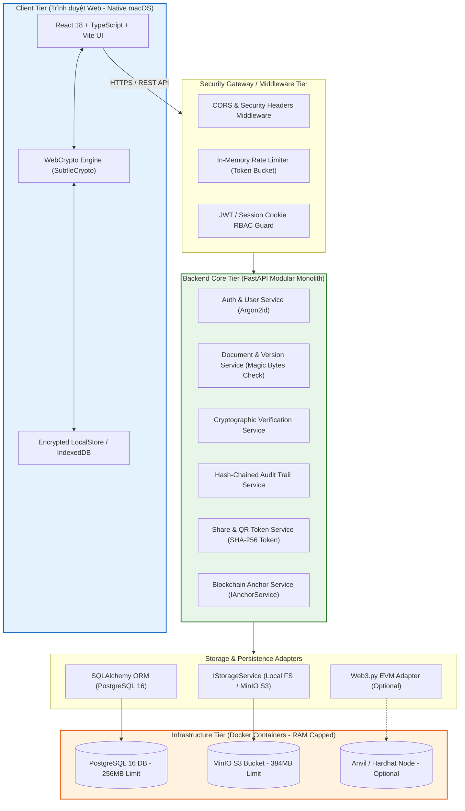
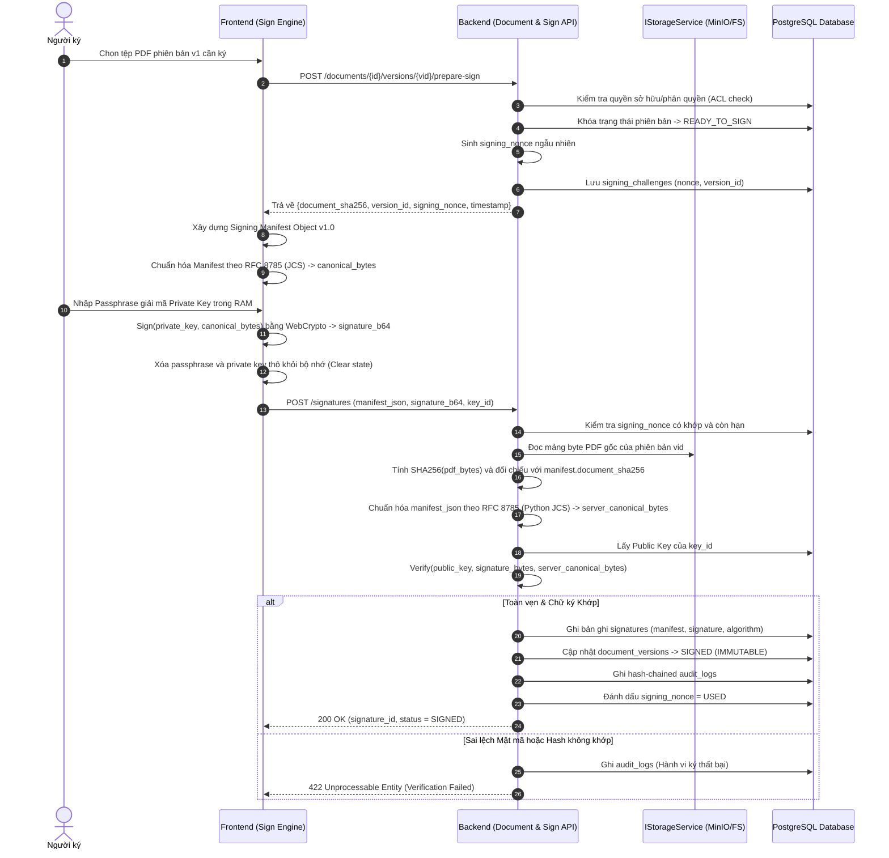
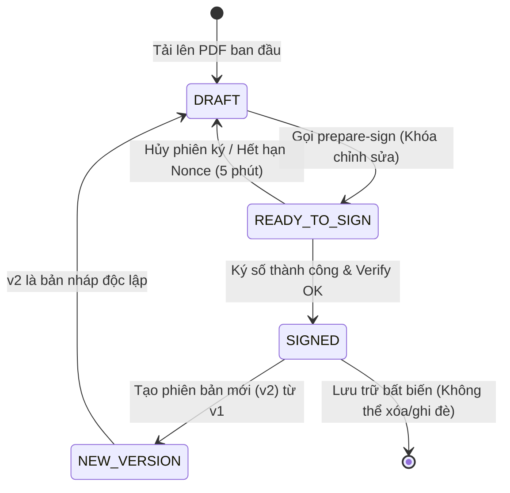
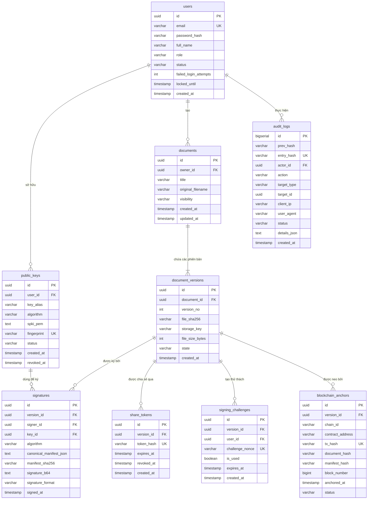
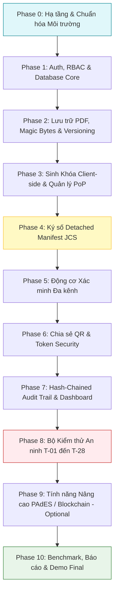

# KẾ HOẠCH TRIỂN KHAI ĐỒ ÁN AN NINH MẠNG (VERSION 3.0 — HARDWARE-OPTIMIZED)
# NGHIÊN CỨU VÀ XÂY DỰNG HỆ THỐNG KÝ SỐ VÀ XÁC THỰC TÀI LIỆU ĐIỆN TỬ
## Research and Development of a Digital Document Signing and Verification System

---

## 1. PROJECT OVERVIEW (TỔNG QUAN DỰ ÁN)

### 1.1. Bối cảnh và Đặt vấn đề
Trong hoạt động trao đổi văn bản điện tử (hợp đồng nội bộ, biên bản thỏa thuận, giấy giới thiệu, quyết định hành chính), việc xác thực nguồn gốc và toàn vẹn của tệp dữ liệu số là thách thức an ninh trọng yếu. Các giải pháp thô sơ như chèn hình ảnh chữ ký quét hoặc con dấu đồ họa vào tệp PDF chỉ mang tính trực quan, hoàn toàn không có khả năng bảo vệ tính toàn vẹn ở cấp độ mật mã. Bất kỳ người nào có công cụ chỉnh sửa PDF cơ bản đều có thể thay đổi số tiền, ngày tháng hoặc điều khoản mà con dấu đồ họa vẫn giữ nguyên.

Dự án này nghiên cứu, thiết kế và phát triển một **Hệ thống Ký số và Xác thực Tài liệu Điện tử** chuẩn mật mã, giải quyết bài toán chống giả mạo, bảo toàn tính toàn vẹn (Integrity), tính xác thực (Authenticity), và chống chối bỏ có cơ sở mật mã (Cryptographic Non-repudiation) cho tệp tài liệu PDF.

### 1.2. Mục tiêu Học thuật và Thực tiễn
1. **Chứng minh nguyên lý mật mã thực nghiệm**:
   - Triển khai thuật toán hàm băm **SHA-256** (FIPS 180-4) và chữ ký số bất đối xứng **RSA-PSS 3072-bit** (FIPS 186-5 / RFC 8017) kết hợp **ECDSA P-256** (FIPS 186-5).
   - Chứng minh thực nghiệm qua kịch bản kiểm thử: việc thay đổi dù chỉ đúng 1 bit dữ liệu trong tệp PDF hoặc bản kê khai (manifest) sẽ kích hoạt hiệu ứng tuyết lở (Avalanche Effect) và khiến tiến trình xác minh chữ ký toán học thất bại (`INVALID`).
2. **Kiến trúc Zero-Knowledge đối với Khóa riêng (Client-side Key Generation)**:
   - Khóa riêng (Private Key) được sinh và lưu trữ cục bộ phía trình duyệt người dùng thông qua chuẩn WebCrypto API.
   - Máy chủ ứng dụng (Backend) theo thiết kế Zero-Trust không bao giờ tiếp nhận, lưu trữ hay xử lý khóa riêng chưa mã hóa.
3. **Phân định ranh giới tin cậy (Trust Boundary Clarification)**:
   - Phân biệt minh bạch giữa **Tính hợp lệ về mặt toán học (Cryptographic Validity)** và **Giá trị định danh pháp lý ngoài đời thực (Legal Identity)**. Hệ thống hiển thị rõ trạng thái khóa công khai tự đăng ký (`SELF_REGISTERED`) thay vì tự ngộ nhận là Tổ chức chứng thực chữ ký số công cộng (Public CA).
4. **Bảo mật ứng dụng và Nhật ký kiểm toán bất biến (Cryptographic Audit Trail)**:
   - Phòng chống các lỗ hổng ứng dụng web (IDOR, XSS, Path Traversal, PDF Active Content).
   - Xây dựng nhật ký kiểm toán dạng chuỗi băm (Hash-Chaining) giúp phát hiện hành vi giả mạo hoặc xóa log.
5. **Mở rộng Blockchain Decoupled (Bằng chứng tham chiếu on-chain)**:
   - Tích hợp neo bằng chứng (Evidence Anchor) lên Smart Contract như một lớp bảo chứng phụ độc lập, tuyệt đối không làm ảnh hưởng đến khả năng hoạt động của lõi ký/xác thực khi mạng Blockchain gián đoạn.

---

## 2. SCOPE AND NON-GOALS (PHẠM VI VÀ GIỚI HẠN)

### 2.1. Phân loại Phân hệ theo Mức độ Ưu tiên
Để đảm bảo tiến độ đồ án và tối ưu hóa tài nguyên phần cứng, các phân hệ được phân loại nghiêm ngặt:

| Phân hệ | Tên phân hệ | Phân loại | Mô tả phạm vi |
| :--- | :--- | :--- | :--- |
| **MOD-01** | Hạ tầng & Môi trường Dev | **CORE** | Docker Compose tối ưu RAM, cấu hình môi trường Lite và Full |
| **MOD-02** | Xác thực & Phân quyền RBAC | **SECURITY** | Argon2id, Session/JWT an toàn, chống IDOR, phân quyền USER/ADMIN |
| **MOD-03** | Lưu trữ PDF & Versioning | **CORE** | Tải lên PDF, kiểm tra magic bytes, lưu trữ bất biến theo UUID, SHA-256 |
| **MOD-04** | Quản lý Khóa Client-side | **SECURITY** | WebCrypto sinh khóa, xuất bản sao lưu mã hóa AES-GCM, đăng ký PoP |
| **MOD-05** | Ký số Detached Manifest | **CORE** | Chuẩn hóa RFC 8785 JCS, RSA-PSS 3072-bit, ECDSA P-256, Nonce replay |
| **MOD-06** | Động cơ Xác minh Đa chiều | **SECURITY** | Kết quả 6 thành phần, độc lập với file gốc và manifest tải lên |
| **MOD-07** | Chia sẻ qua Mã QR | **CORE** | Token 256-bit entropy, lưu hash SHA-256, thời gian sống, không rò rỉ PDF |
| **MOD-08** | Audit Log Hash-Chained | **SECURITY** | Chuỗi băm liên kết phát hiện sửa log, Dashboard giám sát an ninh |
| **MOD-09** | Bộ Kiểm thử STRIDE (28 tests)| **SECURITY** | Bộ test tự động hóa T-01 đến T-28, kiểm chứng phá hủy và an toàn |
| **MOD-10** | Chữ ký nhúng PAdES | **ADVANCED** | Nhúng chữ ký CMS vào PDF qua pyHanko, xem trên Adobe Acrobat |
| **MOD-11** | Neo bằng chứng Blockchain | **OPTIONAL** | Smart Contract AnchorRegistry, adapter decoupled qua IAnchorService |
| **MOD-12** | Mã hóa PDF (AES-256-GCM) | **OPTIONAL** | Bảo vệ tính bí mật cho tài liệu nhạy cảm theo mô hình lai (Hybrid) |

### 2.2. Non-Goals (Những gì hệ thống KHÔNG thực hiện)
- **Không phải Public CA được công nhận pháp lý**: Hệ thống không đóng vai trò tổ chức cung cấp dịch vụ chứng thực chữ ký số công cộng theo luật giao dịch điện tử; không phát hành chứng thư số gốc (Root CA) được cài đặt sẵn vào Windows/macOS Trust Store.
- **Không lưu tệp PDF nhị phân lên Blockchain**: Tuyệt đối không lưu nội dung PDF, Private Key hoặc thông tin định danh cá nhân (PII) lên Smart Contract.
- **Không triển khai kiến trúc Microservices phân tán**: Không sử dụng Kafka, Kubernetes, Istio service mesh nhằm tránh gây cạn kiệt tài nguyên máy phát triển 8GB RAM.
- **Không cam kết "Chống chối bỏ tuyệt đối"**: Mức độ chống chối bỏ phụ thuộc vào tính an toàn của thiết bị đầu cuối phía người dùng; hệ thống chỉ cung cấp bằng chứng kỹ thuật mật mã mạnh nhất trong phạm vi ranh giới tin cậy được thiết kế.

---

## 3. FUNCTIONAL REQUIREMENTS (YÊU CẦU CHỨC NĂNG)

- **FR-01 (Quản lý Tài khoản)**: Đăng ký, đăng nhập với mật khẩu băm Argon2id; phân quyền USER và ADMIN.
- **FR-02 (Tải lên & Xử lý PDF)**: Tải lên tệp PDF; kiểm tra Magic Bytes `%PDF-`; từ chối tệp vượt quá 20MB; loại bỏ mã độc kích hoạt tự động (`/JS`, `/Launch`).
- **FR-03 (Quản lý Phiên bản Bất biến)**: Mỗi tệp có một chuỗi phiên bản (`v1`, `v2`, ...). Phiên bản đã được ký chuyển trạng thái thành `IMMUTABLE`, không được phép ghi đè nội dung nhị phân.
- **FR-04 (Sinh Khóa Phía Client)**: Người dùng sinh cặp khóa bất đối xứng trên trình duyệt; hệ thống hỗ trợ xuất bản sao lưu Private Key có mã hóa mật khẩu.
- **FR-05 (Đăng ký Public Key & Proof-of-Possession)**: Tải Public Key (SPKI PEM) lên server kèm theo chữ ký xác thực quyền sở hữu (Proof-of-Possession) trên một nonce ngẫu nhiên do server cấp.
- **FR-06 (Ký số Detached Manifest)**: Ký trên cấu trúc Manifest được chuẩn hóa theo chuẩn RFC 8785; hỗ trợ RSA-PSS 3072-bit (chính) và ECDSA P-256 (mở rộng).
- **FR-07 (Xác minh Chữ ký Đa kênh)**: Xác minh tài liệu thông qua hệ thống nội bộ, qua mã QR công khai hoặc bằng cách tải lên tệp PDF rời kèm tệp manifest `.json`.
- **FR-08 (Chia sẻ & Quét mã QR)**: Tạo liên kết xác minh công khai có thời hạn và mã QR tương ứng; trang xác minh công khai không làm lộ tệp PDF gốc.
- **FR-09 (Nhật ký Kiểm toán Hash-Chained)**: Ghi lại mọi biến cố an ninh (đăng nhập, tải file, ký số, xác minh, thu hồi khóa); mỗi dòng log liên kết băm với dòng trước đó.
- **FR-10 (Thu hồi Khóa)**: Cho phép người dùng thu hồi Public Key; trạng thái thu hồi được hiển thị rõ ràng trong các lần xác minh chữ ký tiếp theo.
- **FR-11 (Bảo vệ Chống Replay)**: Yêu cầu ký phải chứa `signing_nonce` duy nhất và thời gian hợp lệ do server cung cấp, có cơ chế hủy nonce sau một lần sử dụng.
- **FR-12 (Bảng điều khiển An ninh)**: Thống kê số lượng văn bản, tỷ lệ xác minh hợp lệ/không hợp lệ, danh sách khóa bị thu hồi và trạng thái chuỗi hash audit.

---

## 4. NON-FUNCTIONAL REQUIREMENTS (YÊU CẦU PHI CHỨC NĂNG)

- **NFR-01 (Cryptographic Correctness)**: Tuân thủ nghiêm ngặt FIPS 186-5, RFC 8017 (PKCS#1 v2.2), FIPS 180-4, RFC 8785 (JCS). Không tự viết lại thuật toán mã hóa/băm thô.
- **NFR-02 (Hardware Efficiency - MacBook 8GB RAM)**: Toàn bộ hệ thống khi chạy thử nghiệm tải nhẹ không được tiêu thụ vượt quá 1.5GB RAM tổng thể của máy chủ/container.
- **NFR-03 (Security In-Depth)**: Áp dụng nguyên tắc đặc quyền tối thiểu (Least Privilege), phân tách ranh giới mạng, mã hóa dữ liệu khi truyền (TLS 1.3) và kiểm tra kiểm soát truy cập ở tầng dịch vụ (Service layer ACL).
- **NFR-04 (Performance)**: Thời gian băm và xác minh tài liệu 5MB dưới 500ms trên chip Apple Silicon.
- **NFR-05 (Determinism)**: Chuẩn hóa dữ liệu ký (Canonicalization) đảm bảo tính nhất quán byte-exact tuyệt đối giữa môi trường JavaScript (trình duyệt) và Python (máy chủ).
- **NFR-06 (Portability & Modularity)**: Dễ dàng chuyển đổi giữa môi trường Development Lite (chạy native + filesystem) và Full Security Demo (Docker Compose + MinIO + PostgreSQL).

---

## 5. HARDWARE CONSTRAINTS & RESOURCE OPTIMIZATION (MACBOOK 8GB RAM)

### 5.1. Ràng buộc Tài nguyên Phần cứng
Môi trường phát triển và thực nghiệm là MacBook Apple Silicon (M1/M2/M3/M4) với cấu hình RAM vật lý cố định **8GB Unified Memory**. Hệ điều hành macOS và các ứng dụng thiết yếu (VS Code, trình duyệt, WindowServer) thường chiếm khoảng 4.0GB - 5.0GB RAM. Do đó, ngân sách RAM khả dụng an toàn cho toàn bộ dự án (Docker + App processes) là **tối đa 2.0GB - 2.5GB**. Nếu vượt quá ngưỡng này, hệ điều hành sẽ kích hoạt Memory Swapping liên tục, làm suy giảm hiệu năng và có thể dẫn đến việc Docker OOM (Out Of Memory) Killer tắt tiến trình.

### 5.2. Ngân sách Bộ nhớ (RAM Budget) Ước tính
*Lưu ý: Tất cả các số liệu dưới đây là số liệu ước tính trước khi đo đạc thực tế, phục vụ việc giới hạn cấu hình container.*

| Thành phần hệ thống | Môi trường chạy | RAM Trạng thái Nghỉ (Idle - Ước tính) | RAM Thao tác Thường (Normal - Ước tính) | RAM Kiểm thử Tải nhẹ (Light Load - Ước tính) | Biện pháp Tối ưu hóa |
| :--- | :--- | :--- | :--- | :--- | :--- |
| **Frontend (React + Vite)** | Native macOS | 70 MB – 90 MB | 110 MB – 140 MB | 180 MB – 220 MB | Chạy native bằng Node.js, không chạy trong Docker container |
| **Backend (FastAPI + Uvicorn)** | Native / Container | 60 MB – 80 MB | 100 MB – 130 MB | 180 MB – 250 MB | 1 worker tiến trình, stream đọc tệp chunk 64KB, không load toàn bộ PDF lớn vào RAM |
| **PostgreSQL 16 (Alpine)** | Docker Container | 45 MB – 55 MB | 70 MB – 95 MB | 130 MB – 160 MB | `shared_buffers = 64MB`, `work_mem = 4MB`, `max_connections = 20` |
| **MinIO Object Storage** | Docker Container | 65 MB – 85 MB | 90 MB – 120 MB | 160 MB – 200 MB | Chạy chế độ Single-Drive Single-Node, tắt telemetry, cấu hình cache nhỏ |
| **Hardhat / Anvil (Optional)** | Native / Container | 50 MB – 70 MB | 80 MB – 110 MB | 150 MB – 190 MB | Chỉ kích hoạt khi thực nghiệm Phase 9/Demo; tắt ngay sau khi kiểm thử |
| **TỔNG CỘNG (Chế độ Core Demo)** | **Hybrid** | **~240 MB – 310 MB** | **~370 MB – 485 MB** | **~650 MB – 830 MB** | **An toàn tuyệt đối trên máy 8GB RAM (Dư hơn 6GB cho hệ thống)** |

### 5.3. Quy tắc Vận hành Docker An toàn
1. **Docker Desktop VM Settings**: Cấu hình Docker VM với **2 CPU cores**, **3.0 GB Virtual RAM limit**, và **1.0 GB Swap limit**.
2. **Resource Limits trong `docker-compose.yml`**: Thiết lập `deploy.resources.limits.memory` cho từng container dịch vụ:
   - PostgreSQL: Limit 256MB, Reservation 64MB.
   - MinIO: Limit 384MB, Reservation 128MB.
3. **Log Rotation**: Cấu hình Docker logging driver với `max-size: "10m"` và `max-file: "3"` để tránh tràn ổ đĩa.
4. **Quy tắc bảo vệ dữ liệu**: Tuyệt đối **KHÔNG** sử dụng `docker compose down -v` hoặc `docker system prune -a --volumes` trong quá trình phát triển để tránh mất mát cơ sở dữ liệu và tệp lưu trữ.

---

## 6. ARCHITECTURE DECISION RECORDS (ADRs)

### ADR-01: Kiến trúc Ứng dụng — Modular Monolith thay vì Microservices
- **Bối cảnh**: Cần một hệ thống có đầy đủ phân hệ xác thực, tài liệu, mật mã, audit log, và blockchain adapter trên máy phát triển 8GB RAM.
- **Quyết định**: Xây dựng theo kiến trúc **Modular Monolith** sử dụng Python FastAPI.
- **Lý do**: Microservices đòi hỏi nhiều container riêng biệt, API Gateway, Service Discovery, và mạng nội bộ phức tạp gây tiêu tốn ít nhất 2GB-3GB RAM chỉ cho phần hạ tầng. Modular Monolith cho phép chia tách code rõ ràng theo interface (Clean Architecture / Hexagonal Architecture) trong cùng một tiến trình, tiết kiệm tối đa bộ nhớ và loại bỏ hoàn toàn độ trễ mạng nội bộ.

### ADR-02: Mô hình Môi trường Phát triển — Hybrid Dual-Profile
- **Bối cảnh**: Cần phát triển nhanh mà không bị phụ thuộc vào việc phải bật toàn bộ container Docker.
- **Quyết định**: Thiết lập hai chế độ thực thi:
  1. **Development Lite**: Frontend và Backend chạy native trên macOS; Cơ sở dữ liệu dùng PostgreSQL container gọn nhẹ (hoặc SQLite adapter); Tệp lưu trữ dùng Local Filesystem Adapter.
  2. **Full Security Demo**: Toàn bộ Backend, PostgreSQL, MinIO kết nối trong mạng Docker nội bộ; Frontend chạy native hoặc container; Audit Log và Blockchain adapter sẵn sàng.
- **Lý do**: Giúp lập trình viên có thể code tính năng core ngay cả khi máy đang cạn pin hoặc cần tiết kiệm RAM tối đa.

### ADR-03: Dữ liệu Ký — Chuẩn hóa Manifest (RFC 8785 JCS) thay vì Ký Byte thô
- **Bối cảnh**: Nếu chỉ ký trên mảng byte thô của PDF, hệ thống sẽ thiếu ngữ cảnh an ninh (Context) như: ai ký, ký vào phiên bản logic nào, thuật toán gì, và nonce chống replay là gì.
- **Quyết định**: Sử dụng mô hình **Detached Signed Manifest**. Dữ liệu được đưa vào hàm ký là chuỗi JSON Manifest được chuẩn hóa theo chuẩn **RFC 8785 JSON Canonicalization Scheme (JCS)**, trong đó chứa trường `document_sha256` của tệp PDF gốc.
- **Lý do**: Ngăn chặn hoàn toàn tấn công Replay chữ ký sang tài liệu khác; đồng thời chuẩn hóa JCS đảm bảo cùng một đối tượng JSON sẽ sinh ra chính xác 100% cùng một mảng byte ở cả JavaScript và Python.

### ADR-04: Quản lý Khóa Client-side — Mô hình Extractable Encrypted Backup (Phương án B)
- **Bối cảnh**: Trình duyệt có WebCrypto API hỗ trợ sinh khóa với cờ `extractable: true` hoặc `false`.
- **Quyết định**: Chọn **Phương án B (Extractable có điều kiện)**: Cho phép xuất khóa nhưng khóa riêng bắt buộc phải được mã hóa ngay lập tức bằng **AES-256-GCM** với chìa khóa dẫn xuất từ mật khẩu người dùng (thông qua PBKDF2/Argon2id) trước khi xuất thành tệp sao lưu `.pem.enc`.
- **Lý do**: Đồ án học thuật cần khả năng demo khôi phục khóa trên các trình duyệt khác nhau hoặc sau khi xóa cache trình duyệt. Rủi ro của cờ `extractable: true` được giảm thiểu bằng việc không bao giờ truyền khóa rõ qua mạng và mã hóa ngay tại tầng bộ nhớ máy khách.

### ADR-05: Lưu trữ Tệp — Interface Trừu tượng hóa Storage
- **Bối cảnh**: MinIO là object storage chuẩn S3 nhưng chiếm thêm tài nguyên RAM khi chạy thường trực.
- **Quyết định**: Xây dựng interface `IStorageService` với hai lớp cài đặt: `LocalStorageService` (ghi file vào thư mục bảo vệ cục bộ) và `MinioStorageService` (kết nối S3 bucket qua giao thức S3).
- **Lý do**: Đảm bảo toàn bộ logic nghiệp vụ ký số và tính hash SHA-256 không bị phụ thuộc vào MinIO; có thể chuyển đổi linh hoạt qua biến môi trường `STORAGE_BACKEND`.

### ADR-06: Khử Bỏ Phụ thuộc Redis trong Core
- **Bối cảnh**: Redis thường dùng cho Rate Limiting và Caching nhưng chiếm thêm ~30MB-50MB RAM.
- **Quyết định**: Sử dụng bộ đếm In-Memory Token Bucket tích hợp sẵn trong tiến trình FastAPI cho tính năng Rate Limiting ở Phase 0-8.
- **Lý do**: Đơn giản hóa kiến trúc, giảm bớt một dịch vụ nền tảng, hoàn toàn đủ năng lực cho các bài kiểm thử cục bộ và buổi bảo vệ đồ án.

---

## 7. SYSTEM ARCHITECTURE (KIẾN TRÚC HỆ THỐNG)

### 7.1. Sơ đồ Kiến trúc Tổng thể (Modular Monolith)



### 7.2. Phân tách Module và Giao diện Lập trình (Interfaces)
Hệ thống tuân thủ nguyên lý Dependency Inversion. Tầng nghiệp vụ không phụ thuộc trực tiếp vào driver phần cứng:
- `IStorageService`:
  - `save_file(file_path: str, data: bytes) -> str`
  - `get_file(file_path: str) -> bytes`
  - `check_exists(file_path: str) -> bool`
- `ICryptoService`:
  - `verify_rsa_pss(public_key_pem: str, data: bytes, signature: bytes) -> bool`
  - `verify_ecdsa_p256(public_key_pem: str, data: bytes, signature: bytes) -> bool`
  - `compute_sha256(data: bytes) -> str`
- `IAnchorService`:
  - `anchor_evidence(evidence_id: str, document_hash: str, manifest_hash: str) -> AnchorResult`
  - `get_anchor(evidence_id: str) -> Optional[AnchorRecord]`

---

## 8. DATA FLOW DIAGRAMS (LUỒNG DỮ LIỆU ĐẦU CUỐI)

### 8.1. Sơ đồ Tuần tự 1: Đăng ký Khóa Công khai & Proof-of-Possession

```mermaid
sequenceDiagram
    autonumber
    actor User as Người dùng
    participant UI as Frontend (WebCrypto)
    participant API as Backend (Auth & Key API)
    participant DB as PostgreSQL Database

    User->>UI: Yêu cầu sinh cặp khóa mới (RSA-PSS 3072)
    UI->>UI: window.crypto.subtle.generateKey()
    UI->>UI: Trích xuất SPKI DER & tính SHA-256 Fingerprint
    User->>UI: Nhập Passphrase bảo vệ Private Key
    UI->>UI: Dẫn xuất AES key (PBKDF2) -> Mã hóa Private Key -> Lưu/Tải .pem.enc
    
    Note over UI, API: Quy trình Proof-of-Possession (PoP)
    UI->>API: POST /keys/challenge (yêu cầu thử thách)
    API->>API: Sinh ngẫu nhiên nonce (32 bytes cryptographically secure)
    API->>DB: Lưu signing_challenges (nonce, expires_at = 5 phút)
    API-->>UI: Trả về challenge_nonce
    
    UI->>UI: Sign(private_key, challenge_nonce)
    UI->>API: POST /keys (public_key_pem, fingerprint, challenge_nonce, pop_signature)
    API->>DB: Kiểm tra nonce hợp lệ & chưa sử dụng
    API->>API: Verify(public_key, pop_signature, challenge_nonce)
    alt Chữ ký PoP Hợp lệ
        API->>DB: Lưu vào bảng public_keys (status = ACTIVE)
        API->>DB: Đánh dấu challenge_nonce = USED
        API-->>UI: 201 Created (key_id, fingerprint)
    else Chữ ký PoP Sai
        API-->>UI: 400 Bad Request (Invalid Proof-of-Possession)
    end
```



### 8.2. Sơ đồ Tuần tự 2: Ký số Detached Manifest & Xác minh Hai đầu



---

## 9. CRYPTOGRAPHIC DESIGN & CANONICALIZATION (THIẾT KẾ MẬT MÃ)

### 9.1. Đặc tả Thuật toán Ký số
Hệ thống cài đặt hai bộ thuật toán mật mã bất đối xứng theo chuẩn FIPS 186-5:

1. **Thuật toán Chính (Primary) — RSA-PSS (RFC 8017 / PKCS#1 v2.2)**:
   - **Kích thước khóa**: 3072 bits ($e = 65537$). Kích thước này đáp ứng mức an toàn 128-bit security level, được NIST khuyến nghị sử dụng bảo vệ tài liệu sau năm 2030.
   - **Hàm băm tin nhắn**: SHA-256.
   - **Hàm tạo mặt nạ (MGF)**: MGF1 với SHA-256.
   - **Độ dài Salt ($sLen$)**: 32 bytes (bằng độ dài đầu ra của hàm băm).
   - **Ưu điểm an ninh**: RSA-PSS có chứng minh an toàn chặt chẽ trong mô hình Random Oracle, loại bỏ hoàn toàn các điểm yếu liên quan đến tấn công Padding Oracle của cấu trúc PKCS#1 v1.5 cũ.

2. **Thuật toán Mở rộng (Alternative) — ECDSA P-256 (FIPS 186-5)**:
   - **Đường cong elip**: NIST P-256 (`secp256r1`).
   - **Hàm băm**: SHA-256.
   - **Định dạng chữ ký**: IEEE P1363 (chuỗi nhị phân $R || S$, $32 + 32 = 64$ bytes) hoặc ASN.1 DER theo chuẩn RFC 3279.
   - **Đánh giá Nonce & RFC 6979**:
     - *Phía Python (Backend)*: Thư viện `cryptography` sử dụng OpenSSL, hỗ trợ deterministic nonce theo RFC 6979 hoặc bộ sinh số ngẫu nhiên an toàn của hệ điều hành.
     - *Phía Trình duyệt (WebCrypto)*: Chuẩn W3C WebCrypto API sử dụng CSPRNG của hệ điều hành để sinh nonce $k$, không bắt buộc RFC 6979. Hệ thống không đưa ra giả định sai lầm rằng WebCrypto tự động dùng RFC 6979.
   - **Xử lý Signature Malleability**: Nếu sử dụng định dạng ASN.1 DER, backend chuẩn hóa giá trị $S$ về nửa dưới (Low-S: $s \le n/2$) trước khi đối soát chữ ký nhằm ngăn chặn tính dẻo chữ ký (Malleability).

### 9.2. Cấu trúc Signed Manifest Chuẩn hóa v1.0
Dữ liệu ký không phải là tệp PDF thô, mà là bản kê khai (Manifest) có cấu trúc cụ thể:

```json
{
  "manifest_version": "1.0",
  "document_version_id": "9b1deb4d-3b7d-4bad-9bdd-2b0d7b3dcb6d",
  "document_sha256": "e3b0c44298fc1c149afbf4c8996fb92427ae41e4649b934ca495991b7852b855",
  "key_id": "key-7c9e6679-7425-40de-944b-e07fc1f90ae7",
  "signer_fingerprint": "8f434346648f6b96df89dda901c5176b10a6d83961dd3c1ac88b59b2dc327aa4",
  "algorithm": "RSA-PSS-SHA256",
  "signing_nonce": "a4f89d3c5e2b10a7f9e8c4d2b1a0f3e5",
  "signing_timestamp": "2026-11-14T10:30:00Z",
  "signing_context": "capstone-cybersecurity-v2"
}
```

### 9.3. Chuẩn hóa Manifest tài liệu (thiết kế Phase 4 — RFC 8785 JCS)
Khi ký một đối tượng JSON giữa hai môi trường khác nhau (JavaScript trên trình duyệt và Python trên server), thứ tự các key, khoảng trắng, định dạng số thực và ký tự Unicode có thể bị sai lệch, dẫn đến việc chữ ký xác minh thất bại.
Thiết kế manifest Phase 4 dự kiến áp dụng **RFC 8785 (JSON Canonicalization Scheme - JCS)** và phải được kiểm chứng riêng; Phase 3 chỉ dùng PoP schema v1:
- Sắp xếp tất cả các thuộc tính của object theo thứ tự từ điển mã Unicode (Lexicographical ordering).
- Loại bỏ hoàn toàn khoảng trắng dư thừa (` `), ký tự tab, ký tự xuống dòng (`\n`, `\r`).
- Mã hóa chuỗi ký tự UTF-8 không có byte order mark (BOM).
- Đảm bảo tính tất định (Deterministic serialization):
  $$\text{JCS}(\text{Manifest}) \to \text{exact\_bytes} \implies \text{Sign(private\_key, exact\_bytes)}$$

#### Vector Kiểm thử Liên thông Mật mã (Cross-Language Test Vector):
```python
# Test Vector chuẩn để verify độc lập giữa JS và Python
TEST_MANIFEST = {
    "manifest_version": "1.0",
    "document_sha256": "ba7816bf8f01cfea414140de5dae2223b00361a396177a9cb410ff61f20015ad",
    "signing_context": "capstone-test",
    "key_id": "key-001"
}
# Output JCS chuẩn (không khoảng trắng, sort keys):
# {"document_sha256":"ba7816bf8f01cfea414140de5dae2223b00361a396177a9cb410ff61f20015ad","key_id":"key-001","manifest_version":"1.0","signing_context":"capstone-test"}
# SHA-256 của chuỗi Canonical bytes trên:
# dc93b5894f71a0670868f0cb5d6e24ccce31a7be543a681c62f31b268297b4ec
```

---

## 10. KEY LIFECYCLE MANAGEMENT & TRUST MODEL

### 10.1. Vòng đời Khóa Mật mã (Key Lifecycle)
1. **Sinh khóa (Generation)**: Thực thi bên trong `window.crypto.subtle.generateKey` với cờ cấu hình thuật toán an toàn.
2. **Lưu trữ Cục bộ (Local Persistence)**:
   - Private Key được giữ trong IndexedDB (Object Store riêng của ứng dụng).
   - Trước khi lưu vào IndexedDB, Private Key được mã hóa bằng thuật toán **AES-256-GCM** với khóa dẫn xuất từ mật khẩu (Passphrase) của người dùng qua hàm **PBKDF2-HMAC-SHA256** (với 600,000 vòng lặp theo khuyến nghị OWASP) hoặc Argon2id.
3. **Sao lưu & Phục hồi (Backup & Recovery)**:
   - Người dùng có thể tải về tệp khóa sao lưu `.pem.enc`.
   - Tệp sao lưu chứa: `{ salt_hex, iv_hex, iterations, ciphertext_b64, auth_tag_b64, fingerprint }`.
   - Để phục hồi, người dùng tải tệp lên và nhập đúng Passphrase; Private Key được tái tạo trực tiếp trong bộ nhớ trình duyệt mà không gửi lên server.
4. **Giới hạn Bảo mật Trình duyệt (Honest Browser Security Limits)**:
   - Hệ thống **không tuyên bố** rằng thao tác trong trình duyệt có khả năng chống được phần mềm độc hại (Keylogger, Info-stealer) đã chiếm quyền root máy người dùng.
   - Nếu xảy ra tấn công Cross-Site Scripting (XSS), kẻ tấn công có thể can thiệp vào ngữ cảnh thực thi JS. Do đó, CSP (Content Security Policy) nghiêm ngặt là phòng tuyến bắt buộc.
   - Thao tác xóa mảng nhớ `Uint8Array.fill(0)` là biện pháp giảm thiểu (Best-effort mitigation), không đảm bảo trình thu gom rác (V8 Garbage Collector) đã xóa sạch mọi bản sao trung gian trong RAM.
5. **Thu hồi Khóa (Revocation)**:
   - Người dùng có thể kích hoạt API `POST /keys/{id}/revoke`.
   - Khóa chuyển trạng thái thành `REVOKED` cùng timestamp `revoked_at`.
   - Các chữ ký được tạo **trước** thời điểm `revoked_at` vẫn có giá trị toàn vẹn toán học (`VALID`) nhưng kèm cảnh báo khóa đã bị thu hồi; các chữ ký tạo **sau** thời điểm thu hồi bị coi là bất hợp lệ.

### 10.2. Cấu trúc Kết quả Xác minh 6 Thành phần (6-Tier Verification Result)
Hệ thống hiển thị kết quả kiểm tra đa chiều, tách biệt hoàn toàn tính đúng đắn toán học với giá trị tin cậy danh tính:

```json
{
  "cryptographic_validity": "VALID",
  "document_integrity": "UNCHANGED",
  "key_ownership": "VERIFIED_POP",
  "certificate_trust": "SELF_REGISTERED",
  "key_revocation_status": "ACTIVE",
  "timestamp_evidence": {
    "server_timestamp": "2026-11-14T10:30:00Z",
    "blockchain_anchor": "ANCHORED_AND_MATCHED"
  },
  "warnings": [
    "Khóa ký tự đăng ký trong hệ thống nội bộ, chưa liên kết với Chứng thư số CA quốc gia."
  ]
}
```

---

## 11. DOCUMENT PROCESSING, STORAGE & VERSIONING

### 11.1. Luồng Kiểm duyệt Tệp PDF Tải lên (Secure PDF Ingestion Pipeline)
Để ngăn chặn các cuộc tấn công thông qua tệp tải lên (File Upload Vulnerabilities), backend thực thi quy trình kiểm tra 5 bước:

1. **Kiểm tra Kích thước Stream**: Giới hạn tối đa 20MB. Đọc tệp theo từng khối 64KB để không làm tràn RAM hệ thống.
2. **Kiểm tra Magic Bytes**: Xác thực 5 bytes đầu tiên của tệp bắt buộc phải là `%PDF-` (`0x25 0x50 0x44 0x46 0x2D`). Chặn đứng các tệp `.exe`, `.sh`, `.php` đổi tên đuôi.
3. **Phân tích Cú pháp PDF (AST Parsing & Sanitization)**:
   - Sử dụng thư viện `pypdf` đọc cây đối tượng PDF trong môi trường giới hạn thời gian (Timeout 3 giây).
   - Quét tìm và phát hiện các đối tượng nguy hiểm: `/JavaScript`, `/JS`, `/Launch`, `/SubmitForm`, `/ImportData`.
   - Nếu phát hiện tệp chứa mã thực thi, hệ thống từ chối tải lên và ghi nhận cảnh báo an ninh.
4. **Khử độc Tên tệp & Ngẫu nhiên hóa Đường dẫn**:
   - Loại bỏ toàn bộ ký tự đặc biệt, chống tấn công Path Traversal (`../`).
   - Tạo `document_id` ngẫu nhiên (UUIDv4) và `version_id` ngẫu nhiên (UUIDv4).
   - Đường dẫn lưu trữ: `documents/{document_uuid}/v{version_no}_{version_uuid}.pdf`.
5. **Tính toán Băm SHA-256 Tuyệt đối**:
   - Tính toán hàm băm SHA-256 trên toàn bộ mảng byte nguyên vẹn được ghi xuống ổ đĩa/MinIO.
   - Ghi nhận `sha256` vào bảng `document_versions`.

### 11.2. Máy Trạng thái Phiên bản Tài liệu (Version State Machine)



- **Quy tắc Bất biến (Immutability Invariant)**: Khi một phiên bản đạt trạng thái `SIGNED`, trường `sha256` trong cơ sở dữ liệu và mảng byte nhị phân trong Storage bị khóa vĩnh viễn. Mọi hành vi cập nhật nội dung văn bản bắt buộc phải tạo một bản ghi phiên bản mới với `version_no = version_no + 1`. Phiên bản cũ vẫn tồn tại nguyên vẹn để phục vụ đối soát chữ ký lịch sử.

---

## 12. DATABASE DESIGN & ERD

### 12.1. Sơ đồ Thực thể Quan hệ (Entity Relationship Diagram - Mermaid)



### 12.2. Đặc tả Chi tiết các Bảng và Ràng buộc Toàn vẹn

1. **`users`**: Quản lý tài khoản và trạng thái bảo vệ chống brute-force.
   - `id`: UUID Primary Key.
   - `email`: VARCHAR(255) UNIQUE NOT NULL. Index B-tree.
   - `password_hash`: VARCHAR(255) NOT NULL (Argon2id format `$argon2id$v=19$m=65536,t=3,p=4$...`).
   - `role`: VARCHAR(20) NOT NULL CHECK (role IN ('USER', 'ADMIN')).
   - `status`: VARCHAR(20) NOT NULL DEFAULT 'ACTIVE' CHECK (status IN ('ACTIVE', 'LOCKED', 'DEACTIVATED')).
   - `failed_login_attempts`: INT DEFAULT 0. Khóa tài khoản tạm thời 15 phút nếu $\ge 5$.
   - `locked_until`: TIMESTAMP WITH TIME ZONE NULL.

2. **`public_keys`**: Lưu khóa công khai và trạng thái thu hồi.
   - `id`: UUID Primary Key.
   - `user_id`: UUID NOT NULL REFERENCES users(id) ON DELETE RESTRICT.
   - `algorithm`: VARCHAR(30) NOT NULL CHECK (algorithm IN ('RSA-PSS-3072', 'ECDSA-P256')).
   - `spki_pem`: TEXT NOT NULL (Định dạng SubjectPublicKeyInfo PEM).
   - `fingerprint`: VARCHAR(64) UNIQUE NOT NULL (SHA-256 của SPKI DER dạng hex 64 ký tự).
   - `status`: VARCHAR(20) NOT NULL DEFAULT 'ACTIVE' CHECK (status IN ('ACTIVE', 'REVOKED')).
   - `revoked_at`: TIMESTAMP WITH TIME ZONE NULL.

3. **`documents`**: Thực thể tài liệu logic.
   - `id`: UUID Primary Key.
   - `owner_id`: UUID NOT NULL REFERENCES users(id) ON DELETE RESTRICT.
   - `title`: VARCHAR(255) NOT NULL.
   - `visibility`: VARCHAR(20) NOT NULL DEFAULT 'PRIVATE' CHECK (visibility IN ('PRIVATE', 'SHARED')).

4. **`document_versions`**: Quản lý từng phiên bản nhị phân bất biến.
   - `id`: UUID Primary Key.
   - `document_id`: UUID NOT NULL REFERENCES documents(id) ON DELETE CASCADE.
   - `version_no`: INT NOT NULL. Ràng buộc `UNIQUE (document_id, version_no)`.
   - `file_sha256`: VARCHAR(64) NOT NULL. Index B-tree phục vụ tra cứu ngược.
   - `storage_key`: VARCHAR(512) NOT NULL.
   - `state`: VARCHAR(20) NOT NULL DEFAULT 'DRAFT' CHECK (state IN ('DRAFT', 'READY_TO_SIGN', 'SIGNED')).

5. **`signatures`**: Bản ghi chữ ký số detached.
   - `id`: UUID Primary Key.
   - `version_id`: UUID NOT NULL REFERENCES document_versions(id) ON DELETE RESTRICT.
   - `signer_id`: UUID NOT NULL REFERENCES users(id) ON DELETE RESTRICT.
   - `key_id`: UUID NOT NULL REFERENCES public_keys(id) ON DELETE RESTRICT.
   - `canonical_manifest_json`: TEXT NOT NULL (Chuỗi JSON chuẩn hóa theo RFC 8785).
   - `manifest_sha256`: VARCHAR(64) NOT NULL.
   - `signature_b64`: TEXT NOT NULL (Chữ ký số Base64).
   - `signature_format`: VARCHAR(20) NOT NULL DEFAULT 'detached-manifest-v1'.

6. **`share_tokens`**: Token chia sẻ xác thực công khai qua mã QR.
   - `id`: UUID Primary Key.
   - `version_id`: UUID NOT NULL REFERENCES document_versions(id) ON DELETE CASCADE.
   - `token_hash`: VARCHAR(64) UNIQUE NOT NULL (Lưu `SHA256(raw_token)`).
   - `expires_at`: TIMESTAMP WITH TIME ZONE NOT NULL.
   - `revoked_at`: TIMESTAMP WITH TIME ZONE NULL.

7. **`signing_challenges`**: Quản lý nonce chống tấn công Replay và kiểm tra PoP.
   - `id`: UUID Primary Key.
   - `challenge_nonce`: VARCHAR(64) UNIQUE NOT NULL.
   - `is_used`: BOOLEAN DEFAULT FALSE NOT NULL.
   - `expires_at`: TIMESTAMP WITH TIME ZONE NOT NULL (TTL mặc định 5 phút).

8. **`audit_logs`**: Nhật ký kiểm toán liên kết băm (Cryptographic Hash-Chaining).
   - `id`: BIGSERIAL Primary Key.
   - `prev_hash`: VARCHAR(64) NOT NULL.
   - `entry_hash`: VARCHAR(64) UNIQUE NOT NULL.
   - `action`: VARCHAR(50) NOT NULL.
   - `created_at`: TIMESTAMP WITH TIME ZONE DEFAULT CURRENT_TIMESTAMP NOT NULL.

---

## 13. API DESIGN & SECURITY CONTRACTS

Toàn bộ API tuân thủ tiêu chuẩn RESTful, sử dụng mã hóa HTTPS, nhận và trả dữ liệu định dạng JSON chuẩn:

### 13.1. Danh mục Endpoints Cốt lõi

| Phương thức | Endpoint | Chức năng an ninh | Kiểm soát quyền (RBAC) | Mã lỗi chuẩn |
| :--- | :--- | :--- | :--- | :--- |
| `POST` | `/api/v1/auth/register` | Đăng ký tài khoản, băm mật khẩu Argon2id | Public (Rate Limited) | 400, 409, 429 |
| `POST` | `/api/v1/auth/login` | Xác thực người dùng, cấp phát HttpOnly Cookie | Public (Rate Limited) | 401, 423, 429 |
| `POST` | `/api/v1/auth/logout` | Hủy session, thu hồi cookie | Authenticated | 401 |
| `GET` | `/api/v1/auth/me` | Lấy thông tin tài khoản hiện tại | Authenticated | 401 |
| `POST` | `/api/v1/keys/challenge`| Xin nonce ngẫu nhiên để làm chữ ký PoP | Authenticated | 401, 429 |
| `POST` | `/api/v1/keys` | Đăng ký Public Key kèm chữ ký PoP | Authenticated | 400, 401, 422 |
| `GET` | `/api/v1/keys/my` | Liệt kê danh sách khóa của người dùng | Authenticated | 401 |
| `POST` | `/api/v1/keys/{id}/revoke`| Thu hồi Public Key đã đăng ký | Authenticated (Owner only) | 401, 403, 404 |
| `POST` | `/api/v1/documents` | Tải lên PDF, kiểm tra magic bytes, băm SHA256 | Authenticated | 400, 413, 415, 422 |
| `GET` | `/api/v1/documents` | Danh sách tài liệu thuộc quyền sở hữu | Authenticated | 401 |
| `GET` | `/api/v1/documents/{id}` | Chi tiết tài liệu và danh sách phiên bản | Authenticated (Owner/ACL) | 401, 403, 404 |
| `GET` | `/api/v1/documents/{id}/versions/{vid}/download` | Tải về mảng byte PDF gốc | Authenticated (Owner/ACL) | 401, 403, 404 |
| `POST` | `/api/v1/documents/{id}/versions/{vid}/prepare-sign` | Lấy SHA256 và signing nonce | Authenticated (Signer) | 401, 403, 404, 409 |
| `POST` | `/api/v1/signatures` | Gửi chữ ký, backend verify trước khi ghi | Authenticated (Signer) | 400, 401, 422 |
| `POST` | `/api/v1/verify/upload`| Xác minh độc lập tệp PDF + manifest rời | Public | 400, 422 |
| `POST` | `/api/v1/shares` | Tạo mã QR / token chia sẻ có thời hạn | Authenticated (Owner) | 401, 403 |
| `GET` | `/api/v1/verify/share/{token}` | Xác minh công khai theo token QR | Public (Không lộ file PDF) | 404, 410 |
| `GET` | `/api/v1/audit/logs` | Xem nhật ký kiểm toán hệ thống | Admin Only | 401, 403 |
| `GET` | `/api/v1/audit/verify-chain` | Chạy thuật toán kiểm tra toàn vẹn chuỗi hash | Admin Only | 401, 403 |

---

## 14. AUTHENTICATION, AUTHORIZATION & SESSION MANAGEMENT

### 14.1. Cơ chế Băm Mật khẩu Chuẩn An ninh mạng (Argon2id)
Hệ thống sử dụng **Argon2id** (RFC 9106) thông qua thư viện `argon2-cffi`:
- Kiểu băm: Argon2id (kết hợp chống cả Side-Channel Cache-timing và GPU Brute-force).
- Bộ nhớ ($m$): $65536\text{ KiB}$ ($64\text{ MB}$).
- Số vòng lặp thời gian ($t$): $3$.
- Mức độ song song ($p$): $4$ luồng.
- Salt ngẫu nhiên: 16 bytes tạo từ CSPRNG (`os.urandom(16)`).

### 14.2. Quản lý Phiên An toàn (Secure Session Management)
- Token phiên được lưu trữ trong Cookie với đầy đủ các cờ an ninh:
  - `HttpOnly`: Ngăn chặn mã độc JavaScript phía client đánh cắp token qua XSS (`document.cookie`).
  - `Secure`: Bắt buộc chỉ truyền qua kênh mã hóa HTTPS (ngoại trừ localhost khi dev).
  - `SameSite=Lax` (hoặc `Strict`): Chống tấn công Cross-Site Request Forgery (CSRF).
- Thời gian sống của Access Token: 15 phút. Cơ chế Refresh Token xoay vòng (Token Rotation) với thời hạn tối đa 7 ngày.

### 14.3. Kiểm soát Truy cập Chống IDOR (Object-Level Authorization)
Để phòng chống lỗ hổng **Insecure Direct Object References (IDOR)**:
- Tất cả các endpoint thao tác với tài liệu (`/documents/{id}/...`) bắt buộc phải kiểm tra quyền sở hữu tại tầng nghiệp vụ:
  ```python
  # Nguyên tắc kiểm soát truy cập tại tầng Service
  doc = document_repository.get_by_id(document_id)
  if not doc:
      raise NotFoundException("Document not found")
  if doc.owner_id != current_user.id and current_user.role != "ADMIN":
      raise ForbiddenException("Access denied: You do not own this document")
  ```
- Tuyệt đối không chỉ lọc ẩn nút bấm trên giao diện React.

---

## 15. THREAT MODELING (MÔ HÌNH ĐE DỌA STRIDE MỞ RỘNG)

Mô hình đe dọa được đánh giá theo phương pháp **STRIDE** kết hợp định lượng rủi ro **DREAD**:

| Mã Đe Dọa | Phân Loại STRIDE | Kịch Bản Tấn Công | Tài Sản Bị Ảnh Hưởng | Điểm Xâm Nhập | Likelihood (1-5) | Impact (1-5) | Mức Rủi Ro | Biện Pháp Kiểm Soát An Ninh | Mã Test Kiểm Chứng | Rủi Ro Còn Lại (Residual Risk) |
| :--- | :--- | :--- | :--- | :--- | :--- | :--- | :--- | :--- | :--- | :--- |
| **TH-01** | Spoofing | Kẻ tấn công đăng ký Public Key của nạn nhân để ký giả mạo | Public Key Registry, Danh tính | `POST /keys` | 3 | 5 | **High** | Bắt buộc kiểm tra Proof-of-Possession (PoP) ký challenge nonce | T-08 | Khóa riêng bị lộ trực tiếp trên máy nạn nhân |
| **TH-02** | Tampering | Sửa đổi 1 byte nội dung PDF sau khi văn bản đã được ký | Tính toàn vẹn của PDF | MinIO / Đường truyền | 4 | 5 | **Critical** | Backend và Client kiểm tra SHA-256 trên exact bytes; xác minh chữ ký | T-02 | Không có |
| **TH-03** | Tampering | Sửa đổi chuỗi Base64 của chữ ký trong quá trình truyền | Chữ ký số Detached | `POST /signatures` | 3 | 4 | **High** | Backend chạy Verify độc lập bằng cryptography trước khi ghi DB | T-04 | Không có |
| **TH-04** | Repudiation | Người ký phủ nhận đã ký văn bản | Trách nhiệm pháp lý | Hợp đồng đã ký | 3 | 4 | **Medium** | Ký kèm Manifest có timestamp, key fingerprint, PoP và audit log | T-01 | Người dùng tuyên bố bị mất thiết bị |
| **TH-05** | Info Disclosure| Kẻ tấn công đổi `id` trên URL để tải hợp đồng người khác (IDOR) | Tệp PDF nhạy cảm | `GET /documents/{id}`| 4 | 5 | **Critical** | Kiểm tra quyền truy cập bản ghi tại Service layer (`owner_id`) | T-07 | Lộ thông tin do quản trị viên nội bộ |
| **TH-06** | Info Disclosure| Đo thời gian phản hồi để đoán share token (Timing Attack) | Token chia sẻ QR | `GET /verify/share/{t}`| 2 | 4 | **Medium** | Dùng `hmac.compare_digest` so sánh hash token thời gian hằng số | T-16 | Không có |
| **TH-07** | Denial of Serv| Tải lên PDF chứa cấu trúc đệ quy (Decompression Bomb) | Bộ nhớ & CPU Server | `POST /documents` | 3 | 4 | **High** | Giới hạn tệp 20MB, stream parser có timeout 3s, giới hạn container RAM | T-06 | Suy hao tài nguyên cục bộ khi tải nặng |
| **TH-08** | Elev of Priv | Khai thác SQL Injection qua trường tìm kiếm để nâng quyền | Toàn bộ Cơ sở dữ liệu | `GET /documents?q=` | 2 | 5 | **High** | Tham số hóa 100% truy vấn qua SQLAlchemy ORM | T-14 | Lỗ hổng zero-day trong bản thân ORM |
| **TH-09** | Tampering | Nhúng mã JavaScript độc hại vào PDF (`/JS`, `/Launch`) | Trình duyệt người xem | Tệp PDF | 3 | 4 | **High** | Quét cấu trúc PDF bằng `pypdf`, loại bỏ active content, sandbox PDF | T-15 | Các kỹ thuật bypass parser mới |
| **TH-10** | Repudiation | Quản trị viên can thiệp trực tiếp vào DB để sửa/xóa nhật ký | Bằng chứng kiểm toán | Bảng `audit_logs` | 2 | 5 | **High** | Kiến trúc chuỗi băm (Hash-Chaining) liên kết, neo hash lên Blockchain | T-17 | Toàn bộ DB bị xóa trắng |
| **TH-11** | Tampering | Replay Attack: Bắt gói tin ký cũ gửi lại cho phiên bản mới | Tính toàn vẹn phiên bản | `POST /signatures` | 3 | 4 | **Medium** | Gắn `signing_nonce` sử dụng 1 lần có hạn 5 phút vào Manifest | T-18 | Không có |
| **TH-12** | Info Disclosure| Tải lên tệp có tên `../../../../etc/passwd.pdf` (Path Traversal)| Tệp hệ thống máy chủ | `POST /documents` | 3 | 5 | **High** | Sanitize tên tệp, lưu trữ trên MinIO/FS bằng UUID ngẫu nhiên | T-13 | Không có |

---

## 16. SECURITY CONTROLS & DEFENSE-IN-DEPTH

Hệ thống triển khai mô hình phòng thủ theo chiều sâu (Defense-in-Depth) trên 5 lớp:
1. **Lớp Mạng (Network Layer)**:
   - Tất cả kết nối đều mã hóa TLS 1.3.
   - Cơ sở dữ liệu PostgreSQL và MinIO nằm trong mạng Docker nội bộ (`backend-net`), không publish port ra ngoài Internet trong môi trường Production/Demo an toàn.
2. **Lớp Trình duyệt & Ứng dụng Web (Web/Browser Layer)**:
   - Thiết lập các HTTP Security Headers:
     - `Content-Security-Policy: default-src 'self'; script-src 'self'; object-src 'none'; frame-ancestors 'none';`
     - `X-Content-Type-Options: nosniff`
     - `X-Frame-Options: DENY`
     - `Strict-Transport-Security: max-age=31536000; includeSubDomains`
   - Cô lập trình hiển thị PDF (PDF Viewer) trong môi trường Web Worker không có quyền truy cập DOM chính.
3. **Lớp Ứng dụng (Application Layer)**:
   - Ràng buộc phân quyền RBAC và kiểm tra Object-level ACL ở mọi hàm Service.
   - Xác thực dữ liệu đầu vào (Input Validation) bằng Pydantic schemas nghiêm ngặt.
   - Chống tấn công brute-force mật khẩu bằng Token Bucket Rate Limiter và cơ chế khóa tài khoản tạm thời.
4. **Lớp Mật mã (Cryptographic Layer)**:
   - RSA-PSS 3072-bit và SHA-256 theo chuẩn FIPS 186-5.
   - Proof-of-Possession bắt buộc khi đăng ký khóa công khai.
   - Chuẩn hóa JSON Canonicalization Scheme (RFC 8785) loại bỏ rủi ro sai lệch dữ liệu ký.
5. **Lớp Dữ liệu & Lưu trữ (Data Layer)**:
   - Mật khẩu băm bằng Argon2id với tham số bảo mật cao.
   - Khóa phiên bản tài liệu (Immutability): Không cho phép cập nhật mảng byte của phiên bản đã ký.
   - Token chia sẻ công khai chỉ lưu dạng mã băm SHA-256 trong cơ sở dữ liệu.

---

## 17. AUDIT LOG, HASH-CHAINING & TAMPER DETECTION

### 17.1. Cấu trúc Chuỗi Băm Kiểm toán (Hash-Chained Audit Trail)
Để đảm bảo nhật ký kiểm toán không thể bị can thiệp âm thầm bởi hacker hoặc chính quản trị viên có quyền truy cập cơ sở dữ liệu, bảng `audit_logs` được thiết kế theo cấu trúc liên kết băm:

```
[Bản ghi Khởi tạo (Genesis)] 
  Hash_0 = SHA256("GENESIS_CAPSTONE_SECURITY_LOG_2026")
        |
        v
[Bản ghi 1: UPLOAD_PDF]
  Hash_1 = SHA256(Hash_0 || id_1 || actor_id || "UPLOAD_PDF" || target_id || timestamp || details_hash)
        |
        v
[Bản ghi 2: SIGN_DOCUMENT]
  Hash_2 = SHA256(Hash_1 || id_2 || actor_id || "SIGN_DOCUMENT" || target_id || timestamp || details_hash)
        |
        v
[Bản ghi n: ...]
  Hash_n = SHA256(Hash_{n-1} || id_n || actor_id || action || target_id || timestamp || details_hash)
```

### 17.2. Thuật toán Phát hiện Can thiệp Log (`verify_audit_chain`)
Backend cung cấp hàm kiểm tra tính toàn vẹn của chuỗi nhật ký:
```python
def verify_audit_chain(db_session) -> Tuple[bool, Optional[int]]:
    logs = db_session.query(AuditLog).order_by(AuditLog.id.asc()).all()
    if not logs:
        return True, None
    
    expected_prev = "GENESIS_CAPSTONE_SECURITY_LOG_2026"
    for log in logs:
        if log.prev_hash != expected_prev:
            # Phát hiện chuỗi bị đứt gãy hoặc có bản ghi bị xóa/chèn
            return False, log.id
        
        # Tính toán lại hash của bản ghi hiện tại
        computed_hash = compute_log_entry_hash(
            prev_hash=log.prev_hash,
            entry_id=log.id,
            actor_id=log.actor_id,
            action=log.action,
            target_id=log.target_id,
            timestamp=log.created_at.isoformat(),
            details_json=log.details_json
        )
        if computed_hash != log.entry_hash:
            # Phát hiện bản ghi này đã bị chỉnh sửa nội dung
            return False, log.id
        
        expected_prev = log.entry_hash
        
    return True, None
```

### 17.3. Đánh giá Giới hạn An ninh Thực tế của Hash Chain
- **Điểm mạnh**: Phát hiện ngay lập tức hành vi sửa đổi 1 cột dữ liệu, hành vi xóa bớt 1 dòng log, hoặc đổi chỗ 2 dòng log trong cơ sở dữ liệu.
- **Giới hạn thực tế**: Nếu kẻ tấn công chiếm toàn quyền kiểm soát cơ sở dữ liệu (Root DB access) và hiểu rõ thuật toán, kẻ đó có thể tính toán lại toàn bộ chuỗi hash từ dòng bị sửa cho đến dòng cuối cùng.
- **Biện pháp khắc phục**: Định kỳ xuất mã băm đỉnh của chuỗi (Latest Chain Head Hash) ra tệp tin ngoài (Append-only file) hoặc neo (Anchor) lên Smart Contract trên Blockchain. Khi đó, kẻ tấn công không thể sửa lại được bản băm đã được công khai bên ngoài.

---

## 18. QR VERIFICATION & PUBLIC TOKEN SECURITY

### 18.1. Cơ chế Sinh Token Chia sẻ & Chống Rò rỉ Dữ liệu
1. **Sinh Token Bảo mật cao**:
   - Sử dụng CSPRNG sinh 32 bytes ngẫu nhiên (256-bit entropy):
     ```python
     raw_token = secrets.token_urlsafe(32)
     ```
2. **Lưu trữ An toàn (Chống lộ Token khi DB bị dump)**:
   - Server tính toán `token_hash = SHA256(raw_token)` và chỉ lưu `token_hash` vào bảng `share_tokens`.
   - Ngay cả khi kẻ tấn công trích xuất được toàn bộ bảng cơ sở dữ liệu, chúng cũng không thể biết `raw_token` để tạo liên kết truy cập.
3. **So sánh Thời gian Hằng số (Chống Timing Attack)**:
   - Khi có yêu cầu xác minh qua URL `/verify/share/{token}`, server băm token nhận được và dùng hàm `hmac.compare_digest` để so sánh với các bản ghi hợp lệ trong cơ sở dữ liệu.

### 18.2. Ranh giới Bảo mật Trang Xác minh Công khai
- Trang web xác minh công khai thông qua quét mã QR **chỉ hiển thị các thông tin xác nhận tối thiểu**:
  - Tên văn bản logic, số phiên bản.
  - Kết quả toàn vẹn mật mã: `VALID` hoặc `INVALID`.
  - Fingerprint của khóa ký công khai.
  - Thời gian ký ghi nhận bởi hệ thống.
- **Tuyệt đối không cấp quyền tải tệp PDF gốc** cho người dùng vãng lai chưa đăng nhập thông qua trang QR này, ngăn chặn nguy cơ lộ lọt dữ liệu nội bộ.

---

## 19. BLOCKCHAIN EXTENSION ARCHITECTURE (DECOUPLED EVIDENCE ANCHOR)

### 19.1. Vai trò và Ranh giới của Blockchain trong Đồ án
Blockchain được định vị là **Lớp Bổ sung Bằng chứng Tham chiếu (Decoupled Evidence Layer)**, tuyệt đối không phải là thành phần lõi của hệ thống ký số:
- **Không thay thế mật mã bất đối xứng**: Blockchain không dùng để ký thay RSA/ECDSA.
- **Không lưu dữ liệu nhạy cảm**: Tuyệt đối không lưu tệp PDF, Private Key, hoặc danh tính người dùng lên Smart Contract.
- **Tính độc lập cao**: Nếu mạng Blockchain bị nghẽn mạng, mất kết nối RPC hoặc hết gas, hệ thống ký số và xác minh nội bộ vẫn hoạt động bình thường 100%.

### 19.2. Cấu trúc Smart Contract `AnchorRegistry.sol`
Smart Contract được viết bằng Solidity (phiên bản `^0.8.20`), chỉ lưu các thông tin băm bằng chứng:

```solidity
// SPDX-License-Identifier: MIT
pragma solidity ^0.8.20;

contract AnchorRegistry {
    struct AnchorRecord {
        bytes32 documentHash;
        bytes32 manifestHash;
        uint64 anchoredAt;
        address registrar;
    }

    // evidenceId = keccak256(versionId || documentHash)
    mapping(bytes32 => AnchorRecord) public anchors;
    address public owner;

    event DocumentAnchored(
        bytes32 indexed evidenceId,
        bytes32 documentHash,
        bytes32 manifestHash,
        uint64 anchoredAt,
        address indexed registrar
    );

    modifier onlyOwner() {
        require(msg.sender == owner, "Only owner can call");
        _;
    }

    constructor() {
        owner = msg.sender;
    }

    function anchorEvidence(
        bytes32 evidenceId,
        bytes32 documentHash,
        bytes32 manifestHash
    ) external onlyOwner {
        require(anchors[evidenceId].anchoredAt == 0, "Evidence already anchored");
        
        anchors[evidenceId] = AnchorRecord({
            documentHash: documentHash,
            manifestHash: manifestHash,
            anchoredAt: uint64(block.timestamp),
            registrar: msg.sender
        });

        emit DocumentAnchored(evidenceId, documentHash, manifestHash, uint64(block.timestamp), msg.sender);
    }

    function verifyAnchor(
        bytes32 evidenceId,
        bytes32 documentHash,
        bytes32 manifestHash
    ) external view returns (bool isMatched, uint64 anchoredAt) {
        AnchorRecord memory record = anchors[evidenceId];
        if (record.anchoredAt == 0) {
            return (false, 0);
        }
        bool matched = (record.documentHash == documentHash && record.manifestHash == manifestHash);
        return (matched, record.anchoredAt);
    }
}
```

### 19.3. Kiến trúc Adapter `IAnchorService`

```mermaid
flowchart LR
    SignService["Sign Service (Core)"] -->|Evidence Metadata| AnchorInterface["Interface: IAnchorService"]
    AnchorInterface -->|Default / Lite Profile| Noop["NoopAnchorService (Trả về UNANCHORED, không tốn RAM)"]
    AnchorInterface -->|Full Demo Profile| EVM["EvmAnchorService (Web3.py kết nối Anvil / Testnet)"]
    EVM -->|anchorEvidence() Tx| Contract["Smart Contract: AnchorRegistry"]
```

- Khi hệ thống chạy ở chế độ bình thường hoặc khi máy 8GB RAM cần tiết kiệm bộ nhớ: Kích hoạt `NoopAnchorService`. Kết quả xác minh hiển thị `blockchain_status = NOT_ENABLED`.
- Khi cần demo tính năng mở rộng: Kích hoạt node Anvil cục bộ và bật `EvmAnchorService`.

---

## 20. DEVELOPMENT ENVIRONMENT & DOCKER OPTIMIZATION (8GB RAM TUNING)

### 20.1. File `docker-compose.yml` Tối ưu hóa Bộ nhớ
Tệp cấu hình Docker Compose được phân chia theo **Profiles**, giới hạn nghiêm ngặt CPU và RAM:

```yaml
version: '3.8'

services:
  postgres:
    image: postgres:16-alpine
    container_name: capstone_postgres
    environment:
      POSTGRES_DB: docsign_db
      POSTGRES_USER: docsign_user
      POSTGRES_PASSWORD: secure_dev_password_only
    command: >
      postgres -c shared_buffers=64MB
               -c work_mem=4MB
               -c maintenance_work_mem=16MB
               -c max_connections=20
               -c effective_cache_size=128MB
    volumes:
      - postgres_data:/var/lib/postgresql/data
    ports:
      - "127.0.0.1:5432:5432"
    deploy:
      resources:
        limits:
          cpus: '0.75'
          memory: 256M
        reservations:
          memory: 64M
    restart: unless-stopped

  minio:
    image: minio/minio:RELEASE.2024-01-18T22-51-28Z
    container_name: capstone_minio
    environment:
      MINIO_ROOT_USER: minio_admin_user
      MINIO_ROOT_PASSWORD: minio_secure_password_only
      MINIO_BROWSER: "off" # Tắt Web Console để tiết kiệm ~40MB RAM
    command: server /data
    volumes:
      - minio_data:/data
    ports:
      - "127.0.0.1:9000:9000"
    deploy:
      resources:
        limits:
          cpus: '0.75'
          memory: 384M
        reservations:
          memory: 128M
    restart: unless-stopped

  anvil:
    image: ghcr.io/foundry-rs/foundry:latest
    container_name: capstone_anvil
    profiles: ["blockchain"] # Chỉ chạy khi có cờ --profile blockchain
    command: ["anvil", "--host", "0.0.0.0", "--port", "8545", "--block-time", "2"]
    ports:
      - "127.0.0.1:8545:8545"
    deploy:
      resources:
        limits:
          cpus: '0.5'
          memory: 200M

volumes:
  postgres_data:
  minio_data:
```

### 20.2. Lệnh Quản trị Môi trường Tối ưu
- **Khởi động chế độ Development Core (Tiết kiệm RAM nhất)**:
  ```bash
  # Chỉ bật PostgreSQL và MinIO; Frontend và Backend chạy native trên macOS
  docker compose up -d postgres minio
  ```
- **Khởi động chế độ Full Security Demo (Bao gồm Blockchain)**:
  ```bash
  docker compose --profile blockchain up -d
  ```
- **Dọn dẹp an toàn không mất dữ liệu**:
  ```bash
  # Dừng container, bảo toàn 100% volumes dữ liệu
  docker compose down
  ```

---

## 21. IMPLEMENTATION PHASES (LỘ TRÌNH 11 GIAI ĐOẠN)

Lộ trình được phân tách với các điều kiện ràng buộc (Dependencies) và Cổng An ninh (Security Gates) nghiêm ngặt:



### Chi tiết Từng Giai đoạn:

#### Phase 0: Hạ tầng & Tối ưu hóa Môi trường Phát triển
- **Mục tiêu**: Thiết lập monorepo, Docker Compose tối ưu RAM, kiểm tra tương thích ARM64.
- **Công việc**: Cấu hình `.env.example`, viết Docker Compose profiles, cấu hình memory limits.
- **Đầu ra**: Container PostgreSQL và MinIO khởi động ổn định, RAM tiêu thụ dưới 300MB.
- **Security Gate**: Không để lộ password mặc định, không commit secret vào Git.

#### Phase 1: Xác thực, Phân quyền RBAC & Cơ sở dữ liệu
- **Mục tiêu**: Thiết lập hệ thống người dùng, phân quyền USER/ADMIN và schema cơ sở dữ liệu.
- **Công việc**: Cài đặt Argon2id, JWT Cookie HttpOnly, SQLAlchemy models và Alembic migrations.
- **Đầu ra**: API đăng ký/đăng nhập hoàn chỉnh, phân quyền theo role.
- **Security Gate**: Mật khẩu băm chuẩn Argon2id; bảo vệ chống brute-force đăng nhập (Rate limit & Lockout).

#### Phase 2: Lưu trữ Tài liệu PDF An toàn & Quản lý Phiên bản
- **Mục tiêu**: Xây dựng pipeline tải lên PDF, kiểm duyệt an ninh tệp và lưu trữ bất biến.
- **Công việc**: Kiểm tra Magic Bytes `%PDF-`, quét object tree và từ chối nội dung chủ động trong subprocess có giới hạn, lưu nguyên bytes theo UUID, tính SHA-256 streaming.
- **Đầu ra**: Bảng `documents` và `document_versions`, file được lưu an toàn trong local filesystem native; MinIO DEFERRED.
- **Security Gate**: Kiểm tra nhiều lớp và chặn các cấu trúc chủ động trong bộ test; không tuyên bố phát hiện mọi mã độc. Xem `docs/phase2-report.md` về giới hạn parser.

#### Phase 3: Quản lý Khóa Mật mã Phía Client (WebCrypto)

**Phase 3 sử dụng canonicalization dành riêng cho PoP schema, không phải implementation RFC 8785 đầy đủ. Phase 4 phải đánh giá riêng định dạng payload ký tài liệu.**

- **Mục tiêu**: Sinh cặp khóa RSA-PSS/ECDSA phía trình duyệt, sao lưu mã hóa và đăng ký PoP.
- **Công việc**: Viết module WebCrypto, hàm xuất tệp `.pem.enc` (AES-GCM), API đăng ký khóa kèm chữ ký PoP.
- **Đầu ra**: Người dùng có cặp khóa hợp lệ, Public Key được lưu trong bảng `public_keys`.
- **Security Gate**: Luồng ứng dụng không gửi Private Key lên server; PoP chứng minh sở hữu khóa trong context của tài khoản/challenge, không thay thế chứng thực danh tính. Backup-enabled có thể export PKCS#8 plaintext tạm trong JS memory trước khi mã hóa.

#### Phase 4: Ký số Detached Manifest (RFC 8785 JCS)
- **Mục tiêu**: Xây dựng tiến trình ký số phía client trên Manifest chuẩn hóa.
- **Công việc**: Cài đặt JCS trên JS và Python, API `/prepare-sign`, ký WebCrypto, API `/signatures`.
- **Đầu ra**: Bản ghi chữ ký hoàn chỉnh trong bảng `signatures`, trạng thái tài liệu chuyển sang `SIGNED`.
- **Security Gate**: Backend bắt buộc tải lại mảng byte PDF gốc để verify trước khi cho phép ghi nhận chữ ký.

#### Phase 5: Động cơ Xác minh Chữ ký Đa kênh (Verification Engine)
- **Mục tiêu**: Xác thực toàn vẹn tài liệu và chữ ký với kết quả 6 thành phần minh bạch.
- **Công việc**: Xây dựng API `/verify/upload`, hàm kiểm tra tính toàn vẹn byte và trạng thái thu hồi khóa.
- **Đầu ra**: Giao diện hiển thị chi tiết kết quả xác minh (VALID, INVALID, UNCHANGED, TAMPERED).
- **Security Gate**: Phân biệt rõ tính đúng đắn toán học với chứng thư danh tính (`SELF_REGISTERED`).

#### Phase 6: Chia sẻ An toàn & Xác thực Công khai qua QR
- **Mục tiêu**: Tạo liên kết chia sẻ bảo mật cao và mã QR cho phép quét xác minh nhanh.
- **Công việc**: Sinh token 256-bit entropy, lưu `SHA256(token)`, tạo mã QR, trang `/verify/share/{token}`.
- **Đầu ra**: Mã QR quét được bằng camera điện thoại, hiển thị trạng thái văn bản không làm rò rỉ file gốc.
- **Security Gate**: Dùng `hmac.compare_digest` chống Timing Attack; không cấp quyền tải file cho khách.

#### Phase 7: Nhật ký Kiểm toán Hash-Chained & Bảng điều khiển An ninh
- **Mục tiêu**: Ghi nhận toàn bộ biến cố an ninh vào chuỗi băm bất biến và xây dựng Dashboard.
- **Công việc**: Thiết kế bảng `audit_logs`, hàm tính chuỗi hash đệ quy, thuật toán `verify_audit_chain`.
- **Đầu ra**: Bảng điều khiển trực quan thống kê số lần ký, xác minh, lỗi giả mạo và tính toàn vẹn của log.
- **Security Gate**: Phát hiện ngay lập tức hành vi sửa đổi dữ liệu trực tiếp trong cơ sở dữ liệu.

#### Phase 8: Bộ Kiểm thử An ninh Chuyên sâu (T-01 đến T-28) & Hardening
- **Mục tiêu**: Tự động hóa toàn bộ 28 kịch bản kiểm thử bảo mật STRIDE và vá lỗi hệ thống.
- **Công việc**: Viết test script bằng `pytest`, kiểm tra tấn công 1-byte tamper, IDOR, XSS, Replay, Path Traversal.
- **Đầu ra**: Báo cáo kiểm thử an ninh tự động với 100% test case đạt yêu cầu.
- **Security Gate**: Vượt qua tất cả các bài kiểm thử bảo mật trước khi bước sang giai đoạn mở rộng.

#### Phase 9: Phân hệ Mở rộng Nâng cao (PAdES / Blockchain - Tùy chọn)
- **Mục tiêu**: Tích hợp chữ ký nhúng PAdES qua pyHanko hoặc neo bằng chứng lên Smart Contract Anvil.
- **Công việc**: Triển khai `AnchorRegistry.sol`, cài đặt `EvmAnchorService`, nhúng chữ ký ByteRange PDF.
- **Đầu ra**: Tệp PDF mở trên Adobe Acrobat có tích xanh, hoặc giao diện hiển thị Tx Hash on-chain.
- **Security Gate**: Lõi hệ thống (Phase 0-8) vẫn chạy hoàn hảo ngay cả khi tắt toàn bộ Phase 9.

#### Phase 10: Đo lường Hiệu năng, Hoàn thiện Báo cáo & Kịch bản Bảo vệ
- **Mục tiêu**: Đo đạc hiệu năng thực nghiệm, hoàn thiện tài liệu kỹ thuật và luyện tập kịch bản demo.
- **Công việc**: Đo thời gian ký/verify trên tệp 1MB, 5MB, 10MB; xuất báo cáo RAM/CPU; hoàn thiện slides.
- **Đầu ra**: Báo cáo đồ án hoàn chỉnh, video demo dự phòng, kịch bản thuyết trình tự tin trước Hội đồng.
- **Security Gate**: Mọi số liệu trong báo cáo phải là số liệu đo đạc thực nghiệm thực tế, không bịa số liệu.

---

## 22. TESTING STRATEGY & COMPREHENSIVE TEST MATRIX (BỘ 28 TESTS)

Bộ kiểm thử được xây dựng bằng `pytest` và chạy tự động trong môi trường cô lập:

| Mã Test | Phân Loại | Mục Tiêu Kiểm Thử | Điều Kiện Đầu Vào | Các Bước Thực Hiện | Kết Quả Mong Đợi | Mức Ưu Tiên |
| :--- | :--- | :--- | :--- | :--- | :--- | :--- |
| **T-01** | Positive | Ký và xác minh tài liệu chuẩn | Tệp PDF hợp lệ 1MB | Tải lên -> Sinh khóa -> Ký số -> Gọi xác minh | `VALID`, `UNCHANGED`, Status 200 | **Critical** |
| **T-02** | Tamper | Sửa 1 byte trong nội dung PDF | Tệp PDF đã ký ở T-01 | Đổi byte thứ 100 từ `0x20` thành `0x21` -> Gọi Verify | `INVALID`, `TAMPERED` (Hash mismatch) | **Critical** |
| **T-03** | Security | Xác minh bằng Public Key sai | Tệp PDF đã ký ở T-01 | Dùng Public Key của User B để verify chữ ký User A | `INVALID` (Crypto verification failed) | **Critical** |
| **T-04** | Tamper | Sửa 1 ký tự trong chuỗi chữ ký | Tệp PDF đã ký ở T-01 | Sửa 1 ký tự Base64 của chữ ký -> Gọi Verify | `INVALID` (Signature decode/verify fail) | **Critical** |
| **T-05** | Negative | Tải lên tệp giả mạo Magic Byte | Tệp `malware.exe` đổi tên `.pdf`| Gửi tệp lên API `POST /documents` | Bị từ chối: `415 Unsupported Media Type`| **High** |
| **T-06** | Boundary | Tải lên tệp vượt quá 20MB | Tệp PDF dung lượng 25MB | Gửi tệp lên API `POST /documents` | Bị chặn: `413 Payload Too Large` | **High** |
| **T-07** | IDOR | User B tải tệp riêng tư của User A | User B đã đăng nhập | User B gọi `GET /documents/{id_A}/download` | Bị từ chối: `403 Forbidden` | **Critical** |
| **T-08** | Security | Đăng ký khóa không có chữ ký PoP | Public Key hợp lệ | Gửi `POST /keys` không có chữ ký PoP hợp lệ | Bị từ chối: `400 Bad Request` | **High** |
| **T-09** | Security | Dùng token QR đã hết hạn | Token có `expires_at` quá khứ | Gửi yêu cầu tới `/verify/share/{expired_token}` | Trả về `410 Gone` (Token expired) | **Medium** |
| **T-10** | Security | Dùng token QR đã bị thu hồi | Token đã gọi API revoke | Gửi yêu cầu tới `/verify/share/{revoked_token}` | Trả về `404 Not Found` (Token revoked) | **Medium** |
| **T-11** | Lifecycle| Khóa bị thu hồi sau ngày ký | Khóa ký đã chuyển `REVOKED` | Xác minh tài liệu đã ký trước đó | `VALID` (Mật mã) nhưng `KEY_REVOKED` (Cảnh báo)| **High** |
| **T-12** | Concurrency| 2 yêu cầu ký gửi đồng thời | Phiên bản đang ở DRAFT | Gửi 2 request `prepare-sign` song song | 1 request thành công, 1 request báo `409 Conflict`| **Medium** |
| **T-13** | Path Trav | Tên file chứa `../../etc/passwd` | Tệp PDF có tên độc hại | Gửi tệp lên `POST /documents` | Tên tệp được sanitize, lưu bằng UUID an toàn | **High** |
| **T-14** | Injection| SQL Injection qua ô tìm kiếm | Chuỗi `' OR 1=1 --` | Gửi truy vấn `GET /documents?q=' OR 1=1 --` | Xử lý tham số hóa an toàn, không lộ dữ liệu | **High** |
| **T-15** | PDF Attack| PDF chứa JavaScript `/Launch` | Tệp PDF nhúng mã script | Gửi tệp lên `POST /documents` | Parser phát hiện và từ chối tệp độc hại | **High** |
| **T-16** | Side-Chan | Đo thời gian so sánh token | Chuỗi token đúng từng phần | Gửi 100 request đo thời gian phản hồi | Độ lệch thời gian $\approx 0$ (`compare_digest`)| **Medium** |
| **T-17** | Tamper | Sửa 1 trường trong bảng `audit_logs`| CSDL có 5 dòng log | UPDATE thủ công 1 dòng log trong DB -> Gọi API verify | `verify_audit_chain` phát hiện gãy chuỗi tại ID | **High** |
| **T-18** | Replay | Gửi lại chữ ký cũ cho version mới | Chữ ký của version 1 | Gửi chữ ký v1 vào `POST /signatures` của version 2 | Bị từ chối: `422 Unprocessable` (Nonce mismatch)| **High** |
| **T-19** | Brute-F | Thử mật khẩu sai 6 lần liên tiếp | Tài khoản người dùng tồn tại | Gửi 6 request đăng nhập sai liên tiếp | Lần 6 bị khóa tạm thời 15 phút, trả về `423` | **Medium** |
| **T-20** | Storage | Sửa byte trực tiếp trong Storage | File PDF lưu trong MinIO | Can thiệp sửa file trực tiếp trong MinIO bucket | Backend kiểm tra hash thấy sai lệch -> `INVALID` | **High** |
| **T-21** | XSS | Tên tài liệu chứa `<script>` | Title: `<script>alert(1)</script>`| Tải lên và hiển thị trên giao diện React | Hiển thị dạng text thuần đã escape, không chạy JS| **High** |
| **T-22** | Interop | Test vector JCS giữa JS và Python | Dữ liệu `TEST_MANIFEST` chuẩn | Chạy JCS trên Node.js và Python `jcs` | Sinh ra chính xác 100% cùng mảng byte hex | **Critical** |
| **T-23** | Resource | Stream đọc tệp PDF 20MB | Tệp PDF kích thước đúng 20MB | Gửi tệp lên và theo dõi mức tăng RAM Backend | RAM Backend tăng không quá 30MB (Stream chunk) | **High** |
| **T-24** | Backup | Xuất và phục hồi khóa mã hóa | Cặp khóa người dùng | Xuất `.pem.enc` -> Xóa cache -> Nhập passphrase khôi phục | Tái tạo đúng Public Key và Fingerprint gốc | **Medium** |
| **T-25** | Versioning| Tạo v2 sau khi ký v1 | Tài liệu đã ký v1 | Tạo v2, sửa nội dung và ký v2 | Cả v1 và v2 đều xác minh độc lập chính xác | **High** |
| **T-26** | Nonce TTL| Sử dụng nonce ký sau 6 phút | Nonce sinh ra quá 5 phút | Gọi `POST /signatures` với nonce quá hạn | Bị từ chối: `400 Bad Request` (Nonce expired) | **Medium** |
| **T-27** | Chain Down| Xác minh khi Blockchain tắt | Khởi động hệ thống không bật Anvil| Gọi xác minh tài liệu nội bộ | Xác minh mật mã vẫn `VALID`, báo chain offline | **High** |
| **T-28** | Memory Zero| Xóa sạch passphrase sau khi ký | Quá trình ký phía client | Ký xong -> Kiểm tra biến trạng thái RAM Frontend | Mảng buffer được zeroize, không lưu biến toàn cục | **Medium** |

---

## 23. PERFORMANCE EVALUATION & BENCHMARK METHODOLOGY

### 23.1. Phương pháp Đo lường Thực nghiệm Tối ưu cho Máy 8GB RAM
- **Nguyên tắc**: Không chạy các công cụ stress test không giới hạn (như JMeter hay Locust hàng nghìn người dùng) để tránh làm sập Docker VM hoặc cạn kiệt bộ nhớ máy.
- **Tập Dữ liệu Kiểm thử Thực nghiệm**: Tạo 3 tệp PDF tổng hợp chuẩn có dung lượng: **1 MB**, **5 MB**, và **10 MB**.
- **Quy trình Đo**:
  - Thực hiện tuần tự **20 lần lặp** cho mỗi kích thước tệp.
  - Sau mỗi đợt đo, có thời gian nghỉ 2 giây để Python Garbage Collector thu hồi bộ nhớ.
  - Ghi nhận các chỉ số: Thời gian tính băm SHA-256, Thời gian ký WebCrypto, Thời gian xác minh backend, Bộ nhớ RAM thực tế (Resident Set Size - RSS), và % CPU sử dụng.

### 23.2. Mẫu Bảng Báo cáo Hiệu năng Thực nghiệm (Template Đo đạc)
*Lưu ý: Bảng dưới đây là cấu trúc báo cáo; các giá trị số phải được điền từ kết quả đo thực tế trên máy MacBook Apple Silicon trong quá trình thực hiện Phase 10.*

| Dung lượng Tệp | Thuật toán Ký | Thời gian Băm SHA-256 (Trung vị / P95) | Thời gian Ký Client (Trung vị / P95) | Thời gian Verify Backend (Trung vị / P95) | Đỉnh RAM Backend (RSS) | Kết quả Đạt được |
| :--- | :--- | :--- | :--- | :--- | :--- | :--- |
| **1 MB** | RSA-PSS 3072 | *[Điền số đo thực tế]* ms | *[Điền số đo thực tế]* ms | *[Điền số đo thực tế]* ms | *[Điền số đo]* MB | Đạt tiêu chuẩn |
| **1 MB** | ECDSA P-256 | *[Điền số đo thực tế]* ms | *[Điền số đo thực tế]* ms | *[Điền số đo thực tế]* ms | *[Điền số đo]* MB | Đạt tiêu chuẩn |
| **5 MB** | RSA-PSS 3072 | *[Điền số đo thực tế]* ms | *[Điền số đo thực tế]* ms | *[Điền số đo thực tế]* ms | *[Điền số đo]* MB | Đạt tiêu chuẩn |
| **5 MB** | ECDSA P-256 | *[Điền số đo thực tế]* ms | *[Điền số đo thực tế]* ms | *[Điền số đo thực tế]* ms | *[Điền số đo]* MB | Đạt tiêu chuẩn |
| **10 MB** | RSA-PSS 3072 | *[Điền số đo thực tế]* ms | *[Điền số đo thực tế]* ms | *[Điền số đo thực tế]* ms | *[Điền số đo]* MB | Đạt tiêu chuẩn |
| **10 MB** | ECDSA P-256 | *[Điền số đo thực tế]* ms | *[Điền số đo thực tế]* ms | *[Điền số đo thực tế]* ms | *[Điền số đo]* MB | Đạt tiêu chuẩn |

---

## 24. RISK REGISTER & MITIGATION STRATEGIES (QUẢN TRỊ RỦI RO)

| Mã Rủi Ro | Mô Tả Rủi Ro Kỹ Thuật | Khả Năng (1-5) | Mức Độ (1-5) | Điểm | Biện Pháp Phòng Ngừa & Xử Lý Sự Cố |
| :--- | :--- | :--- | :--- | :--- | :--- |
| **R-01** | Docker Desktop cạn kiệt RAM gây treo máy khi chạy demo | 3 | 5 | **15** | Giới hạn Docker VM 3GB RAM; tắt container Anvil/MinIO khi không cần thiết; dùng cấu hình Development Lite chạy native. |
| **R-02** | Lệch chuẩn Canonicalization giữa JavaScript và Python làm chữ ký Verify hỏng | 3 | 5 | **15** | Áp dụng RFC 8785 JCS; xây dựng bộ Test Vector liên thông `T-22` kiểm tra ngay từ Phase 4. |
| **R-03** | Trình duyệt Safari không hỗ trợ đầy đủ WebCrypto RSA-PSS | 2 | 4 | **8** | Khuyến nghị sử dụng Google Chrome / Chromium; hỗ trợ thuật toán phụ ECDSA P-256 tương thích phổ quát. |
| **R-04** | Người dùng quên Passphrase khiến không thể giải mã Private Key | 3 | 3 | **9** | Đưa ra cảnh báo đỏ nổi bật: Server không lưu mật khẩu; khuyến khích người dùng lưu trữ cẩn thận file backup. |
| **R-05** | Tệp PDF quá phức tạp làm thư viện parser bị treo | 2 | 4 | **8** | Đặt Timeout 3 giây cho tiến trình đọc PDF; từ chối tệp nếu phân tích cú pháp thất bại; giới hạn kích thước 20MB. |
| **R-06** | Mạng Anvil / Blockchain cục bộ bị lỗi kết nối RPC | 2 | 3 | **6** | Kiến trúc Decoupled qua `IAnchorService`: Lõi ký/xác minh vẫn hoạt động 100% độc lập khi mất RPC. |

---

## 25. FINAL DEFENSE DEMO PLAN (KỊCH BẢN BẢO VỆ 11 BƯỚC)

Kịch bản trình diễn được thiết kế chuẩn xác cho buổi bảo vệ đồ án trước Hội đồng chấm thi:

| Bước | Màn Hình / Giao Diện Cần Mở | Hành Động Trực Tiếp | Quá Trình Diễn Ra Phía Backend | Bằng Chứng Kỹ Thuật Cần Show | Kết Quả Mong Đợi |
| :--- | :--- | :--- | :--- | :--- | :--- |
| **1** | Màn hình Đăng ký / Đăng nhập | Đăng nhập tài khoản `alice@cyber.edu` | Backend xác thực bằng Argon2id, trả về HttpOnly Cookie | Xem Cookie trong DevTools: có cờ `HttpOnly`, `Secure` | Đăng nhập thành công, vào Dashboard |
| **2** | Trang Quản lý Khóa cá nhân | Nhấn "Sinh Cặp Khóa Mới", chọn RSA-PSS 3072-bit, nhập Passphrase | WebCrypto sinh khóa, xuất bản sao lưu `.pem.enc`, gửi Public Key kèm PoP | Terminal Backend hiển thị log: `PoP Verified OK! Key registered with fingerprint` | Giao diện hiện thẻ khóa: `Active`, hiển thị Fingerprint hex |
| **3** | Trang Quản lý Tài liệu | Tải lên tệp `HopDongKinhDoanh.pdf` (1.5MB) | Backend kiểm tra magic bytes `%PDF-`, lưu vào MinIO, tính SHA-256 | Xem bảng tệp: Hiển thị Document ID, SHA-256 Hash gốc, trạng thái `DRAFT` | Tệp tải lên thành công, xem trước được nội dung |
| **4** | Trang Chi tiết Tài liệu | Nhấn nút "Ký số Tài liệu" (Chọn phiên bản v1) | Backend cấp `signing_nonce`; Frontend tạo JCS Manifest và ký qua WebCrypto | DevTools Network: Xem payload `POST /signatures` có chuỗi Base64 và Manifest | Trạng thái tài liệu chuyển sang màu xanh: `SIGNED` |
| **5** | Chi tiết Phiên bản v1 | Bấm xem Chứng nhận Ký số | Backend trả về thông tin chữ ký, key fingerprint, timestamp | Hiển thị chữ ký: `RSA-PSS-SHA256`, Fingerprint khớp với khóa của Alice | Toàn bộ thông tin chữ ký minh bạch |
| **6** | Trang Tạo Liên kết Chia sẻ | Bấm "Tạo Mã QR Chia sẻ" | Backend sinh token 256-bit entropy, lưu `SHA256(token)` vào DB | Màn hình hiển thị mã QR và liên kết `/verify/share/{token}` | Dùng điện thoại quét mã QR mở trang web thành công |
| **7** | Màn hình Trình duyệt Khách (Ẩn danh) | Xem trang xác minh từ mã QR | Backend dùng `hmac.compare_digest` kiểm tra token; trả về metadata tối thiểu | Trang hiển thị: `VALID`, `UNCHANGED`, Khóa tự đăng ký; **KHÔNG có nút tải PDF** | Người ngoài xác minh được nhưng không tải trộm được file |
| **8** | **CAO TRÀO DEMO: TẤN CÔNG SỬA 1 BYTE** | Mở tệp PDF bằng Hex Fiend / Hex Editor, sửa 1 ký tự số tiền từ `$1000` thành `$9000`, lưu lại | Tệp PDF đã bị thay đổi mảng byte nhị phân | Tải tệp bị sửa lên trang "Xác minh Độc lập" kèm tệp chữ ký ban đầu | **HỆ THỐNG BÁO ĐỎ RỰC:** `INVALID: HASH MISMATCH - Dữ liệu đã bị can thiệp!` |
| **9** | **DEMO TẤN CÔNG THAY KHÓA** | Thử xác minh tệp nguyên vẹn nhưng chọn Public Key của `Bob` | Backend chạy hàm Verify mật mã thất bại | Hệ thống báo lỗi: `INVALID: Chữ ký không khớp với Khóa Công khai được cung cấp` | Chứng minh không thể lấy khóa người khác gán vào chữ ký |
| **10** | **DEMO PHÒNG CHỐNG IDOR** | Đăng nhập tài khoản `charlie@evil.com`, copy URL tải file của Alice | Backend kiểm tra `owner_id != charlie.id` tại Service layer | Màn hình hiển thị lỗi `403 Forbidden: Access Denied` | Chứng minh hệ thống kiểm soát quyền nghiêm ngặt |
| **11** | Trang Security Dashboard & Audit | Đăng nhập tài khoản Admin, mở trang Giám sát An ninh | Backend đọc bảng `audit_logs` và chạy thuật toán `verify_audit_chain` | Hiển thị chuỗi Hash Audit: `ALL INTEGRITY CHECKS PASSED`. Xem giao dịch Blockchain (nếu bật)| Hội đồng thấy rõ tính minh bạch và bất biến của hệ thống |

#### Phương án Dự phòng Sự cố Kỹ thuật (Contingency Fallback):
- **Nếu Docker bị đơ/quá tải RAM**: Chuyển ngay sang chế độ **Development Lite Profile** (chạy Backend và Frontend native, dữ liệu lưu vào filesystem cục bộ). Toàn bộ tính năng ký và xác minh mật mã hoạt động giống hệt 100%.
- **Nếu mạng Blockchain / Anvil gặp sự cố**: Tiếp tục demo bình thường; hệ thống sẽ hiển thị kết quả xác minh nội bộ `VALID` kèm dòng trạng thái `Blockchain Anchor: Unavailable (Decoupled Mode)`.
- **Luôn chuẩn bị sẵn**: 01 video quay lại toàn bộ 11 bước demo mượt mà độ phân giải 1080p lưu sẵn trong máy để phòng trường hợp máy chiếu hoặc mạng tại hội đồng gặp trục trặc.

---

## 26. DEFINITION OF DONE (DoD) & SECURITY GATES

Một tính năng hoặc giai đoạn chỉ được coi là hoàn thành (**DONE**) khi thỏa mãn đầy đủ các điều kiện:
1. **Mã nguồn Chuẩn mực**: Có định kiểu Type Hints (Python) và TypeScript strict mode; không có cảnh báo nghiêm trọng từ linter (`flake8`, `eslint`).
2. **Kiểm thử Tự động Vượt qua**: 100% các bài unit test và integration test liên quan đều pass.
3. **Cổng An ninh (Security Gate Passed)**:
   - Không chứa thông tin nhạy cảm (hardcoded secrets, private keys, passwords) trong code hoặc Git commit history.
   - Các API nhạy cảm đều có kiểm soát quyền (RBAC/ACL) và kiểm tra dữ liệu đầu vào.
   - Thao tác mật mã được đối soát bằng test vector độc lập.
4. **Hiệu năng & Tài nguyên đạt Chuẩn**: Không gây rò rỉ bộ nhớ (Memory Leak); RAM duy trì trong ngưỡng ngân sách phân bổ cho MacBook 8GB.
5. **Tài liệu Hóa**: Đã cập nhật vào tài liệu API, sơ đồ kiến trúc và ghi nhật ký kiểm toán.

---

## 27. TODO GENERATION READINESS CHECKLIST

Đánh giá mức độ sẵn sàng chuyển dịch sang tệp `todo.md`:

- [x] **Mục tiêu và ranh giới hệ thống rõ ràng**: Đã phân định rõ giữa chữ ký toán học và danh tính pháp lý; không ngộ nhận là Public CA.
- [x] **Ràng buộc phần cứng 8GB RAM được giải quyết**: Kiến trúc Modular Monolith, Docker Compose profiles, memory limits và chế độ Lite native.
- [ ] **Kiểm chứng chuẩn mật mã theo từng giai đoạn**: Phase 3 đã kiểm tra RSA-PSS 3072-bit, SHA-256 và PoP schema v1; RFC 8785 cho manifest phải được đánh giá riêng ở Phase 4.
- [x] **Quy trình ký nhất quán hai đầu**: Khắc phục hoàn toàn lỗi lệch dữ liệu ký thông qua Canonical Signed Manifest.
- [x] **Mô hình đe dọa STRIDE và ma trận kiểm thử chi tiết**: Bao phủ 28 test cases có mã định danh và tiêu chí nghiệm thu rõ ràng.
- [x] **Thiết kế cơ sở dữ liệu và ERD hoàn chỉnh**: Đầy đủ 9 bảng, khóa ngoại, unique constraints và index tối ưu.
- [x] **Audit log và Blockchain được thiết kế an toàn**: Hash-chaining phát hiện sửa đổi; Blockchain decoupled qua interface trừu tượng.
- [x] **Kịch bản demo bảo vệ 11 bước mạch lạc**: Có kịch bản dự phòng khi máy gặp sự cố.

**KẾT LUẬN**: Bản kế hoạch triển khai Version 3.0 đã hoàn thiện ở cấp độ chuyên sâu cao nhất, chính xác về mật mã, tối ưu cho phần cứng máy MacBook 8GB RAM và sẵn sàng 100% để chuyển hóa thành tệp `todo.md`.

