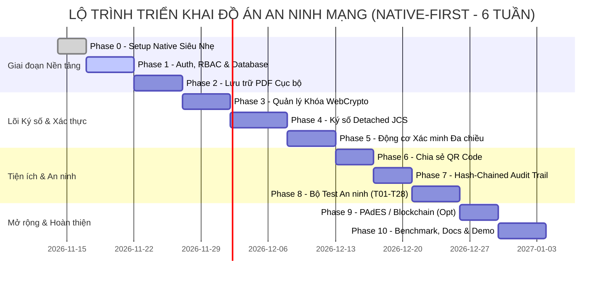

# BẢNG NHIỆM VỤ CHI TIẾT (TODO.MD) — ĐỒ ÁN AN NINH MẠNG
# HỆ THỐNG KÝ SỐ VÀ XÁC THỰC TÀI LIỆU ĐIỆN TỬ
## Research and Development of a Digital Document Signing and Verification System
**Môn học**: An ninh mạng | **Phiên bản**: 3.1 (Tối ưu Native macOS — KHÔNG BẮT BUỘC DOCKER — Siêu nhẹ cho máy 8GB RAM)  
**Ngày cập nhật**: 14/11/2026 | **Tình trạng**: Đã sẵn sàng thực thi (Ready for Execution)

---

## 📌 HƯỚNG DẪN QUẢN TRỊ & MÔ HÌNH THỰC THI NATIVE-FIRST

### 1. Kiến trúc Thực thi Ưu tiên: Native-First (Không cần Docker)
Nhằm giải phóng hoàn toàn gánh nặng bộ nhớ cho máy **MacBook Apple Silicon 8GB RAM** và tránh việc Docker Desktop ngốn mất 2.5GB – 3.0GB RAM cho máy ảo Linux ngầm, toàn bộ dự án được thiết kế theo nguyên tắc **Native-First**:
- **Frontend**: Chạy native bằng Node.js (`npm run dev`). RAM tiêu thụ: ~70MB – 90MB.
- **Backend**: Chạy native trong Python Virtual Environment (`uvicorn app.main:app --reload`). RAM tiêu thụ: ~60MB – 80MB.
- **Cơ sở dữ liệu**: Sử dụng **SQLite** tích hợp sẵn trong Python (`data/docsign.db`), hoàn toàn không cần cài dịch vụ nền. Khi cần nộp bài có thể đổi sang PostgreSQL chỉ bằng 1 dòng cấu hình trong file `.env`. RAM tiêu thụ: 0MB phụ.
- **Lưu trữ Tệp PDF**: Sử dụng **`LocalStorageService`** lưu trữ an toàn trong thư mục cục bộ `data/storage/documents/`. Bảo toàn nguyên vẹn 100% mảng byte để tính SHA-256 mà không cần bật MinIO container. RAM tiêu thụ: 0MB phụ.
- **Tổng RAM toàn hệ thống khi chạy Native**: **Chỉ ~150MB – 220MB** (tiết kiệm hơn 90% so với Docker, máy mát rượi, pin dùng cả ngày).
- **Vai trò của Docker**: Tệp `Dockerfile` và `docker-compose.yml` vẫn được giữ lại trong thư mục `infra/` như một **tùy chọn đóng gói dự phòng** để nộp bài hoặc khi giảng viên muốn chạy thử trên máy tính khác.

### 2. Quy ước Mức độ Ưu tiên (Priority)
- `[P0 - Core]`: Bắt buộc hoàn thành để hệ thống hoạt động được luồng ký và xác minh cơ bản.
- `[P1 - Security]`: Tính năng bảo mật cốt lõi môn An ninh mạng (Bắt buộc để lấy điểm cao).
- `[P2 - Advanced]`: Tính năng nâng cao giúp tạo điểm nhấn (PAdES nhúng PDF, Benchmark đo đạc).
- `[P3 - Optional]`: Tính năng mở rộng tùy chọn (Blockchain Anchoring, Docker containerization).

### 3. Phân chia Vai trò (Roles)
- `[Backend]`: FastAPI, REST API, SQLite/SQLAlchemy, quản lý phiên bản, lưu trữ local.
- `[Crypto]`: Mật mã học, WebCrypto, RFC 8785 JCS, RSA-PSS, ECDSA, băm SHA-256.
- `[Frontend]`: React, TypeScript, Vite, giao diện người dùng, mã QR, PDF viewer sandbox.
- `[QA/SecTest]`: Viết bộ 28 test cases bằng pytest, kiểm thử thâm nhập, đo lường hiệu năng.
- `[DevSecOps]`: Môi trường native, script tự động hóa, git hygiene, đóng gói dự phòng.

---

## 📊 BẢNG THEO DÕI TIẾN ĐỘ TỔNG THỂ (PROJECT PROGRESS)

| Giai đoạn (Phase) | Tên Phân Hệ Công Việc | Mức Ưu Tiên | Số Tasks | Đã Xong | Trạng Thái |
| :--- | :--- | :---: | :---: | :---: | :---: |
| **Phase 0** | Khởi tạo Dự án & Môi trường Native Siêu Nhẹ | P0 - Core | 10 | 10/10 | Hoàn thành |
| **Phase 1** | Xác thực, Quản lý User & Phân quyền RBAC | P1 - Security | 11 | 11/11 | Hoàn thành |
| **Phase 2** | Lưu trữ PDF Cục bộ & Quản lý Phiên bản | P0 - Core | 12 | 11/12 | Local hoàn thành; MinIO DEFERRED |
| **Phase 3** | Quản lý Khóa Mật mã Phía Client (WebCrypto) | P1 - Security | 12 | 12/12 | Hoàn thành |
| **Phase 4** | Lõi Ký số Detached Manifest (RFC 8785 JCS) | P0 - Core | 12 | 0/12 | Sẵn sàng bắt đầu |
| **Phase 5** | Động cơ Xác minh Đa chiều (Verification Engine)| P1 - Security | 11 | 0/11 | Chưa bắt đầu |
| **Phase 6** | Chia sẻ An toàn & Xác thực Công khai qua QR | P0 - Core | 10 | 0/10 | Chưa bắt đầu |
| **Phase 7** | Nhật ký Kiểm toán Hash-Chained & Dashboard | P1 - Security | 10 | 0/10 | Chưa bắt đầu |
| **Phase 8** | Bộ Kiểm thử An ninh Chuyên sâu (T-01 đến T-28) | P1 - Security | 12 | 0/12 | Chưa bắt đầu |
| **Phase 9** | Tính năng Nâng cao (PAdES / Blockchain) | P3 - Optional | 10 | 0/10 | Chưa bắt đầu |
| **Phase 10** | Benchmark, Tài liệu Kỹ thuật & Kịch bản Demo | P1 - Security | 11 | 0/11 | Chưa bắt đầu |
| **TỔNG CỘNG** | **Toàn bộ Dự án Ký số & Xác thực** | — | **121 Tasks** | **44/121 (36.4%)** | **Đang triển khai** |

---

## 🚀 DANH SÁCH CHI TIẾT CÁC CÔNG VIỆC CẦN THỰC HIỆN

---

### GIAI ĐOẠN 0: KHỞI TẠO DỰ ÁN & MÔI TRƯỜNG NATIVE SIÊU NHẸ (PHASE 0)
*Mục tiêu: Dựng bộ khung Monorepo chạy Native 100% trên macOS (Python venv + Node.js), tiêu tốn < 200MB RAM, không cần bật Docker.*

- [x] **TASK-P0-01** `[DevSecOps]` `[P0]` **Khởi tạo Cấu trúc Thư mục Monorepo**:
  - Tạo cấu trúc:
    ```
    cuối kì an ninh mạng/
    ├── backend/app/{api,auth,crypto,models,schemas,services,storage}/
    ├── frontend/src/{components,crypto,pages,services}/
    ├── data/{storage/documents,db}/    <-- Nơi lưu SQLite và file PDF cục bộ
    ├── tests/{unit,integration,security,data}/
    ├── docs/
    └── scripts/
    ```
  - *DoD*: Cây thư mục được tạo đầy đủ; có sẵn thư mục `data/` phục vụ lưu trữ native.
- [x] **TASK-P0-02** `[DevSecOps]` `[P0]` **Cấu hình Quản lý Phiên bản Git (`.gitignore`)**:
  - Chặn commit: `.env`, `.pem`, `.enc`, `*.db`, `data/storage/*`, `data/db/*`, `venv/`, `node_modules/`, `__pycache__/`.
  - *DoD*: `git status` sạch sẽ, không vô tình theo dõi các file cơ sở dữ liệu và file PDF nhạy cảm.
- [x] **TASK-P0-03** `[DevSecOps]` `[P0]` **Tạo Template Cấu hình Native `.env.example`**:
  - Thiết lập các giá trị mặc định cho Native Mode:
    ```ini
    ENVIRONMENT=development
    DATABASE_URL=sqlite:///./data/db/docsign.db
    STORAGE_BACKEND=local
    LOCAL_STORAGE_PATH=./data/storage/documents
    SECRET_KEY=change_this_to_a_random_32_bytes_hex_for_production
    JWT_SECRET=change_this_jwt_secret_key_for_development
    CORS_ORIGINS=http://localhost:5173
    ```
  - *DoD*: File `.env.example` sẵn sàng chạy ngay chế độ Native mà không cần cấu hình mật khẩu container.
- [x] **TASK-P0-04** `[Backend]` `[P0]` **Khởi tạo Môi trường Python Virtual Environment Native**:
  - Chạy `python3 -m venv venv` và kích hoạt `source venv/bin/activate`.
  - Tạo `requirements.txt`: `fastapi`, `uvicorn`, `pydantic`, `sqlalchemy`, `alembic`, `cryptography`, `argon2-cffi`, `pypdf`, `python-multipart`, `pytest`, `httpx`.
  - Cài đặt native trên chip Apple Silicon: `pip install -r requirements.txt`.
  - *DoD*: Cài đặt thành công 100% thư viện native, không phát sinh lỗi trình biên dịch C.
- [x] **TASK-P0-05** `[Frontend]` `[P0]` **Khởi tạo Dự án React TypeScript Vite Native**:
  - Khởi tạo thư mục `frontend/` bằng Vite: React 18+, TypeScript strict mode, Tailwind CSS, Axios, Lucide React.
  - Cài đặt thư viện: `npm install`.
  - *DoD*: Chạy `npm run dev` khởi động ngay trong 300ms tại `http://localhost:5173`.
- [x] **TASK-P0-06** `[Backend]` `[P0]` **Entrypoint Backend FastAPI (`backend/app/main.py`)**:
  - Khởi tạo app FastAPI, cấu hình CORS an toàn cho `http://localhost:5173`.
  - Endpoint health check: `GET /health` trả về `{ status: "ok", mode: "native", db: "sqlite" }`.
  - *DoD*: Chạy `uvicorn app.main:app --reload` phản hồi tức thì, RAM chỉ chiếm ~60MB.
- [x] **TASK-P0-07** `[DevSecOps]` `[P0]` **Tạo Script Khởi động 1 Click Native (`scripts/dev_start.sh`)**:
  - Viết bash script tự động bật Backend (port 8000) và Frontend (port 5173) song song:
    ```bash
    #!/bin/bash
    source venv/bin/activate
    uvicorn app.main:app --reload --port 8000 &
    cd frontend && npm run dev &
    wait
    ```
  - *DoD*: Chỉ cần gõ `./scripts/dev_start.sh` là toàn bộ hệ thống hoạt động ngay sau 2 giây.
- [x] **TASK-P0-08** `[DevSecOps]` `[P3]` **Tạo Dockerfile & docker-compose.yml Dự Phòng (Packaging)**:
  - Viết `backend/Dockerfile`, `frontend/Dockerfile`, `infra/docker-compose.yml`.
  - Dành riêng cho việc đóng gói nộp bài cho giảng viên nếu đề bài yêu cầu nộp file Docker, không dùng để code hằng ngày.
  - *DoD*: File cấu hình đóng gói chuẩn mực, nằm gọn trong thư mục `infra/`.
- [x] **TASK-P0-09** `[Backend]` `[P0]` **Khởi tạo Thư mục Dữ liệu Cục bộ**: Script kiểm tra và tự động tạo `data/storage/documents` và `data/db` nếu chưa có.
  - *DoD*: Không bị lỗi `FileNotFoundError` khi chạy lần đầu.
- [x] **TASK-P0-10** `[QA/SecTest]` `[P0]` **Đo đạc Mức Sử Dụng RAM Thực Tế (Native Verification)**:
  - Dùng lệnh `ps aux | grep -E "uvicorn|node"` kiểm tra mức tiêu thụ RAM thực tế của tiến trình.
  - *DoD*: Tổng RAM toàn hệ thống duy trì ở mức **~150MB – 200MB**, giải phóng hoàn toàn bộ nhớ cho máy.

---

### GIAI ĐOẠN 1: XÁC THỰC, QUẢN LÝ USER & PHÂN QUYỀN RBAC (PHASE 1)
*Mục tiêu: Xây dựng hệ thống tài khoản an toàn với băm mật khẩu Argon2id, Cookie HttpOnly và phân quyền chặt chẽ.*

- [x] **TASK-P1-01** `[Backend]` `[P0]` **Thiết kế Model SQLAlchemy `User` (`app/models/user.py`)**:
  - Các cột: `id (UUID PK)`, `email (VARCHAR UK)`, `password_hash (VARCHAR)`, `full_name`, `role (USER|ADMIN)`, `status (ACTIVE|LOCKED)`, `failed_login_attempts (INT)`, `locked_until (TIMESTAMP)`, `created_at`.
  - Tương thích 100% với cả SQLite và PostgreSQL nhờ kiểu dữ liệu chuẩn SQLAlchemy.
  - *DoD*: Model được định nghĩa chuẩn xác, tự động sinh UUID.
- [x] **TASK-P1-02** `[Backend]` `[P0]` **Khởi tạo Cơ sở Dữ liệu Native (`app/models/base.py`)**: Tạo hàm `init_db()` tự động tạo bảng nếu dùng SQLite, hoặc cấu hình Alembic migration nếu dùng PostgreSQL.
  - *DoD*: Khởi động ứng dụng tự động tạo file `data/db/docsign.db` với đầy đủ các bảng.
- [x] **TASK-P1-03** `[Crypto]` `[P1]` **Module Băm Mật khẩu Chuẩn Argon2id (`app/auth/hasher.py`)**:
  - Sử dụng thư viện `argon2-cffi` với tham số: $m=65536$ (64MB), $t=3$, $p=4$, salt ngẫu nhiên 16 bytes.
  - Cài đặt: `hash_password(raw_password) -> str` và `verify_password(raw_password, hashed) -> bool`.
  - *DoD*: Băm và kiểm tra mật khẩu chính xác; thời gian băm ~100ms trên Apple Silicon.
- [x] **TASK-P1-04** `[Backend]` `[P1]` **Cơ chế Chống Brute-Force Đăng nhập**:
  - Đăng nhập sai quá 5 lần liên tiếp: Khóa tài khoản tạm thời 15 phút (`locked_until = now() + 15m`).
  - Đăng nhập đúng: Reset `failed_login_attempts = 0`.
  - *DoD*: Trả về mã lỗi `423 Locked` khi tài khoản đang trong thời gian bị khóa.
- [x] **TASK-P1-05** `[Backend]` `[P1]` **Quản lý Phiên An toàn qua HttpOnly Cookie (`app/auth/jwt.py`)**:
  - Tạo Access Token JWT thời hạn 15 phút chứa `sub=user_id`, `role=role`.
  - Thiết lập cookie an toàn: `httponly=True`, `samesite="lax"`.
  - *DoD*: JavaScript không thể đọc cookie phiên qua `document.cookie` (chống XSS đánh cắp session).
- [x] **TASK-P1-06** `[Backend]` `[P0]` **API `POST /api/v1/auth/register`**: Đăng ký người dùng mới, kiểm tra độ phức tạp mật khẩu ($\ge 8$ ký tự, chữ hoa, thường, số, ký tự đặc biệt).
  - *DoD*: Đăng ký thành công trả về HTTP 201; trùng email trả về HTTP 409.
- [x] **TASK-P1-07** `[Backend]` `[P0]` **API `POST /api/v1/auth/login`**: Đăng nhập, kiểm tra lockout, trả về cookie phiên và thông tin người dùng.
  - *DoD*: Đăng nhập đúng cấp cookie; sai mật khẩu báo `401 Unauthorized`.
- [x] **TASK-P1-08** `[Backend]` `[P0]` **API `POST /api/v1/auth/logout`**: Hủy phiên làm việc, xóa cookie trên trình duyệt.
  - *DoD*: Gọi logout xóa sạch cookie phiên làm việc.
- [x] **TASK-P1-09** `[Backend]` `[P1]` **Dependency Phân quyền RBAC (`app/auth/dependencies.py`)**:
  - `get_current_user`: Trích xuất user từ cookie phiên.
  - `require_role("ADMIN")`: Chặn người dùng thường, gửi mã lỗi `403 Forbidden`.
  - *DoD*: Bảo vệ an toàn các endpoint quản trị.
- [x] **TASK-P1-10** `[Frontend]` `[P0]` **Màn hình Đăng nhập / Đăng ký (`frontend/src/pages/Auth/`)**: Form đăng nhập đẹp mắt bằng Tailwind CSS, lưu trạng thái user qua `AuthContext`.
  - *DoD*: Đăng nhập và đăng xuất mượt mà trên giao diện React.
- [x] **TASK-P1-11** `[Backend]` `[P1]` **Script Tạo Tài khoản Mẫu Cục bộ (`scripts/seed_users.py`)**: Tạo sẵn tài khoản `admin@cyber.edu` (ADMIN), `alice@cyber.edu` (USER) và `bob@cyber.edu` (USER).
  - *DoD*: Chạy script 1 lần là có sẵn dữ liệu test để demo.

---

### GIAI ĐOẠN 2: LƯU TRỮ PDF CỤC BỘ & QUẢN LÝ PHIÊN BẢN (PHASE 2)
*Mục tiêu: Tiếp nhận tệp PDF, kiểm duyệt an ninh, lưu trữ cục bộ bảo toàn mảng byte và tính băm SHA-256.*

- [x] **TASK-P2-01** `[Backend]` `[P0]` **Thiết kế Model `Document` và `DocumentVersion`**:
  - Bảng `documents`: `id (UUID PK)`, `owner_id (FK users)`, `title`, `visibility`, `created_at`.
  - Bảng `document_versions`: `id (UUID PK)`, `document_id (FK)`, `version_no (INT)`, `file_sha256 (VARCHAR 64)`, `storage_key`, `file_size_bytes`, `state (DRAFT|READY_TO_SIGN|SIGNED)`, `created_at`.
  - *DoD*: Model định nghĩa đầy đủ quan hệ một-nhiều giữa Document và DocumentVersion.
- [x] **TASK-P2-02** `[Backend]` `[P0]` **Interface Trừu tượng `IStorageService` (`app/storage/base.py`)**: Khai báo các hàm: `save_file(key, bytes)`, `get_file(key) -> bytes`, `exists(key) -> bool`.
  - *DoD*: Chuẩn hóa interface giúp đổi adapter lưu trữ mà không sửa code nghiệp vụ ký số.
- [x] **TASK-P2-03** `[Backend]` `[P0]` **Cài đặt `LocalStorageService` Làm Bộ Lưu Trữ Chính (`app/storage/local.py`)**:
  - Lưu file trực tiếp vào `data/storage/documents/{doc_uuid}/v{ver}_{ver_uuid}.pdf`.
  - Đọc/ghi theo mảng byte nhị phân tuyệt đối (`rb`, `wb`), bảo toàn nguyên vẹn 100% từng bit dữ liệu.
  - Ghi theo chunk 64KB, file tạm + fsync + hard-link nguyên tử không ghi đè; số đo thực tế trong `docs/phase2-benchmark.json`.
  - *DoD*: Unit test lưu và đọc lại file PDF thành công, hash SHA-256 trước và sau ghi trùng khớp hoàn toàn.
- [ ] **TASK-P2-04** `[Backend]` `[P3]` **`MinioStorageService` Tùy Chọn Dự Phòng**: **DEFERRED** — chưa cài adapter; native chỉ phụ thuộc local. Protocol sẵn sàng cho adapter tương lai, cấu hình minio hiện bị từ chối rõ ràng.
  - *DoD*: Khi `STORAGE_BACKEND=minio` thì dùng MinIO; mặc định là `local`.
- [x] **TASK-P2-05** `[Crypto]` `[P1]` **Stream Tính Băm SHA-256 (`app/crypto/hasher.py`)**: Đọc tệp PDF theo từng khối chunk 64KB và tính SHA-256 (FIPS 180-4), đối chiếu reference trên 1/5/10MB; RAM/CPU đo thực tế, không cam kết mức RAM chưa kiểm chứng.
  - *DoD*: Tính toán mã băm SHA-256 chính xác tuyệt đối theo chuẩn NIST.
- [x] **TASK-P2-06** `[Backend]` `[P1]` **Kiểm tra Magic Bytes PDF (`app/services/pdf_validator.py`)**:
  - Kiểm tra 5 bytes đầu tiên của file: Bắt buộc là `%PDF-` (`0x25 0x50 0x44 0x46 0x2D`).
  - *DoD*: Chặn đứng file thực thi `.exe`, file script `.php` đổi tên đuôi `.pdf`, trả về lỗi `415`.
- [x] **TASK-P2-07** `[Backend]` `[P1]` **Quét Object Tree và Từ Chối Nội Dung Chủ Động**:
  - Dùng `pypdf` trong subprocess: CPU 3 giây, wall time 5 giây, RSS 256MB, 50.000 lượt duyệt, sâu 64; tối đa 2 parser đồng thời mỗi process.
  - Phát hiện và từ chối các tệp chứa thẻ thực thi tự động: `/JavaScript`, `/JS`, `/Launch`, `/SubmitForm`.
  - *DoD*: Phát hiện và chặn tệp PDF độc hại, ghi cảnh báo an ninh.
- [x] **TASK-P2-08** `[Backend]` `[P1]` **Khử Độc Tên Tệp & Đặt Tên Bằng UUID**: Loại bỏ ký tự Path Traversal (`../`), lưu tệp trên ổ cứng hoàn toàn bằng UUID ngẫu nhiên.
  - *DoD*: Tên file tải lên có chứa ký tự độc hại không gây ảnh hưởng đến hệ thống file máy chủ.
- [x] **TASK-P2-09** `[Backend]` `[P0]` **API `POST /api/v1/documents`**: Nhận file PDF, kiểm duyệt an ninh, lưu vào thư mục local, ghi nhận phiên bản v1 trạng thái `DRAFT`.
  - *DoD*: Tải lên thành công trả về `document_id`, `version_id`, `file_sha256`.
- [x] **TASK-P2-10** `[Backend]` `[P1]` **API `GET /api/v1/documents/{id}/versions/{vid}/download` Chống IDOR**:
  - Kiểm tra quyền sở hữu tại Service layer: `doc.owner_id == current_user.id`.
  - Người dùng khác nhận `404` nhất quán để hạn chế tiết lộ tài liệu.
  - *DoD*: Đã kiểm thử ngăn chặn truy cập chéo tài liệu giữa 2 tài khoản.
- [x] **TASK-P2-11** `[Backend]` `[P1]` **Quy Tắc Bất Biến (Version Immutability)**: Nội dung/hash/key bất biến ở mọi trạng thái; DRAFT → READY_TO_SIGN khóa hash sau xác minh. SIGNED dành cho Phase 4, chưa có API chuyển sang SIGNED.
  - *DoD*: Cố tình sửa phiên bản đã ký trả về lỗi `409 Conflict`.
- [x] **TASK-P2-12** `[Frontend]` `[P0]` **Giao diện Danh Sách & Tải Lên Tài Liệu (`frontend/src/pages/Documents/`)**: Kéo thả file PDF, hiển thị mã băm SHA-256 rút gọn, danh sách phiên bản v1, v2...
  - *DoD*: Người dùng upload và xem danh sách tài liệu trực quan trên web.

---

**Bằng chứng Phase 2 (14/11/2026):** 88 backend tests (20 Phase 1 + 68 Phase 2), 13 React DOM tests, production build và Alembic check đạt. Benchmark 24 mẫu tuần tự. Chi tiết, giới hạn và danh sách file: [`docs/phase2-report.md`](docs/phase2-report.md). Browser E2E chưa chạy.

### GIAI ĐOẠN 3: QUẢN LÝ KHÓA PHÍA CLIENT (ZERO-TRUST KEY MANAGEMENT) (PHASE 3)
*Mục tiêu: Sinh khóa bất đối xứng qua WebCrypto, sao lưu mã hóa AES-GCM và đăng ký Public Key kèm chữ ký PoP.*

**Bằng chứng Phase 3 (14/11/2026, final remediation):** 134 backend tests (20 Phase 1 + 68 Phase 2 + 46 Phase 3), 38 frontend tests (16 crypto + 9 Keys offline/retry + 13 Documents) đã chạy đạt. Strict TypeScript và production build đạt; Alembic check không lệch schema. PoP v1 golden bytes và chữ ký thực tế JS ↔ Python đạt; dữ liệu DB thật giữ nguyên hash. READY cho phát triển Phase 4 theo release gates tự động, chưa phải chứng nhận production; browser E2E chưa chạy. Xem [`docs/phase3-report.md`](docs/phase3-report.md).

- [x] **FIX-P3-01** — Sửa production build/TypedArray/PopPayload, type-check cả tests với strict.
- [x] **FIX-P3-02** — Kiểm tra expiry bằng giờ SQLite trong atomic UPDATE; regression expiry/concurrency/rollback đạt.
- [x] **FIX-P3-03** — Offline vẫn thấy key local; UNKNOWN/LOCAL_ONLY/REGISTERED/REGISTRATION_FAILED/REVOKED; retry key cũ với challenge mới, không mất operation error.
- [x] **FIX-P3-04** — Contract PoP v1 giới hạn schema, golden vectors dùng chung, PoP JS ↔ Python; không tuyên bố RFC 8785 tổng quát.
- [x] **FIX-P3-05** — Benchmark Node/Python tách biệt, PBKDF2 600000; RSS before/end, peak Not measured; báo cáo nêu rõ giới hạn.


- [x] **TASK-P3-01** `[Backend]` `[P0]` **Thiết kế Model `PublicKey` và `SigningChallenge`**:
  - Bảng `public_keys`: `id (UUID PK)`, `user_id (FK)`, `algorithm (RSA-PSS-3072|ECDSA-P256)`, `spki_pem (TEXT)`, `fingerprint (VARCHAR 64 UK)`, `status (ACTIVE|REVOKED)`, `revoked_at`.
  - Bảng `signing_challenges`: `id (UUID PK)`, `challenge_nonce (VARCHAR 64 UK)`, `is_used (BOOLEAN)`, `expires_at`.
  - *DoD*: Bảng được tạo trong database cục bộ, có index cho fingerprint.
- [x] **TASK-P3-02** `[Crypto]` `[P0]` **Sinh Khóa RSA-PSS 3072-bit Phía Trình Duyệt (`frontend/src/crypto/keygen.ts`)**:
  - Gọi `window.crypto.subtle.generateKey` với thuật toán RSA-PSS, 3072 bits, $e=65537$, SHA-256, MGF1-SHA256; Mode A `extractable: false`, Mode B `extractable: true`.
  - *DoD*: Sinh cặp khóa bất đối xứng thành công trong RAM trình duyệt, không gửi private key đi đâu.
- [x] **TASK-P3-03** `[Crypto]` `[P0]` **Trích Xuất SPKI PEM & Tính Fingerprint Chuẩn Hóa**:
  - Trích xuất Public Key thành SubjectPublicKeyInfo (SPKI) DER mảng byte.
  - Tính $\text{Fingerprint} = \text{SHA256}(\text{SPKI\_DER\_Bytes})$ dạng hex 64 ký tự.
  - Đóng gói thành chuỗi chuẩn PEM: `-----BEGIN PUBLIC KEY-----\n...\n-----END PUBLIC KEY-----`.
  - *DoD*: Fingerprint đồng nhất, không bị sai lệch bởi ký tự xuống dòng.
- [x] **TASK-P3-04** `[Crypto]` `[P1]` **Sao Lưu Private Key Mã Hóa Bằng Mật Khẩu (`.pem.enc`)**:
  - Người dùng nhập Passphrase bảo vệ.
  - Dẫn xuất khóa 256-bit qua **PBKDF2-HMAC-SHA256** ($600{,}000$ vòng lặp, salt 16 bytes ngẫu nhiên).
  - Mã hóa Private Key bằng **AES-256-GCM** (96-bit nonce, 128-bit authentication tag).
  - Xuất JSON `.pem.enc` theo schema version 1; `ciphertext_b64` chứa ciphertext nối tag 128-bit do WebCrypto trả về, không tách `auth_tag` riêng.
  - *DoD*: Private key lưu trữ ở trạng thái mã hóa mạnh; nhập sai mật khẩu sẽ giải mã thất bại.
- [x] **TASK-P3-05** `[Crypto]` `[P1]` **Khôi Phục Khóa từ Tệp Sao Lưu**: Tải tệp `.pem.enc` lên, nhập đúng Passphrase $\to$ Giải mã và nạp lại khóa vào IndexedDB trình duyệt.
  - *DoD*: Tái tạo chính xác cặp khóa và đúng Fingerprint ban đầu.
- [x] **TASK-P3-06** `[Backend]` `[P1]` **API `POST /api/v1/keys/challenge`**: Sinh `challenge_nonce` ngẫu nhiên 32 bytes từ CSPRNG, lưu vào DB với thời gian sống TTL = 5 phút.
  - *DoD*: Trả về nonce ngẫu nhiên phục vụ kiểm tra sở hữu khóa.
- [x] **TASK-P3-07** `[Crypto]` `[P1]` **Ký Xác Thực Sở Hữu Khóa (Proof-of-Possession - PoP)**: Client dùng Private Key ký UTF-8 payload PoP schema v1 (user/challenge/nonce/purpose/algorithm/fingerprint/version), không chỉ nonce; trả chữ ký Base64.
  - *DoD*: Chữ ký PoP được tạo thành công ngay trên máy khách.
- [x] **TASK-P3-08** `[Backend]` `[P1]` **API `POST /api/v1/keys` (Kiểm Tra PoP & Đăng Ký Public Key)**:
  - Tiếp nhận: `public_key_pem`, `algorithm`, `challenge_id`, `pop_signature_b64`.
  - Dựng lại PoP schema v1 từ DB, kiểm tra ownership/fingerprint/algorithm và xác minh RSA-PSS/SHA-256, salt 32 bytes.
  - Nếu đúng: Lưu Public Key vào DB, đánh dấu nonce đã sử dụng (`is_used = True`).
  - Nếu sai: Từ chối với lỗi `400 Bad Request`.
  - *DoD*: Bộ test PoP sai/cross-user/replay/fingerprint/expiry/concurrency đạt; PoP không thay thế xác thực danh tính ngoài đời thực.
- [x] **TASK-P3-09** `[Backend]` `[P0]` **API `GET /api/v1/keys/my`**: Trả về danh sách các khóa công khai của người dùng kèm fingerprint và trạng thái.
  - *DoD*: Hiển thị đúng danh sách khóa của tài khoản đang đăng nhập.
- [x] **TASK-P3-10** `[Backend]` `[P1]` **API `POST /api/v1/keys/{id}/revoke`**: Cho phép người dùng thu hồi khóa; cập nhật `status = 'REVOKED'`, `revoked_at = now()`.
  - *DoD*: Owner revoke/idempotency/state tests đạt; Phase 4 phải kiểm tra ACTIVE ở backend khi tiếp nhận chữ ký mới.
- [x] **TASK-P3-11** `[Frontend]` `[P0]` **Giao Diện Quản Lý Khóa Cá Nhân (`frontend/src/pages/Keys/`)**: Sinh khóa mới, tải về file backup `.pem.enc`, import khôi phục khóa, nút bấm thu hồi khóa.
  - *DoD*: Người dùng tự chủ hoàn toàn vòng đời khóa của mình trên giao diện.
- [x] **TASK-P3-12** `[Crypto]` `[P1]` **Giảm Thời Gian Tồn Tại Dữ Liệu Nhạy Cảm (Memory Hygiene)**: Dùng `Uint8Array.fill(0)` làm sạch buffer PKCS#8 thô khi hoàn tất backup/restore; giải phóng dữ liệu tạm theo best effort, không bảo đảm memory zeroization.
  - *DoD*: Best-effort xóa PKCS#8 typed buffers và tham chiếu; không bảo đảm xóa bản sao do JS engine/WebCrypto tạo. Backup-enabled có plaintext PKCS#8 tạm trong JS memory.

---

### GIAI ĐOẠN 4: LÕI KÝ SỐ DETACHED MANIFEST (RFC 8785 JCS) (PHASE 4)
*Mục tiêu: Chuẩn hóa dữ liệu ký qua RFC 8785 JCS, ký số client-side và backend verify trước khi ghi nhận.*

- [ ] **TASK-P4-01** `[Backend]` `[P0]` **Thiết kế Model `Signature`**:
  - Bảng `signatures`: `id (UUID PK)`, `version_id (FK)`, `signer_id (FK)`, `key_id (FK)`, `algorithm`, `canonical_manifest_json (TEXT)`, `manifest_sha256 (VARCHAR 64)`, `signature_b64 (TEXT)`, `signature_format`, `signed_at`.
  - *DoD*: Bảng được tạo trong database cục bộ, liên kết khóa ngoại chặt chẽ.
- [ ] **TASK-P4-02** `[Crypto]` `[P1]` **Đặc tả Cấu Trúc Signed Manifest Schema v1.0**:
  - Cấu trúc: `{ manifest_version, document_version_id, document_sha256, key_id, signer_fingerprint, algorithm, signing_nonce, signing_timestamp, signing_context }`.
  - *DoD*: Định nghĩa schema thống nhất giữa TypeScript (frontend) và Pydantic (backend).
- [ ] **TASK-P4-03** `[Crypto]` `[P1]` **Chuẩn Hóa JCS (RFC 8785) Phía Client**: Dùng thư viện `canonicalize` (npm) sắp xếp keys theo từ điển, loại bỏ khoảng trắng, mã hóa UTF-8.
  - *DoD*: Sinh ra chuỗi canonical bytes tất định trên trình duyệt.
- [ ] **TASK-P4-04** `[Crypto]` `[P1]` **Chuẩn Hóa JCS (RFC 8785) Phía Backend Python**: Đánh giá implementation RFC 8785 đã kiểm chứng và test vectors riêng; không coi `json.dumps(sort_keys=True)` hoặc contract PoP v1 là JCS đầy đủ.
  - *DoD*: Vượt qua bài kiểm thử **Test Vector `T-22`**: Output canonical bytes của JS và Python trùng nhau 100%.
- [ ] **TASK-P4-05** `[Backend]` `[P0]` **API `POST /api/v1/documents/{id}/versions/{vid}/prepare-sign`**:
  - Khóa phiên bản sang `READY_TO_SIGN`.
  - Cấp `signing_nonce` duy nhất có thời hạn 5 phút.
  - Trả về: `{ document_sha256, version_id, signing_nonce, timestamp }`.
  - *DoD*: Khóa phiên bản chống chỉnh sửa đồng thời, cấp nonce chống replay.
- [ ] **TASK-P4-06** `[Crypto]` `[P0]` **Ký Số Phía Trình Duyệt Bằng WebCrypto (`frontend/src/crypto/signer.ts`)**:
  - Giải mã Private Key trong RAM bằng Passphrase.
  - Tạo Manifest $\to$ Chuẩn hóa JCS $\to$ `canonical_bytes`.
  - Ký: `window.crypto.subtle.sign({ name: "RSA-PSS", saltLength: 32 }, privateKey, canonical_bytes)`.
  - Xuất ra chuỗi chữ ký số Base64.
  - *DoD*: Ký thành công mảng byte canonical manifest phía máy khách.
- [ ] **TASK-P4-07** `[Backend]` `[P0]` **API `POST /api/v1/signatures` & Xác Minh Hai Đầu**:
  - Nhận: `{ version_id, key_id, manifest_json, signature_b64 }`.
  - Kiểm tra `signing_nonce` còn hạn và chưa dùng.
  - **Tải mảng byte PDF gốc từ thư mục lưu trữ cục bộ `data/storage/`**.
  - Tính SHA-256 mảng byte gốc và đối chiếu với `manifest.document_sha256`.
  - Chuẩn hóa `manifest_json` bằng JCS Python $\to$ `server_canonical_bytes`.
  - Lấy Public Key của `key_id` từ DB $\to$ Thực thi hàm `verify()` bằng Python `cryptography`.
  - Nếu OK: Lưu chữ ký vào DB, chuyển trạng thái phiên bản sang `SIGNED`, đánh dấu nonce đã dùng.
  - Nếu sai: Trả về `422 Unprocessable Entity`, tuyệt đối không lưu chữ ký giả mạo.
  - *DoD*: Đảm bảo chữ ký được verify toán học thành công trước khi ghi nhận vào hệ thống.
- [ ] **TASK-P4-08** `[Frontend]` `[P0]` **Trình Xem PDF Sandbox (`frontend/src/components/PDFViewer/`)**: Xem trước nội dung tài liệu bằng `pdfjs-dist` chạy trong Web Worker cô lập trước khi bấm ký.
  - *DoD*: Hiển thị tài liệu PDF mượt mà, ngăn chặn thực thi mã script nhúng.
- [ ] **TASK-P4-09** `[Frontend]` `[P0]` **Hộp Thoại Ký Số Trực Quan (`frontend/src/pages/Documents/SignModal.tsx`)**: Chọn khóa ký, nhập Passphrase, hiển thị thông tin ký, nút "Ký số ngay".
  - *DoD*: Người dùng thực hiện ký số dễ dàng chỉ trong vài giây.
- [ ] **TASK-P4-10** `[Backend]` `[P1]` **Chống Tấn Công Replay Chữ Ký**: Một `signing_nonce` chỉ được chấp nhận đúng 1 lần; gửi lại chữ ký cũ sẽ bị từ chối ngay.
  - *DoD*: Đã kiểm chứng qua bài test `T-18`.
- [ ] **TASK-P4-11** `[Backend]` `[P1]` **Xử Lý Tranh Chấp Ký Song Song (Concurrency Race)**: Khóa lạc quan hoặc trạng thái `READY_TO_SIGN` ngăn chặn 2 người cùng ký đè lên 1 bản nháp.
  - *DoD*: Đã kiểm chứng qua bài test `T-12`.
- [ ] **TASK-P4-12** `[Crypto]` `[P1]` **Hỗ Trợ Ký Bằng ECDSA P-256**: Bổ sung hàm ký ECDSA phía client và verify phía backend với chuẩn hóa Low-S.
  - *DoD*: Hệ thống hỗ trợ song song cả 2 thuật toán RSA-PSS 3072 và ECDSA P-256.

---

### GIAI ĐOẠN 5: ĐỘNG CƠ XÁC MINH ĐA CHIỀU (VERIFICATION ENGINE) (PHASE 5)
*Mục tiêu: Xây dựng bộ xác thực độc lập, hiển thị kết quả 6 thành phần minh bạch, phân định rõ toán học và pháp lý.*

- [ ] **TASK-P5-01** `[Backend]` `[P0]` **Schema Kết Quả Xác Minh 6 Thành Phần (`app/schemas/verify.py`)**:
  - `cryptographic_validity`: `VALID` | `INVALID`.
  - `document_integrity`: `UNCHANGED` | `TAMPERED`.
  - `key_ownership`: `VERIFIED_POP` | `UNVERIFIED`.
  - `certificate_trust`: `SELF_REGISTERED` | `TRUSTED_CA`.
  - `key_revocation_status`: `ACTIVE` | `REVOKED`.
  - `timestamp_evidence`: `{ server_timestamp, verification_time }`.
  - `warnings`: Danh sách cảnh báo chi tiết.
  - *DoD*: Schema phản ánh trung thực bản chất an ninh, không dùng 1 nhãn đơn giản.
- [ ] **TASK-P5-02** `[Backend]` `[P0]` **API `POST /api/v1/verify/upload` (Xác Minh Độc Lập File Rời)**:
  - Cho phép tải lên cặp tệp: File PDF cần kiểm tra + File Manifest chữ ký detached (`manifest.json`).
  - Tính lại SHA-256 của file PDF tải lên và so sánh với `document_sha256` trong manifest.
  - Lấy Public Key theo `key_id` từ DB (hoặc public key đính kèm).
  - Chuẩn hóa manifest theo JCS và chạy Verify chữ ký.
  - *DoD*: Bất kỳ ai có file PDF và manifest đều kiểm tra được tính toàn vẹn mà không cần đăng nhập.
- [ ] **TASK-P5-03** `[Backend]` `[P1]` **Thuật Toán Phân Loại Kết Quả Xác Minh**:
  - File PDF bị sửa $\to$ Báo `TAMPERED` (Hash mismatch).
  - Chữ ký bị sửa $\to$ Báo `INVALID` (Signature verification failed).
  - Khóa bị thu hồi sau ngày ký $\to$ Báo `VALID` về mật mã nhưng `KEY_REVOKED` về trạng thái khóa kèm cảnh báo vàng.
  - *DoD*: Phân loại chính xác 100% các tình huống kiểm thử.
- [ ] **TASK-P5-04** `[Frontend]` `[P0]` **Trang Xác Minh Độc Lập (`frontend/src/pages/Verify/IndependentVerify.tsx`)**: Giao diện kéo thả file PDF và manifest, nút bấm "Kiểm tra Tính Toàn Vẹn".
  - *DoD*: Thao tác kiểm tra độc lập trực quan, dễ sử dụng.
- [ ] **TASK-P5-05** `[Frontend]` `[P0]` **Huy Hiệu Trạng Thái Trực Quan (Status Badges)**:
  - Màu Xanh lá: `VALID` & `UNCHANGED`.
  - Màu Đỏ rực: `TAMPERED` / `INVALID`.
  - Màu Vàng: `KEY_REVOKED` / `SELF_REGISTERED`.
  - *DoD*: Giao diện nổi bật, gây ấn tượng mạnh khi demo trực tiếp.
- [ ] **TASK-P5-06** `[Backend]` `[P0]` **API `GET /api/v1/documents/{id}/versions/{vid}/verify`**: Xác minh tài liệu nội bộ trực tiếp từ thông tin đã lưu trong cơ sở dữ liệu và thư mục tệp cục bộ.
  - *DoD*: Trả về kết quả xác minh tức thời của phiên bản tài liệu.
- [ ] **TASK-P5-07** `[Backend]` `[P1]` **Chống Tấn Công Tráo Public Key**: Đối chiếu fingerprint của khóa gửi lên với fingerprint ghi nhận trong manifest; chặn việc lấy khóa người khác gán vào chữ ký.
  - *DoD*: Đã kiểm chứng qua bài test `T-03`.
- [ ] **TASK-P5-08** `[Frontend]` `[P0]` **Bảng So Sánh Mã Băm Từng Ký Tự**: Hiển thị song song `Expected Hash` và `Computed Hash`; bôi đỏ ký tự khác nhau nếu file bị sửa đổi.
  - *DoD*: Giúp Hội đồng nhìn thấy ngay lập tức sự sai lệch khi tệp bị can thiệp 1 byte.
- [ ] **TASK-P5-09** `[Backend]` `[P1]` **Xuất Biên Bản Xác Minh JSON**: Cho phép tải về tệp `verification-report.json` có dấu thời gian của máy chủ.
  - *DoD*: Người dùng xuất được báo cáo kiểm tra độc lập.
- [ ] **TASK-P5-10** `[Backend]` `[P1]` **Ghi Nhận Lịch Sử Xác Minh**: Thống kê số lần xác minh hợp lệ và thất bại để đưa lên Dashboard.
  - *DoD*: Dữ liệu xác minh được phản ánh lên màn hình giám sát.
- [ ] **TASK-P5-11** `[Crypto]` `[P1]` **Tương Thích Mật Mã RSA-PSS và ECDSA**: Động cơ tự động nhận diện thuật toán trong manifest để gọi hàm verify phù hợp.
  - *DoD*: Xác minh chính xác cả 2 chuẩn mật mã.

---

### GIAI ĐOẠN 6: CHIA SẺ AN TOÀN & XÁC THỰC CÔNG KHAI QUA QR (PHASE 6)
*Mục tiêu: Tạo mã QR chứa token ngẫu nhiên bảo mật cao, xác thực thời gian hằng số và không làm lộ tệp PDF gốc.*

- [ ] **TASK-P6-01** `[Backend]` `[P0]` **Thiết kế Model `ShareToken`**:
  - Bảng `share_tokens`: `id (UUID PK)`, `version_id (FK)`, `token_hash (VARCHAR 64 UK)`, `expires_at`, `revoked_at`.
  - *DoD*: Bảng được tạo trong database cục bộ, lưu hash SHA-256 của token.
- [ ] **TASK-P6-02** `[Crypto]` `[P1]` **Sinh Token 256-bit Entropy An Toàn**:
  - Sinh token ngẫu nhiên: `raw_token = secrets.token_urlsafe(32)`.
  - Băm SHA-256 lưu vào DB: `token_hash = SHA256(raw_token)` (Không bao giờ lưu raw token vào DB).
  - *DoD*: Dump cơ sở dữ liệu cũng không làm lộ raw token.
- [ ] **TASK-P6-03** `[Backend]` `[P0]` **API `POST /api/v1/shares`**: Tạo liên kết chia sẻ cho phiên bản tài liệu đã ký, thời hạn mặc định 7 ngày.
  - *DoD*: Trả về liên kết công khai `http://localhost:5173/verify/share/{raw_token}`.
- [ ] **TASK-P6-04** `[Frontend]` `[P0]` **Tạo Mã QR Phía Trình Duyệt (`frontend/src/components/QRCodeModal.tsx`)**: Dùng thư viện `qrcode.react` tạo ảnh mã QR chứa đường dẫn xác minh, có nút tải ảnh QR PNG về máy.
  - *DoD*: Dùng camera điện thoại quét mã QR mở ra đúng trang web xác minh.
- [ ] **TASK-P6-05** `[Backend]` `[P1]` **So Sánh Thời Gian Hằng Số Chống Timing Attack**:
  - Khi người dùng truy cập `/api/v1/verify/share/{token}`:
  - Băm token nhận được và so sánh bằng hàm `hmac.compare_digest`.
  - *DoD*: Đã kiểm chứng qua bài test `T-16`.
- [ ] **TASK-P6-06** `[Backend]` `[P1]` **Bảo Vệ Tính Riêng Tư (Zero PDF Leakage)**:
  - Trang xác minh qua QR **tuyệt đối không cung cấp nút tải hoặc đường dẫn tải file PDF gốc**.
  - Chỉ hiển thị: Tên tài liệu, số phiên bản, kết quả toàn vẹn mật mã, fingerprint người ký, ngày ký.
  - *DoD*: Khách quét mã xác minh được nguồn gốc văn bản nhưng không tải trộm được tệp tin riêng tư.
- [ ] **TASK-P6-07** `[Backend]` `[P0]` **Xử Lý Token Quá Hạn & Thu Hồi**:
  - Quá hạn: Trả về mã lỗi `410 Gone`.
  - Đã thu hồi: Trả về mã lỗi `404 Not Found`.
  - *DoD*: Đã kiểm chứng qua bài test `T-09` và `T-10`.
- [ ] **TASK-P6-08** `[Frontend]` `[P0]` **Trang Xác Minh Mobile-Friendly (`frontend/src/pages/Verify/PublicQRVerify.tsx`)**: Giao diện tối ưu cho màn hình điện thoại di động, hiển thị tích xanh kiểm định toàn vẹn rõ ràng.
  - *DoD*: Trình duyệt điện thoại quét QR hiển thị trang web mượt mà, đẹp mắt.
- [ ] **TASK-P6-09** `[Backend]` `[P0]` **API `POST /api/v1/shares/{id}/revoke`**: Chủ sở hữu tài liệu có thể thu hồi mã QR bất kỳ lúc nào.
  - *DoD*: Thu hồi xong, quét mã QR sẽ báo liên kết không còn tồn tại.
- [ ] **TASK-P6-10** `[Frontend]` `[P0]` **Quản Lý Danh Sách Liên Kết Chia Sẻ**: Xem danh sách các mã QR đã phát hành và nút bấm thu hồi tức thì.
  - *DoD*: Chủ tài liệu kiểm soát hoàn toàn việc chia sẻ.

---

### GIAI ĐOẠN 7: NHẬT KÝ KIỂM TOÁN CHUỖI BĂM & DASHBOARD (PHASE 7)
*Mục tiêu: Ghi nhận mọi sự kiện an ninh vào chuỗi băm bất biến (Hash-Chaining) và xây dựng Dashboard an ninh.*

- [ ] **TASK-P7-01** `[Backend]` `[P0]` **Thiết kế Model `AuditLog`**:
  - Bảng `audit_logs`: `id (BIGSERIAL PK)`, `prev_hash (VARCHAR 64)`, `entry_hash (VARCHAR 64 UK)`, `actor_id (FK)`, `action`, `target_type`, `target_id`, `client_ip`, `user_agent`, `status`, `details_json`, `created_at`.
  - *DoD*: Bảng được tạo trong database cục bộ, lưu chuỗi hash liên kết.
- [ ] **TASK-P7-02** `[Crypto]` `[P1]` **Thuật Toán Chuỗi Băm Kiểm Toán (Hash-Chaining Engine)**:
  - Bản ghi đầu tiên: `prev_hash = "GENESIS_CAPSTONE_SECURITY_LOG_2026"`.
  - Mỗi bản ghi mới tính:
    $$\text{entry\_hash} = \text{SHA256}(\text{prev\_hash} \,||\, \text{id} \,||\, \text{actor\_id} \,||\, \text{action} \,||\, \text{target\_id} \,||\, \text{timestamp} \,||\, \text{details\_hash})$$
  - *DoD*: Chuỗi băm được liên kết chặt chẽ qua từng bản ghi mới.
- [ ] **TASK-P7-03** `[Backend]` `[P1]` **Ghi Nhận Tự Động Biến Cố An Ninh**: Ghi nhận các sự kiện: `USER_LOGIN`, `KEY_GENERATE`, `KEY_REVOKE`, `DOCUMENT_UPLOAD`, `DOCUMENT_SIGN`, `DOCUMENT_VERIFY`, `SHARE_QR`, `ACCESS_DENIED_IDOR`.
  - *DoD*: Mọi thao tác quan trọng đều sinh ra 1 dòng log kiểm toán tương ứng.
- [ ] **TASK-P7-04** `[Backend]` `[P1]` **Quy Tắc Không Log Secret**: Tuyệt đối không ghi Private Key, Passphrase, Token thô vào trường `details_json`.
  - *DoD*: File log hoàn toàn sạch sẽ, không lộ bí mật.
- [ ] **TASK-P7-05** `[Backend]` `[P1]` **Thuật Toán Phát Hiện Can Thiệp Log `verify_audit_chain`**: Quét tuần tự bảng log, tính lại mã băm từng dòng và so sánh với dòng trước $\to$ Phát hiện ngay lập tức nếu có dòng bị sửa dữ liệu hoặc bị xóa.
  - *DoD*: Đã kiểm chứng qua bài test `T-17`.
- [ ] **TASK-P7-06** `[Backend]` `[P0]` **API `GET /api/v1/audit/logs` & `GET /api/v1/audit/verify-chain`**: Dành riêng cho quyền ADMIN xem nhật ký và kiểm tra toàn vẹn chuỗi hash.
  - *DoD*: Người dùng thường gọi API bị chặn bằng mã lỗi `403`.
- [ ] **TASK-P7-07** `[Backend]` `[P0]` **API `GET /api/v1/dashboard/stats`**: Thống kê số lượng văn bản, tỷ lệ chữ ký hợp lệ/giả mạo, số khóa đang hoạt động.
  - *DoD*: Trả về dữ liệu thống kê tổng hợp phục vụ hiển thị Dashboard.
- [ ] **TASK-P7-08** `[Frontend]` `[P0]` **Màn Hình Bảng Điều Khiển An Ninh (`frontend/src/pages/Dashboard/`)**: Biểu đồ thống kê trực quan, trạng thái kiểm tra chuỗi băm (Huy hiệu xanh: `AUDIT LOG INTACT`).
  - *DoD*: Dashboard sinh động, gây ấn tượng tốt trong buổi bảo vệ.
- [ ] **TASK-P7-09** `[Frontend]` `[P0]` **Trang Tra Cứu Nhật Ký Kiểm Toán (`frontend/src/pages/Audit/`)**: Bảng hiển thị danh sách log, có cột `prev_hash` và `entry_hash` cho từng dòng.
  - *DoD*: Admin tra cứu lịch sử hành vi người dùng dễ dàng.
- [ ] **TASK-P7-10** `[Backend]` `[P1]` **Cảnh Báo An Ninh Tự Động**: Đánh dấu cảnh báo đỏ khi phát hiện chuỗi xác minh thất bại liên tiếp hoặc cố ý truy cập trái phép IDOR.
  - *DoD*: Hiển thị hộp cảnh báo an ninh nổi bật trên Dashboard.

---

### GIAI ĐOẠN 8: BỘ KIỂM THỬ AN NINH CHUYÊN SÂU (T-01 ĐẾN T-28) (PHASE 8)
*Mục tiêu: Tự động hóa 100% bộ 28 test cases bảo mật STRIDE bằng Pytest chạy Native trên macOS.*

- [ ] **TASK-P8-01** `[QA/SecTest]` `[P0]` **Thiết Lập Môi Trường Test Pytest Native (`tests/conftest.py`)**: Tạo file database test SQLite tạm thời (`test_docsign.db`), mock HTTP client qua `httpx.AsyncClient`.
  - *DoD*: Chạy `pytest` thực thi môi trường test cô lập, dọn dẹp sạch sau khi test xong.
- [ ] **TASK-P8-02** `[QA/SecTest]` `[P0]` **Bộ Test Toàn Vẹn Mật Mã (T-01 đến T-04)**:
  - `T-01`: Ký và xác minh tài liệu chuẩn $\to$ VALID.
  - `T-02`: Đổi 1 byte trong PDF $\to$ INVALID (Hash mismatch).
  - `T-03`: Dùng Public Key sai để verify $\to$ INVALID.
  - `T-04`: Đổi 1 ký tự trong chuỗi chữ ký $\to$ INVALID.
  - *DoD*: 4 test cases đều PASS với assertion chuẩn.
- [ ] **TASK-P8-03** `[QA/SecTest]` `[P0]` **Bộ Test Tải Lên & Biên Giới Tệp (T-05, T-06, T-13, T-15)**:
  - `T-05`: File exe đổi tên `.pdf` $\to$ Bị chặn `415`.
  - `T-06`: File 25MB (vượt 20MB) $\to$ Bị chặn `413`.
  - `T-13`: Tên file chứa `../../etc/passwd` $\to$ Đổi thành UUID an toàn.
  - `T-15`: File PDF chứa JavaScript `/Launch` $\to$ Bị phát hiện và chặn.
  - *DoD*: Chặn đứng 100% các file bất thường.
- [ ] **TASK-P8-04** `[QA/SecTest]` `[P0]` **Bộ Test Phân Quyền & Chống IDOR (T-07, T-08, T-14, T-21)**:
  - `T-07`: User B tải tài liệu riêng tư của User A $\to$ Bị chặn `403`.
  - `T-08`: Đăng ký khóa không có chữ ký PoP hợp lệ $\to$ Bị chặn `400`.
  - `T-14`: SQL Injection trên ô tìm kiếm $\to$ Xử lý an toàn.
  - `T-21`: Tên file chứa mã XSS `<script>` $\to$ Escape text an toàn.
  - *DoD*: Vượt qua toàn bộ các bài test lỗ hổng OWASP Top 10.
- [ ] **TASK-P8-05** `[QA/SecTest]` `[P0]` **Bộ Test Vòng Đời Khóa & Token QR (T-09, T-10, T-11, T-26)**:
  - `T-09`: Dùng token QR hết hạn $\to$ Trả về `410 Gone`.
  - `T-10`: Dùng token QR đã thu hồi $\to$ Trả về `404 Not Found`.
  - `T-11`: Khóa bị thu hồi sau ngày ký $\to$ VALID về mật mã nhưng cảnh báo REVOKED.
  - `T-26`: Sử dụng nonce ký quá hạn 5 phút $\to$ Bị từ chối `400`.
  - *DoD*: Logic trạng thái thời gian hoạt động chính xác.
- [ ] **TASK-P8-06** `[QA/SecTest]` `[P1]` **Bộ Test Replay, Concurrency & Storage Tampering (T-12, T-18, T-20)**:
  - `T-12`: Gửi 2 yêu cầu ký song song $\to$ 1 thành công, 1 báo `409 Conflict`.
  - `T-18`: Gửi lại chữ ký cũ cho phiên bản mới $\to$ Bị từ chối nonce mismatch.
  - `T-20`: Giả lập sửa byte trực tiếp trong thư mục lưu trữ `data/storage/` $\to$ Backend phát hiện sai hash.
  - *DoD*: Đảm bảo tính nhất quán dữ liệu trong mọi tình huống can thiệp.
- [ ] **TASK-P8-07** `[QA/SecTest]` `[P1]` **Bộ Test Side-Channel & Brute-Force (T-16, T-19)**:
  - `T-16`: Đo thời gian so sánh token $\to$ Sai lệch không đáng kể nhờ `compare_digest`.
  - `T-19`: Thử sai mật khẩu 6 lần $\to$ Bị khóa tài khoản tạm thời 15 phút.
  - *DoD*: Bảo vệ an toàn trước tấn công dò quét và vét cạn.
- [ ] **TASK-P8-08** `[QA/SecTest]` `[P1]` **Bộ Test Chuỗi Băm Kiểm Toán (T-17)**: Sửa trực tiếp 1 trường dữ liệu trong DB $\to$ Chạy `verify_audit_chain` phát hiện chính xác ID dòng bị sửa.
  - *DoD*: Kiểm chứng cơ chế phát hiện giả mạo log thành công.
- [ ] **TASK-P8-09** `[QA/SecTest]` `[P0]` **Bộ Test Liên Thông Mật Mã JCS (T-22)**: Chạy test vector canonicalization trên cả Node.js và Python $\to$ Tạo ra chính xác 100% cùng chuỗi byte hex.
  - *DoD*: Khẳng định tính tương thích mật mã tuyệt đối giữa frontend và backend.
- [ ] **TASK-P8-10** `[QA/SecTest]` `[P1]` **Bộ Test Quản Lý Bộ Nhớ & Phục Hồi Khóa (T-23, T-24, T-25, T-28)**:
  - `T-23`: Stream đọc tệp 20MB $\to$ RAM backend tăng không quá 15MB.
  - `T-24`: Xuất bản sao lưu `.pem.enc`, xóa cache, nhập passphrase khôi phục $\to$ Tái tạo đúng fingerprint.
  - `T-25`: Ký v1, tạo v2 và ký v2 $\to$ Cả 2 phiên bản đều verify độc lập chính xác.
  - `T-28`: Kiểm tra làm sạch biến nhớ nhạy cảm sau khi ký.
  - *DoD*: Vận hành trơn tru và an toàn trên môi trường máy 8GB RAM.
- [ ] **TASK-P8-11** `[QA/SecTest]` `[P1]` **Bộ Test Chạy Độc Lập Khi Không Có Dịch Vụ Ngoài (T-27)**: Chạy toàn bộ hệ thống ở chế độ Native hoàn toàn không cần Docker hay mạng ngoài $\to$ Chức năng ký và verify nội bộ hoạt động 100%.
  - *DoD*: Chứng minh hệ thống hoạt động độc lập, tự chủ hoàn toàn.
- [ ] **TASK-P8-12** `[DevSecOps]` `[P0]` **Script Chạy Bộ Test 1 Click (`scripts/run_security_tests.sh`)**: Viết script chạy `pytest tests/security/ -v` xuất báo cáo tổng kết.
  - *DoD*: Chạy 1 lệnh duy nhất thực thi toàn bộ 28 bài test với kết quả 100% PASS.

---

### GIAI ĐOẠN 9: TÍNH NĂNG NÂNG CAO (PADES / BLOCKCHAIN - TÙY CHỌN) (PHASE 9)
*Mục tiêu: Mở rộng chữ ký nhúng PAdES và neo bằng chứng lên Smart Contract (Chỉ thực hiện khi Core đã hoàn tất).*

- [ ] **TASK-P9-01** `[Crypto]` `[P2]` **Nghiên Cứu Cấu Trúc Chữ Ký Nhúng PDF (PAdES)**: Tìm hiểu cấu trúc `/ByteRange` và cấu trúc chữ ký CMS nhúng vào file PDF.
  - *DoD*: Phân tích rõ sự khác biệt kỹ thuật giữa chữ ký Detached và chữ ký PAdES.
- [ ] **TASK-P9-02** `[Backend]` `[P2]` **Thử Nghiệm Nhúng Chữ Ký PAdES Bằng `pyHanko`**:
  - Dùng `pyHanko` ký số và nhúng chữ ký vào tệp PDF.
  - Mở tệp PDF đã ký trên phần mềm Adobe Acrobat Reader để kiểm tra hiển thị chữ ký số.
  - *DoD*: Adobe Reader nhận diện được chữ ký số nhúng trong tệp PDF.
- [ ] **TASK-P9-03** `[Crypto]` `[P3]` **Soạn Thảo Smart Contract `AnchorRegistry.sol`**:
  - Hợp đồng Solidity `^0.8.20`: Lưu `documentHash`, `manifestHash`, `anchoredAt`, `registrar`.
  - Hàm `anchorEvidence(evidenceId, docHash, manifestHash)` kèm kiểm tra chống trùng lặp.
  - *DoD*: Contract biên dịch thành công bằng Foundry hoặc Hardhat.
- [ ] **TASK-P9-04** `[DevSecOps]` `[P3]` **Cài Đặt Node Anvil Native Cục Bộ**: Cài đặt Foundry native qua Homebrew (`brew install foundry`), chạy `anvil` trực tiếp trên macOS (không cần Docker), tốn < 50MB RAM.
  - *DoD*: Node Anvil cục bộ chạy native mượt mà.
- [ ] **TASK-P9-05** `[Backend]` `[P3]` **Deploy Smart Contract Lên Anvil**: Script deploy contract bằng `web3.py`, ghi nhận địa chỉ contract vào `.env`.
  - *DoD*: Script deploy thành công, in ra `CONTRACT_ADDRESS`.
- [ ] **TASK-P9-06** `[Backend]` `[P3]` **Cài Đặt `IAnchorService` (`app/services/anchor/`)**:
  - `NoopAnchorService`: Mặc định, không làm gì, trả về `UNANCHORED`.
  - `EvmAnchorService`: Kết nối qua `web3.py`, gửi giao dịch gọi hàm `anchorEvidence`.
  - *DoD*: Bật tắt tính năng neo blockchain dễ dàng qua biến `ENABLE_BLOCKCHAIN=true|false`.
- [ ] **TASK-P9-07** `[Backend]` `[P3]` **Bảng `blockchain_anchors` Trong Cơ Sở Dữ Liệu**: Lưu trữ metadata giao dịch on-chain: `tx_hash`, `block_number`, `anchored_at`.
  - *DoD*: Giao dịch on-chain được lưu vết trong cơ sở dữ liệu.
- [ ] **TASK-P9-08** `[Frontend]` `[P3]` **Hiển Thị Bằng Chứng Blockchain Trên Giao Diện**: Hiển thị Tx Hash, Block Number nếu có neo; nếu tắt thì hiện dòng ghi chú `Blockchain: Decoupled Mode (Not Enabled)`.
  - *DoD*: Giao diện minh bạch, không gây hiểu nhầm về vai trò của blockchain.
- [ ] **TASK-P9-09** `[Crypto]` `[P3]` **Mã Hóa Tài Liệu Mật (AES-256-GCM Tùy Chọn)**: Module mã hóa lai: Mã hóa tệp PDF bằng khóa AES ngẫu nhiên, sau đó bọc khóa AES bằng Public Key của người nhận.
  - *DoD*: Tệp lưu trong storage ở dạng mã hóa; chỉ người nhận mới giải mã được.
- [ ] **TASK-P9-10** `[DevSecOps]` `[P3]` **Dọn Dẹp Tiến Trình Blockchain**: Tắt tiến trình Anvil khi kết thúc thử nghiệm để tiết kiệm RAM.
  - *DoD*: Giải phóng bộ nhớ an toàn.

---

### GIAI ĐOẠN 10: BENCHMARK, TÀI LIỆU KỸ THUẬT & KỊCH BẢN DEMO (PHASE 10)
*Mục tiêu: Đo đạc hiệu năng thực tế trên chip Apple Silicon, hoàn thiện 6 tài liệu kỹ thuật và luyện tập kịch bản demo 11 bước.*

- [ ] **TASK-P10-01** `[QA/SecTest]` `[P1]` **Sinh 3 Tệp PDF Kiểm Thử Thực Nghiệm**: Script `scripts/generate_test_pdfs.py` sinh ra 3 file PDF tổng hợp chuẩn có dung lượng chính xác: **1 MB**, **5 MB**, và **10 MB**.
  - *DoD*: Tạo sẵn 3 file test trong thư mục `tests/data/`.
- [ ] **TASK-P10-02** `[QA/SecTest]` `[P1]` **Kịch Bản Đo Lường Hiệu Năng Thực Nghiệm (`scripts/benchmark.py`)**:
  - Chạy tuần tự 20 lần lặp cho mỗi kích thước tệp (1MB, 5MB, 10MB).
  - Đo: Thời gian tính băm SHA-256, thời gian ký WebCrypto, thời gian verify backend, mức tiêu thụ RAM đỉnh (RSS) và % CPU.
  - So sánh trực tiếp giữa RSA-PSS 3072-bit và ECDSA P-256 chạy native trên chip Apple Silicon.
  - *DoD*: Thu thập được đầy đủ số liệu thực nghiệm đo đạc thực tế, trung thực.
- [ ] **TASK-P10-03** `[QA/SecTest]` `[P1]` **Vẽ Biểu Đồ & Xuất Báo Cáo Hiệu Năng**: Tính toán Trung vị (Median), P95; vẽ biểu đồ so sánh thời gian xử lý và mức sử dụng bộ nhớ.
  - *DoD*: Đưa bảng số liệu thực nghiệm chuẩn xác vào báo cáo cuối kỳ.
- [ ] **TASK-P10-04** `[Backend]` `[P1]` **Hoàn Thiện Tài Liệu `docs/SRS.md`**: Đặc tả yêu cầu phần mềm và các chuẩn mật mã áp dụng.
  - *DoD*: Tài liệu đặc tả đầy đủ và chuyên nghiệp.
- [ ] **TASK-P10-05** `[DevSecOps]` `[P1]` **Hoàn Thiện Tài Liệu `docs/architecture.md`**: Mô tả kiến trúc Modular Monolith, sơ đồ tuần tự Mermaid, phân tích ranh giới tin cậy.
  - *DoD*: Sơ đồ kiến trúc rõ ràng, chuẩn mực kỹ thuật.
- [ ] **TASK-P10-06** `[Crypto]` `[P1]` **Hoàn Thiện Tài Liệu `docs/threat-model.md`**: Bảng phân tích chi tiết 12 mối đe dọa STRIDE, ma trận DREAD và các biện pháp kiểm soát an ninh đã cài đặt.
  - *DoD*: Tài liệu mô hình đe dọa đạt chuẩn an ninh thông tin.
- [ ] **TASK-P10-07** `[Backend]` `[P1]` **Hoàn Thiện Tài Liệu `docs/ERD.md` và `docs/API.md`**: Thiết kế cơ sở dữ liệu chi tiết và tài liệu OpenAPI / Swagger chuẩn cho toàn bộ endpoint.
  - *DoD*: Tài liệu API đầy đủ tham số request, response và mã lỗi.
- [ ] **TASK-P10-08** `[QA/SecTest]` `[P1]` **Hoàn Thiện Báo Cáo Kiểm Thử `docs/security-test-report.md`**: Tổng hợp kết quả chạy bộ 28 bài test an ninh T-01 đến T-28 kèm ảnh chụp log minh chứng.
  - *DoD*: Báo cáo kiểm thử có đầy đủ bằng chứng kỹ thuật khách quan.
- [ ] **TASK-P10-09** `[Frontend]` `[P0]` **Chuẩn Bị Dữ Liệu Demo Hoàn Hảo**: Nạp sẵn dữ liệu hợp đồng mẫu `HopDongMuaBan_Demo.pdf`, tài khoản Alice (người ký), tài khoản Bob (người xác minh), tài khoản Charlie (kẻ tấn công) và tài khoản Admin.
  - *DoD*: Khởi động hệ thống lên là có thể thực hiện demo ngay lập tức trong 2 giây.
- [ ] **TASK-P10-10** `[Frontend]` `[P0]` **Luyện Tập Kịch Bản Demo Trực Tiếp 11 Bước**:
  - Thực hành tuần tự 11 bước: Đăng ký $\to$ Sinh khóa $\to$ Tải hợp đồng $\to$ Ký số $\to$ Quét QR xác minh.
  - **Pha cao trào an ninh**: Dùng Hex Editor sửa đúng 1 ký tự số tiền trong file PDF $\to$ Tải lên xác minh hệ thống báo đỏ rực `HASH MISMATCH`.
  - **Pha demo IDOR**: Dùng tài khoản Charlie copy link tải file của Alice $\to$ Bị chặn đứng `403 Forbidden`.
  - *DoD*: Thực hiện demo trôi chảy trong thời gian 7 - 10 phút.
- [ ] **TASK-P10-11** `[DevSecOps]` `[P1]` **Chuẩn Bị Video Demo Dự Phòng (1080p)**: Quay sẵn 01 video chất lượng cao 1080p toàn bộ 11 bước demo lưu trên máy phòng khi mất mạng hoặc máy chiếu phòng thi gặp sự cố.
  - *DoD*: Đảm bảo 100% không bị động trước bất kỳ sự cố kỹ thuật nào tại phòng bảo vệ.

---

## 📅 LỘ TRÌNH THỰC HIỆN THEO TUẦN (WEEKLY MILESTONES)



---

## 🛡️ CHECKLIST KIỂM TRA AN NINH TRƯỚC KHI BẢO VỆ (DEFENSE GATE)

- [ ] **Secret Hygiene**: Trong toàn bộ repository và Git history không chứa bất kỳ private key, password, hoặc secret thô nào.
- [ ] **Zero-Knowledge Key**: Tuyệt đối không có đoạn code nào gửi Private Key chưa mã hóa từ trình duyệt lên backend.
- [ ] **Byte-Exact Verification**: Đã chứng minh được việc sửa đổi 1 byte trong file PDF làm Verify báo `INVALID` ngay lập tức.
- [ ] **IDOR Immunity**: Đã thử dùng tài khoản B gọi endpoint tải file của tài khoản A và nhận về mã lỗi `403 Forbidden`.
- [ ] **Log Hash-Chain**: Thuật toán `verify_audit_chain` phát hiện được ngay lập tức hành vi sửa đổi trực tiếp cơ sở dữ liệu.
- [ ] **QR Privacy**: Trang xác minh qua mã QR chỉ hiển thị thông tin kiểm chứng, không có nút tải trộm file PDF riêng tư.
- [ ] **Native Stability**: Hệ thống chạy Native mượt mà trên macOS, khởi động trong 2 giây, RAM chiếm < 200MB.
- [ ] **Demo Video Backup**: Đã có sẵn 01 video quay lại toàn bộ 11 bước demo lưu trên máy phòng khi mất mạng/lỗi máy chiếu.
